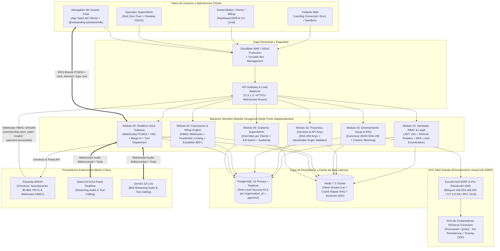
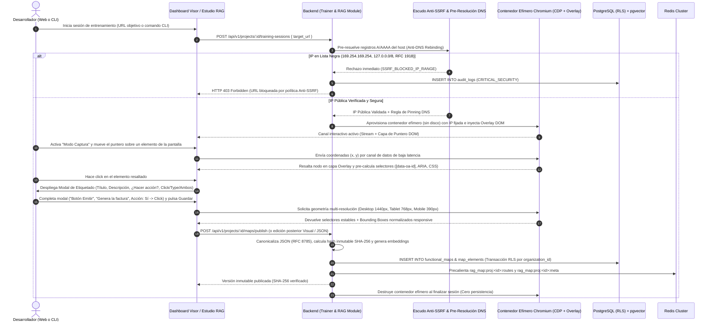

# PLANO ARQUITECTÓNICO INTEGRAL Y DE CIBERSEGURIDAD ENTERPRISE: PLATAFORMA SAAS B2B DE ONBOARDING INTERACTIVO & REALTIME VOICE GATEWAY

**Rol de Diseño:** Principal Software Architect & Enterprise Cybersecurity Director  
**Motores de IA Realtime:** `Qwen3.8-Omni-Flash-Realtime` & `Gemini 3.8 Live`  
**Pasarela Financiera:** `WHOP` (Checkout, Membresías, Suscripciones $5/$10/$30/$50, Pago por Uso, Descuentos por Volumen y Overrides SuperAdmin)  
**Stack Base:** PostgreSQL 16+ (Row-Level Security RLS Multi-Tenant + pgvector), Redis 7.2+ Cluster, Backend Monolito Modular Hexagonal, Frontend Multi-Portal y `@onboarding-assistant/sdk`.

---

# MÓDULO 1: ARQUITECTURA DE INTERFAZ DE USUARIO, IDENTIDAD, PANELES Y CUMPLIMIENTO LEGAL

Este documento especifica la arquitectura lógica completa del Frontend, los flujos de identidad y autenticación (Logins B2B, SSO y SuperAdmin), los mecanismos de recuperación de cuentas, la arquitectura de cumplimiento legal (Términos, Privacidad, DPA y Consentimiento de Voz), las cuatro aplicaciones web de la plataforma, el SDK instalable (`@onboarding-assistant/sdk`) y la matriz de control de acceso basado en roles (RBAC).

## 1. Arquitectura de Identidad, Logins y Recuperación de Cuentas

La plataforma separa de forma estricta el plano de identidad de clientes B2B (`Owner`, `Developer`, `Billing`, `Viewer`) del plano de identidad de operaciones internas (`SuperAdmin`).

### 1.1. Matriz de Accesos y Portales de Inicio de Sesión

| Portal de Acceso | Ruta Base / Subdominio | Métodos de Autenticación Permitidos | Requisitos de MFA y Seguridad | Destino Post-Login |
| :--- | :--- | :--- | :--- | :--- |
| **Login B2B Estándar** | `app.plataforma.com/auth/login` | Email + Password (Argon2id), OAuth 2.0 PKCE (Google Workspace, GitHub, Microsoft Entra ID) | MFA TOTP (RFC 6238) o WebAuthn Passkey opcional para `Developer`/`Viewer`, obligatorio si la organización activa `mfa_enforced = true` | `/dashboard/org/:orgSlug/overview` |
| **Login B2B Enterprise SSO** | `app.plataforma.com/auth/sso` | SAML 2.0 / OIDC federado (Okta, Azure AD, PingIdentity, OneLogin) | Delegado al IdP corporativo + validación de firma XML SAML con certificado X.509 rotativo por tenant | `/dashboard/org/:orgSlug/projects` |
| **Login CLI Developer** | `app.plataforma.com/auth/cli-device` | Device Authorization Flow (RFC 8628) mediante código de usuario de 8 caracteres (`XXXX-XXXX`) | Requiere sesión autenticada en navegador web + confirmación explícita de alcance (`training:write`, `maps:publish`) | Emite token efímero al binario CLI local |
| **Login Aislado SuperAdmin** | `admin.plataforma.com/internal/login` | Email corporativo interno + Password (Argon2id) + **Hardware Passkey FIDO2/WebAuthn obligatorio** | Bloqueado por Cloudflare Zero Trust / IP Allowlist corporativa; prohibido login social; sesión máxima de 4 horas sin renovación silenciosa | `/superadmin/control-center` |

### 1.2. Flujos Detallados de Registro e Inicio de Sesión (Componentes, Props, Estados y Eventos)

#### A. Flujo de Registro de Nueva Organización (`/auth/register`)
* **Componente Principal:** `<OrganizationSignUpWizard />`
* **Props de Entrada:** `{ initialPlanCode?: 'PAYG' | 'PLAN_5' | 'PLAN_10' | 'PLAN_30' | 'PLAN_50', referralCode?: string, utmParams?: Record<string, string> }`
* **Estados de la Máquina de Estados UI:**
  1. `STEP_1_ACCOUNT_CREDENTIALS`: Captura `fullName`, `workEmail`, `password` (validado en cliente con medidor de entropía mínima de 70 bits y verificación asíncrona contra contraseñas filtradas vía k-Anonymity), `organizationName` y `organizationSlug` (autocalculado y verificado vía `GET /api/v1/auth/check-slug?slug=...` con debounce de 300ms).
  2. `STEP_2_LEGAL_ACCEPTANCE`: Presenta casillas obligatorias independientes para:
     * Aceptación de **Términos y Condiciones del Servicio (ToS)** y **Política de Privacidad**.
     * Suscripción automática al **Acuerdo de Procesamiento de Datos (DPA)** para cumplimiento GDPR/CCPA.
     * Declaración de responsabilidad sobre la captura de elementos DOM y no indexación de campos sensibles (PCI-DSS / HIPAA).
  3. `STEP_3_EMAIL_OTP_VERIFICATION`: Envía un código numérico CSPRNG de 6 dígitos al correo (`POST /api/v1/auth/verify-email/send`). El componente `<OtpVerificationInput />` bloquea el acceso al Dashboard hasta que `POST /api/v1/auth/verify-email/confirm` devuelve `HTTP 200 OK`.
  4. `STEP_4_INITIAL_PROJECT_AND_BILLING`: Crea automáticamente el primer proyecto por defecto (`Default Project`) y permite continuar en modo **Sandbox Gratuito Limitado** (15 minutos de prueba única no renovables vinculados a huella de tarjeta/dominio) o redirigir al checkout de Whop.

#### B. Flujo de Login B2B Unificado (`/auth/login`)
* **Componente Principal:** `<B2BAuthenticationBoundary />`
* **Props de Entrada:** `{ returnToUrl?: string, invitationToken?: string }`
* **Subcomponentes y Eventos:**
  * `<DomainDiscoveryEmailInput />`:
    * **Evento `onBlur(email)`:** Ejecuta `POST /api/v1/auth/discover-tenant` enviando `{ email }`.
    * **Respuesta Backend:** `{ sso_enforced: boolean, sso_provider_url?: string }`. Si `sso_enforced === true`, oculta el campo `password` y transforma el botón principal en **"Continuar con SSO Corporativo"**, evitando que empleados de clientes Enterprise inicien sesión con contraseñas locales.
  * `<PasswordAuthForm />`:
    * **Campos:** `email`, `password`, `cloudflareTurnstileToken`.
    * **Botón:** `btn_submit_login` ("Iniciar Sesión").
    * **Evento `onSubmit`:** `POST /api/v1/auth/login`.
    * **Transiciones de Respuesta:**
      * `HTTP 200 OK`: Recibe `{ access_token, user, organizations, active_organization_id }` en el cuerpo JSON y establece la cookie `HttpOnly; Secure; SameSite=Strict; Path=/api/v1/auth` con el `refresh_token`.
      * `HTTP 202 Accepted`: Recibe `{ mfa_required: true, mfa_ephemeral_token, available_factors: ['totp', 'webauthn', 'recovery_code'] }`. Renderiza `<MfaChallengeModal />`.
      * `HTTP 403 Forbidden (code: LEGAL_CONSENT_OUTDATED)`: Recibe `{ required_documents: [{ id, type, version, title, content_markdown, sha256_hash }] }`. Renderiza el bloqueador `<MandatoryLegalReconsentModal />` antes de emitir tokens de sesión.
      * `HTTP 423 Locked`: Cuenta bloqueada temporalmente tras 5 intentos fallidos consecutivos en 15 minutos; muestra temporizador regresivo sincronizado con la cabecera `Retry-After`.

#### C. Flujo de Invitación de Miembros a una Organización (`/auth/accept-invite`)
* **Componente Principal:** `<OrganizationInviteAcceptor />`
* **Props de Entrada:** `{ rawInviteToken: string }` (leído de query param `?token=`).
* **Flujo Lógico:**
  1. Al montar, ejecuta `GET /api/v1/auth/invitations/verify?token=<rawInviteToken>`.
  2. Si el correo invitado no existe en la tabla `users`, muestra formulario de creación de perfil (`fullName`, `password`, aceptación legal).
  3. Si el correo ya existe en `users`, solicita autenticación normal + MFA y ejecuta `POST /api/v1/auth/invitations/accept`, creando el registro en `memberships` con el rol predefinido (`Developer`, `Billing` o `Viewer`) y registrando el evento `member.invitation_accepted` en `audit_logs`.

### 1.3. Flujos de Recuperación de Cuenta, Contraseña y MFA

#### A. Recuperación de Contraseña Anti-Enumeración (`/auth/forgot-password` y `/auth/reset-password`)
* **Solicitud (`<ForgotPasswordView />`):**
  * Captura `email` y `turnstileToken`.
  * Botón `btn_request_password_reset` dispara `POST /api/v1/auth/password/forgot`.
  * El backend aplica un **Constant-Time Execution Floor de 350ms** (tanto si el correo existe como si no) y devuelve siempre `HTTP 200 OK` con mensaje idéntico.
  * Si el usuario existe y está activo, genera un token aleatorio de 32 bytes (`256 bits` en hex), guarda únicamente `SHA-256(token)` en la tabla `password_reset_tokens` con TTL de 15 minutos e invalida cualquier token de recuperación previo del mismo usuario.
* **Confirmación (`<ResetPasswordConfirmView />`):**
  * Captura `rawResetToken` (de la URL), `newPassword` y `confirmNewPassword`.
  * Botón `btn_confirm_new_password` dispara `POST /api/v1/auth/password/reset`.
  * El backend verifica `SHA-256(rawResetToken)`, comprueba `expires_at > NOW()` y `used_at IS NULL`, actualiza `password_hash` con Argon2id, marca `used_at = NOW()`, **incrementa `users.token_version = token_version + 1`** y elimina todas las sesiones activas en Redis y PostgreSQL, enviando correo de alerta de seguridad al usuario.

#### B. Recuperación de Cuenta por Pérdida de Dispositivo MFA (`/auth/mfa-recovery`)
* **Nivel 1 — Código de Recuperación Criptográfico (Autoservicio Instantáneo):**
  * Al activar MFA por primera vez, el sistema genera 10 códigos alfanuméricos de un solo uso con formato `XXXX-XXXX-XXXX` (hasheados con SHA-256 individualmente con sal en `user_mfa_recovery_codes`).
  * En `<MfaRecoveryCodeForm />`, el usuario introduce uno de sus códigos; al validarse, el código se marca como `consumed_at = NOW()` y se permite el acceso para enrolar un nuevo dispositivo MFA.
* **Nivel 2 — Reseteo Delegado por Owner de la Organización (Para roles `Developer`, `Billing`, `Viewer`):**
  * Si un miembro pierde su dispositivo MFA y sus códigos, solicita el reseteo a un `Owner` de su organización.
  * El `Owner`, autenticado con su propio MFA en `/dashboard/org/:orgSlug/team`, pulsa `btn_reset_member_mfa(userId)`.
  * Esto requiere re-autenticación sudo del `Owner` (`POST /api/v1/auth/sudo-confirm`), invalida los factores MFA del miembro (solo si el miembro pertenece exclusivamente a esa organización) y fuerza el re-enrolamiento en su próximo inicio de sesión.
* **Nivel 3 — Recuperación de Emergencia para `Owner` Único (Break-Glass Verification):**
  * Si el único `Owner` pierde tanto su MFA como sus códigos de respaldo, inicia el flujo en `/auth/owner-emergency-recovery`:
    1. Valida propiedad del correo electrónico mediante OTP.
    2. Valida propiedad del dominio verificado en `allowed_domains` publicando un registro TXT DNS efímero (`_onboarding-recovery.<dominio> = oa-verify-<token>`) **O** validando los metadatos de la última factura pagada en Whop (`whop_receipt_id`).
    3. Entra en estado `PENDING_SUPERADMIN_REVIEW` con un período de enfriamiento (cooling-off) de 24 horas durante el cual se envían alertas al correo y webhook de seguridad de la organización antes de que el SuperAdmin apruebe el reseteo desde el panel de auditoría.

## 2. Arquitectura Legal, Privacidad, Términos y Consentimiento (GDPR / CCPA / SOC2 / AI Act)

Dado que la plataforma procesa voz en tiempo real de usuarios finales e interactúa con el DOM de aplicaciones web de terceros, la arquitectura legal está integrada a nivel de motor de base de datos, SDK y API Gateway.

### 2.1. Catálogo de Instrumentos Legales Versionados en Base de Datos (`legal_documents`)

| Código de Documento (`doc_type`) | Audiencia Obligatoria | Mecanismo de Aceptación | Regla de Bloqueo Técnico en Plataforma |
| :--- | :--- | :--- | :--- |
| `TOS_B2B` (Términos y Condiciones de Servicio SaaS) | `Owner`, `Developer`, `Billing`, `Viewer` | Checkbox explícito en registro + Modal bloqueante ante cambios de versión (`major_version`) | Si `user_legal_acceptances` no registra la última versión obligatoria, el middleware HTTP devuelve `403 LEGAL_CONSENT_OUTDATED` en todos los endpoints excepto `/api/v1/legal/*` y `/api/v1/auth/logout`. |
| `PRIVACY_POLICY` (Política de Privacidad y Tratamiento de Datos) | Todos los usuarios y visitantes | Enlace público en `/legal/privacy` + Aceptación vinculada en registro | Registro inmutable de `ip_address`, `user_agent`, `accepted_at` y `document_sha256` en `legal_acceptances`. |
| `DPA_ENTERPRISE` (Data Processing Agreement & Subprocessors) | `Owner` de cada Organización | Firma electrónica / Aceptación clickwrap con sello criptográfico al activar el primer proyecto o checkout en Whop | Sin DPA vigente para la organización, el endpoint de Handshake del SDK (`POST /api/v1/sdk/handshake`) rechaza la inicialización en dominios de producción (`403 DPA_NOT_SIGNED`). |
| `AI_VOICE_AUP` (Política de Uso Aceptable de IA y Voz) | `Owner`, `Developer` | Confirmación al publicar el primer System Prompt o Mapa Funcional | Prohibición técnica y contractual de usar el asistente para suplantación de identidad, captura de credenciales bancarias o ingeniería social. |
| `END_USER_VOICE_CONSENT` (Aviso de Asistente de Voz IA para Usuario Final) | Usuario final del cliente B2B que usa el SDK | Banner/Tooltip integrado en el widget del `@onboarding-assistant/sdk` al pulsar el botón de micrófono por primera vez | El SDK no abre el stream `navigator.mediaDevices.getUserMedia({ audio: true })` ni el WebSocket de voz hasta que el usuario final confirma el consentimiento de sesión de voz (`consent_granted = true` enviado en el payload de apertura del WebSocket). |

### 2.2. Controles Técnicos de Privacidad y Protección de Datos (Privacy by Design)
1. **Sanitización y Enmascaramiento Automático en el DOM (PII/PCI Scrubber en el SDK y Navegador de Entrenamiento):**
   * El script inyectado en el Navegador de Entrenamiento Remoto y el paquete `@onboarding-assistant/sdk` bloquean por código la selección, lectura o escritura sobre elementos que coincidan con selectores de alta sensibilidad: `input[type="password"]`, `input[autocomplete^="cc-"]`, `[data-oa-sensitive="true"]`, `[data-private="true"]`, o iframes de pasarelas de pago (Stripe, Whop, PayPal, Adyen).
   * Cuando la herramienta `type_text` es invocada por la IA, el motor verifica en el cliente que el elemento destino no sea un campo de contraseña ni tarjeta bancaria; si lo es, aborta la acción localmente y devuelve al Gateway de Voz el error estructurado `ACTION_BLOCKED_SENSITIVE_FIELD`.
2. **Política de Retención Cero de Audio Crudo (Zero Raw Audio Persistence por Defecto):**
   * Los chunks de audio PCM16 transmitidos por WebSocket entre el navegador del usuario final, el Gateway de Voz y los proveedores `Qwen3.8-Omni-Flash-Realtime` / `Gemini 3.8 Live` se procesan **exclusivamente en buffers de memoria RAM volátil (Ring Buffers)** y se descartan inmediatamente tras su inferencia.
   * No se almacenan grabaciones `.wav` o `.mp3` en disco ni en Object Storage, salvo que el `Owner` active explícitamente el modo de depuración auditada (`opt_in_session_transcripts = true`) y declare el consentimiento correspondiente en su aviso de privacidad hacia sus usuarios finales.
3. **Derecho al Olvido y Borrado Criptográfico (GDPR Art. 17 / CCPA):**
   * En `/dashboard/org/:orgSlug/settings/privacy-compliance`, el `Owner` dispone de:
     * **Exportación de Datos Portables (`btn_export_org_data`):** Genera un archivo JSON/ZIP firmado con todos los mapas funcionales, logs de uso, sesiones y facturas (`POST /api/v1/organizations/:orgId/compliance/export`).
     * **Eliminación Definitiva de Organización (`btn_delete_organization`):** Requiere confirmación por MFA + escribir el slug exacto de la organización. Cancela suscripciones activas en Whop, purga en cascada `projects`, `functional_maps`, `map_elements`, `api_keys` y anonimiza los identificadores personales en `audit_logs` y `usage_ledger` (conservando solo los asientos contables agregados exigidos por ley tributaria durante 7 años).

---

## 3. Especificación Detallada de las Vistas y Paneles del Frontend

### 3.1. LANDING PÚBLICA COMERCIAL (`/` — Aplicación Web Pública)

#### A. Arquitectura de Componentes y Jerarquía Lógica
1. `<PublicCommercialHeader />`:
   * **Props:** `{ isAuthenticated: boolean, activeOrgSlug?: string }`
   * **Elementos y Acciones:** Enlaces de navegación (`#arquitectura`, `#demo-en-vivo`, `#calculadora-precios`, `/docs`, `/docs/sandbox`, `/legal/privacy`, `/legal/terms`). Si `isAuthenticated === false`, muestra `btn_nav_login` (`/auth/login`) y `btn_nav_signup` (`/auth/register`). Si `isAuthenticated === true`, muestra `btn_go_to_dashboard` (`/dashboard/org/:activeOrgSlug`).
2. `<HeroArchitectureShowcase />`:
   * **Props:** `{ supportedModels: ['Qwen3.8-Omni-Flash-Realtime', 'Gemini 3.8 Live'], latencySlaMs: number }`
   * **Estado Interno:** `{ selectedDemoScenario: 'CRM_ONBOARDING' | 'ERP_INVOICING' | 'SAAS_ANALYTICS' }`
   * **Acciones:** Botón primario `btn_start_free_sandbox` (redirige a `/auth/register?mode=sandbox`), botón secundario `btn_launch_cli_command` (copia al portapapeles `npx @onboarding-assistant/cli init` y emite evento de telemetría `POST /api/v1/telemetry/public-event`).
3. `<LiveInteractiveVoiceDemo />` (Demostración Interactiva en Vivo del Asistente):
   * **Propósito:** Permitir que un visitante anónimo pruebe en vivo cómo el asistente de voz conversa en tiempo real y mueve un cursor virtual haciendo click y escribiendo sobre una aplicación SaaS simulada incrustada en un contenedor DOM aislado (Shadow DOM), sin necesidad de registrarse.
   * **Props:** `{ demoProjectId: string, maxDemoDurationSeconds: 90, demoModel: 'Qwen3.8-Omni-Flash-Realtime' | 'Gemini 3.8 Live' }`
   * **Estados Internos:** `IDLE` ➔ `REQUESTING_MIC_PERMISSION` ➔ `FETCHING_DEMO_EPHEMERAL_TOKEN` ➔ `CONNECTED_LISTENING` ➔ `AI_SPEAKING` ➔ `EXECUTING_DOM_ACTION` ➔ `DEMO_COMPLETED` | `RATE_LIMITED`.
   * **Flujo de Conexión y Eventos:**
     * El visitante selecciona el escenario simulado (ej. *"Crear mi primer pipeline de ventas en el CRM demo"*) y el motor de IA (`Selector: Qwen3.8-Omni vs Gemini 3.8 Live`).
     * Al pulsar `btn_start_live_demo`:
       1. Solicita permiso `navigator.mediaDevices.getUserMedia({ audio: { echoCancellation: true, noiseSuppression: true, sampleRate: 16000 } })`.
       2. Llama a `POST /api/v1/public/demo-session` enviando `{ scenario_id, turnstile_token, preferred_model }`.
       3. El backend valida el rate limit por IP (máximo 2 sesiones demo de 90 segundos por IP cada 24 horas en Redis) y devuelve `{ ws_url, ephemeral_demo_jwt, simulated_functional_map }`.
       4. Abre conexión WebSocket a `wss://voice.plataforma.com/ws/v1/demo?token=<ephemeral_demo_jwt>`.
       5. Mientras el asistente habla, despacha eventos reales `click_element` y `type_text` sobre los elementos del `<SimulatedCrmCanvas />` (ej. resalta el botón `#demo-btn-new-deal`, mueve el puntero virtual, hace click, abre el modal simulado y escribe `"Contrato Anual Acme Corp"` en `#demo-input-deal-name`).
     * Incluye botón `btn_interrupt_assistant` (o simplemente hablar encima del asistente) para demostrar la capacidad de **Barge-in** en vivo, y botón `btn_end_demo_session`.
4. `<InteractivePricingCalculator />` (Calculadora Dinámica de Planes, Overage y Descuento por Volumen):
   * **Props:** `{ baseRatePerMinuteUsd: number, plans: PlanDefinition[], volumeDiscountTiers: VolumeTier[] }` (hidratados desde `GET /api/v1/public/pricing-matrix`).
   * **Controles de Entrada (Inputs/Sliders):**
     * `input_monthly_active_onboardings`: Número estimado de usuarios guiados por mes (`10` a `100,000`).
     * `input_avg_session_minutes`: Duración media por sesión en minutos (`1` a `30` min).
     * `select_billing_modality`: Selector entre `'AUTO_RECOMMEND'` | `'PAY_AS_YOU_GO'` | `'FIXED_PLAN_WITH_OVERAGE'`.
     * `select_ai_engine`: `'Qwen3.8-Omni-Flash-Realtime'` | `'Gemini 3.8 Live'` | `'Mixed (50/50)'`.
   * **Lógica de Cálculo en Tiempo Real (`calculateProjectedBilling()`):**
     * Calcula `totalMonthlyMinutes = monthlyActiveOnboardings * avgSessionMinutes`.
     * Compara el costo total mensual bajo:
       1. **Pago por Uso Puro (PAYG):** `totalMonthlyMinutes * baseRatePerMinuteUsd`.
       2. **Planes Fijos Mensuales ($5, $10, $30, $50 USD):** Muestra los minutos incluidos en cada plan. Si `totalMonthlyMinutes > includedMinutes`:
          * Para planes de **$5, $10 y $30 USD**, calcula el exceso a tarifa estándar o sugiere el salto automático al plan inmediato superior.
          * Para el **Plan de $50 USD (y régimen de exceso / Plan Masivo)**, aplica automáticamente la tabla de **Descuento por Volumen Escalonado** sobre cada minuto adicional consumido (ej. Tramo 1: 0% desc., Tramo 2: 15% desc., Tramo 3: 30% desc., Tramo 4: 45% desc.).
   * **Salidas Visuales y Acciones:**
     * Muestra desglose exacto: `Costo Base del Plan`, `Minutos Incluidos`, `Minutos en Exceso (Overage)`, `Porcentaje de Descuento por Volumen Aplicado`, `Tarifa Efectiva por Minuto ($/min)` y `Total Mensual Estimado (USD)`.
     * Botón `btn_checkout_selected_plan(planCode)`: Redirige a `/auth/register?plan=<planCode>&estimated_minutes=<totalMonthlyMinutes>` para encadenar el alta con el Checkout de Whop.

---

### 3.2. LANDING PÚBLICA DE DOCUMENTACIÓN & SANDBOX (`/docs` y `/docs/sandbox`)

#### A. Guía de Integración Paso a Paso del SDK (`/docs/quickstart` y `/docs/sdk-reference`)
* **Componente Principal:** `<DeveloperDocsLayout />` con árbol de navegación lateral, buscador semántico local (`Cmd+K`) y selector de framework (`React / Next.js`, `Vue 3 / Nuxt`, `Angular`, `Vanilla JS / HTML`).
* **Secciones Técnicas Documentadas:**
  1. **Instalación del paquete oficial:**
     * Comando: `npm install @onboarding-assistant/sdk` (o `pnpm add @onboarding-assistant/sdk` / `yarn add @onboarding-assistant/sdk`).
  2. **Inicialización del Proveedor (`<OnboardingAssistantProvider />` o `OnboardingAssistant.init()`):**
     * Documentación exhaustiva de parámetros de configuración:
       * `publicKey: string` (`pk_live_...` o `pk_test_...`).
       * `projectId: string` (`UUID` del proyecto).
       * `userContext?: { externalUserId: string, name?: string, role?: string, plan?: string, customAttributes?: Record<string, string | number | boolean> }` (inyectado como variables seguras en el System Prompt para personalizar el saludo y los pasos sin exponer secretos).
       * `routerAdapter?: { getCurrentPath: () => string, navigateTo: (path: string) => Promise<void> }` (para sincronizar cambios de ruta SPA en tiempo real con el motor de Context Slimming RAG).
       * `onActionBeforeExecute?: (event: ActionEventPayload) => boolean | Promise<boolean>` (hook opcional para que el desarrollador intercepte o valide una acción antes de que el SDK haga click o escriba en el DOM).
       * `onStepCompleted?: (stepIndex: number, stepId: string) => void`.
       * `onSessionEnded?: (summary: { durationSeconds: number, completedSteps: number, terminationReason: string }) => void`.
  3. **Atributos HTML recomendados para Selectores Inmutables:**
     * Guía de uso del atributo dedicado `data-oa-id="boton-crear-factura"` y buenas prácticas de accesibilidad (`aria-label`, `role`) para garantizar resiliencia ante refactorizaciones de clases CSS (Tailwind/CSS Modules).
  4. **Guía de la Herramienta CLI (`@onboarding-assistant/cli`):**
     * Uso de `npx @onboarding-assistant/cli login`, `npx @onboarding-assistant/cli train --url http://localhost:3000 --project <id>` (que levanta un túnel seguro TLS o conecta la sesión de entrenamiento) y `npx @onboarding-assistant/cli maps pull / push` para flujos CI/CD GitOps.

#### B. Visor de Especificación de la API y Sandbox Interactivo (`/docs/sandbox`)
* **Componente Principal:** `<InteractiveSdkSandboxEnvironment />`
* **Estructura de Pantalla Dividida (3 Paneles Sincronizados):**
  1. **Panel Izquierdo — Inspector de Especificación API & WebSocket (`<ApiAndProtocolSpecViewer />`):**
     * Documenta y permite probar los endpoints REST públicos/privados (configuración de System Prompt vía API `PUT /api/v1/projects/:projectId/prompt`, publicación de Mapas RAG `POST /api/v1/projects/:projectId/maps`, consulta de consumo `GET /api/v1/billing/usage`) y la especificación completa de tramas WebSocket del Gateway de Voz (`session.init`, `audio.input.pcm16`, `route.changed`, `tool.call.click_element`, `tool.call.type_text`, `tool.execution.ack`, `voice.barge_in`).
  2. **Panel Central — Lienzo DOM de Pruebas (`<SandboxTargetApplicationCanvas />`):**
     * Contiene una interfaz interactiva de prueba con múltiples componentes complejos: formularios con inputs controlados de React, selectores desplegables, modales dinámicos, pestañas, tablas con paginación y botones de acción con atributos `data-oa-id`, `id` y roles ARIA, además de un campo `input[type="password"]` para comprobar el bloqueo de seguridad PII.
     * Permite conmutar el viewport del lienzo entre **Desktop (`1440x900`)**, **Tablet (`768x1024`)** y **Mobile (`390x844`)** para verificar el recálculo de coordenadas relativas y bounding boxes en diseño responsive.
  3. **Panel Derecho — Despachador Manual y Simulador de Eventos (`<SandboxToolDispatcher />`):**
     * **Props:** `{ targetCanvasRef: RefObject<HTMLElement>, activeViewport: ViewportMode }`
     * **Controles Interactivos:**
       * Selector de herramienta: `'click_element'` | `'type_text'` | `'click_and_type'`.
       * Input `target_element_id` / `selector_strategy` (permite elegir un elemento del Mapa Funcional de ejemplo o escribir un selector CSS / `data-oa-id` / coordenadas normalizadas `{ x_norm, y_norm }`).
       * Input `text_to_type` (visible cuando la acción es `type_text` o `click_and_type`), velocidad de tipeo simulada (`instant` | `human_cadence_45ms`) y flag `clear_before_type: boolean`.
       * Botón `btn_dispatch_click_element` ("Probar click_element") y Botón `btn_dispatch_type_text` ("Probar type_text").
     * **Flujo al Ejecutar Prueba:**
       * El SDK renderiza el cursor asistido sobre el lienzo, desplaza suavemente el scroll si el elemento está fuera del viewport (`scrollIntoView({ behavior: 'smooth', block: 'center' })`), valida que el elemento sea visible y no esté cubierto por otro nodo (`document.elementFromPoint(x, y)`), despacha la secuencia completa de eventos nativos compatibles con React/Vue/Angular (`pointerdown` ➔ `mousedown` ➔ `focus` ➔ `mouseup` ➔ `click`, o setter nativo de `HTMLInputElement.prototype.value` + `new InputEvent('input', { bubbles: true })` + `change`) y muestra en la consola inferior el payload exacto de confirmación `tool.execution.ack` con el tiempo de ejecución en milisegundos.

---

### 3.3. DASHBOARD DEL DESARROLLADOR (`/dashboard/org/:orgSlug/*`)

El Dashboard del Desarrollador es la consola operativa B2B donde las organizaciones configuran sus proyectos, entrenan visualmente sus aplicaciones, redactan el System Prompt paso a paso, gestionan sus API Keys y controlan su facturación con Whop.

#### A. Estructura Global de Navegación y Contexto
* **Componente Shell:** `<DeveloperDashboardShell />`
* **Selectores Globales en Barra Superior:**
  * `<OrganizationSwitcher />`: Cambia entre organizaciones a las que pertenece el usuario.
  * `<ProjectSwitcher />`: Cambia entre proyectos de la organización (ej. `CRM Producción`, `CRM Staging`, `Portal Clientes`) y botón `btn_create_project`.
  * `<EnvironmentModeBadge />`: Indica el entorno activo del proyecto (`PRODUCTION` vs `SANDBOX_TEST`).
  * `<RealtimeBalancePill />`: Muestra en vivo los minutos restantes del plan o el saldo actual consumido en dólares, con alerta visual si supera el 85% del presupuesto mensual, más acceso rápido a `btn_topup_or_upgrade`.

#### B. Módulo 3.3.1: Gestión de Proyectos, Dominios Permitidos y API Keys (`/dashboard/org/:orgSlug/projects/:projectId/keys`)
* **Sub-panel 1: Lista Blanca de Dominios CORS y Handshake (`<AllowedDomainsManager />`)**
  * Permite registrar los orígenes autorizados para el SDK Web (ej. `https://app.micrm.com`, `https://*.staging.micrm.com`, `http://localhost:3000` solo para claves `pk_test_`).
  * **Componentes y Botones:**
    * Input `domain_pattern`, selector `environment` (`production` | `development`), botón `btn_add_allowed_domain` ➔ `POST /api/v1/projects/:projectId/domains`.
    * Botón `btn_verify_domain_dns(domainId)` (opcional para seguridad reforzada) y botón `btn_revoke_domain(domainId)` ➔ `DELETE /api/v1/projects/:projectId/domains/:domainId`.
* **Sub-panel 2: Generador y Gestor de API Keys (`<ApiKeyLifecycleManager />`)**
  * **Diferenciación Estricta de Claves:**
    1. **Clave Pública del SDK (`Publishable Key` — `pk_live_...` / `pk_test_...`):**
       * Diseñada para incrustarse en el frontend del cliente (`@onboarding-assistant/sdk`).
       * **Alcance único:** Solo puede invocar `POST /api/v1/sdk/handshake` desde un encabezado `Origin` que coincida exactamente con `allowed_domains` del proyecto. No puede leer ni modificar configuraciones, ni consultar facturación.
    2. **Clave Secreta de Backend (`Secret Key` — `sk_live_...` / `sk_test_...`):**
       * Diseñada exclusivamente para llamadas servidor-a-servidor (CI/CD, actualización programática del System Prompt, sincronización de Mapas Funcionales RAG, generación de tokens de sesión firmados desde el backend del cliente).
       * **Alcances (Scopes) configurables por clave:** `prompt:read`, `prompt:write`, `maps:read`, `maps:write`, `sessions:create`, `analytics:read`.
  * **Props del Componente `<ApiKeyTable />`:** `{ projectId: string, keys: ApiKeyMetadata[], userRole: RbacRole }`
  * **Eventos y Botones:**
    * `btn_create_api_key`: Abre `<CreateApiKeyModal />` donde se define `name`, `key_type` (`publishable` | `secret`), `environment` (`live` | `test`), `scopes[]` y `expires_at` (opcional). Dispara `POST /api/v1/projects/:projectId/api-keys`.
    * `<OneTimeSecretRevealDialog />`: Muestra el valor en texto plano (`sk_live_...`) **una única vez en toda su historia** con botón `btn_copy_key_clipboard` y advertencia de que solo se almacena su hash SHA-256.
    * `btn_rotate_api_key(keyId)`: Abre `<RotateApiKeyModal />` permitiendo elegir una **Ventana de Gracia de Transición** (`0h - Revocación Inmediata`, `1h`, `24h`, `72h`). Al confirmar (`POST /api/v1/projects/:projectId/api-keys/:keyId/rotate`), genera la nueva clave inmediatamente y programa la expiración automática (`grace_period_ends_at`) de la clave anterior para evitar caídas en producción durante el despliegue del cliente.
    * `btn_revoke_api_key_immediately(keyId)`: Ejecuta `DELETE /api/v1/projects/:projectId/api-keys/:keyId` e invalida en `<5ms` la clave en el caché de Redis (`DEL apikey:sha256:<hash>`).

#### C. Módulo 3.3.2: Estudio del Prompt del Asistente y Flujo Paso a Paso (`/dashboard/org/:orgSlug/projects/:projectId/prompt-studio`)
* **Propósito:** Permitir que el desarrollador configure con un único System Prompt maestro (y su estructura de pasos deterministas) la personalidad, las reglas de negocio y la secuencia exacta con la que el asistente de voz guiará al usuario final de principio a fin, tanto desde la interfaz gráfica como vía API REST.
* **Componente Principal:** `<AssistantPromptStudio />`
* **Props:** `{ projectId: string, activePromptVersion: PromptConfigVersion, availableMapRoutes: string[], supportedModels: ModelOption[] }`
* **Subcomponentes, Controles y Estados:**
  1. `<ModelAndVoiceConfigBar />`:
     * `select_primary_model`: `'Qwen3.8-Omni-Flash-Realtime'` | `'Gemini 3.8 Live'`.
     * `select_fallback_model`: Conmutación automática en caso de degradación del proveedor primario.
     * `select_voice_persona`: Selector de timbre vocal y velocidad de locución (`0.8x` a `1.25x`), idioma principal (`es-ES`, `es-MX`, `en-US`, `pt-BR`, `multilingual-auto`) y sensibilidad del detector de interrupción (`VAD / Barge-in Sensitivity`: `Low`, `Balanced`, `High`).
     * `input_temperature`: Control numérico (`0.0` a `1.0`, recomendado `0.2` para adherencia estricta a herramientas y pasos).
  2. `<UnifiedSystemPromptEditor />`:
     * Editor enriquecido basado en Monaco Editor con resaltado de variables dinámicas (`{{user.name}}`, `{{user.role}}`, `{{current_route}}`, `{{current_step}}`) y referencias directas a elementos del Mapa Funcional (`@[Botón Crear Cliente](el_uuid_123)`).
     * Permite redactar en un solo bloque el System Prompt completo, por ejemplo:
       > *"Eres el asistente técnico oficial de nuestro CRM. Debes guiar al cliente y atenderlo end-to-end con tono profesional y claro. Habla con él, confirma cada acción antes o mientras la realizas y ve por estos pasos uno a uno sin saltarte ninguno: Paso 1: Dirígete a la sección de Contactos y haz click en 'Nuevo Contacto'. Paso 2: Pregúntale el nombre de su empresa y escríbelo en el campo 'Nombre Comercial'. Paso 3: Haz click en 'Guardar y Continuar'..."*
  3. `<StepByStepFlowExtractorAndGuardrails />`:
     * **Sincronización Bidireccional:** Analiza el System Prompt (o permite definir explícitamente la lista ordenada de pasos `steps[]`) para que el motor de estado en el Gateway de Voz haga cumplir el avance secuencial (`Step 1` ➔ `Step 2` ➔ `Step 3`), verificando qué elementos del Mapa Funcional corresponden a cada paso y qué condición de validación DOM (`element_clicked`, `input_filled`, `route_reached`) marca el paso como completado.
     * Controles de reglas de seguridad del prompt (`Guardrails`):
       * `toggle_strict_step_enforcement`: Impide que la IA ejecute acciones de los pasos `N+1` si el paso `N` no ha sido confirmado por el SDK.
       * `toggle_ask_confirmation_before_submit`: Obliga al asistente a pedir confirmación verbal explícita del usuario antes de hacer click en botones clasificados como transaccionales o de envío final.
  4. `<PromptVersionHistoryAndApiSync />`:
     * Cada cambio guardado mediante `btn_save_prompt_draft` o publicado con `btn_publish_prompt_version` (`POST /api/v1/projects/:projectId/prompts`) crea una versión inmutable con número de revisión y autor.
     * Muestra el snippet listo para copiar para actualizar el System Prompt programáticamente vía API usando la `Secret Key` (`sk_live_...`):
       `PUT /api/v1/projects/:projectId/prompt` con payload `{ system_prompt, steps_schema, model_config, publish_immediately: true }`.

#### D. Módulo 3.3.3: Visor del Navegador de Entrenamiento Remoto (`/dashboard/org/:orgSlug/projects/:projectId/visual-trainer`)
* **Propósito:** Proveer una sesión de navegador aislado en la nube (o vinculado vía CLI local) donde el desarrollador navega por su aplicación real y, sin tomar capturas de pantalla ciegas, utiliza un puntero interactivo en capas (overlay) para inspeccionar, seleccionar y etiquetar elementos del DOM con precisión milimétrica tanto en Desktop como en Mobile.
* **Componente Principal:** `<RemoteVisualTrainerWorkspace />`
* **Estados de la Sesión de Entrenamiento:**
  `DISCONNECTED` ➔ `PROVISIONING_CONTAINER` ➔ `DNS_AND_SSRF_VALIDATING` ➔ `STREAMING_ACTIVE_NAVIGATION_MODE` ➔ `OVERLAY_CAPTURE_MODE` ➔ `ELEMENT_MODAL_OPEN` ➔ `COMPUTING_RESPONSIVE_COORDINATES` ➔ `PUBLISHING_RAG_MAP`.
* **Flujo de Inicio (Web o CLI):**
  * **Desde la Web:** El desarrollador introduce la `target_url` (ej. `https://app.micrm.com/dashboard`), selecciona si requiere inyectar cookies/headers de sesión de prueba, y pulsa `btn_start_remote_browser` (`POST /api/v1/projects/:projectId/training-sessions`).
  * **Desde el CLI:** El desarrollador ejecuta `npx @onboarding-assistant/cli train --url http://localhost:3000`. El CLI autenticado abre un túnel reverso seguro WebSocket/mTLS hacia el contenedor de entrenamiento efímero y devuelve la URL directa al Visor en el Dashboard.
* **Subcomponentes del Visor y Controles Interactivos:**
  1. `<TrainerToolbar />`:
     * Input de barra de direcciones `input_remote_url` con botón `btn_navigate_url`.
     * Conmutador de Modo de Interacción (`<InteractionModeToggle />`):
       * **Modo Navegación (`NAVIGATION_MODE`):** Permite al desarrollador iniciar sesión en su app de prueba, abrir menús desplegables o navegar hasta la vista que desea entrenar.
       * **Modo Captura con Puntero Overlay (`CAPTURE_OVERLAY_MODE`):** Activa la capa superpuesta de inspección DOM.
     * Selector de Viewport en Vivo (`<ResponsiveViewportSwitcher />`):
       * Botones `btn_viewport_desktop` (`1440x900`), `btn_viewport_tablet` (`768x1024`), `btn_viewport_mobile` (`390x844`).
       * Toggle `toggle_auto_responsive_recalculation`: Cuando está activo (por defecto), al guardar un elemento, el motor redimensiona silenciosamente el viewport en segundo plano a Desktop, Tablet y Mobile para capturar sus selectores y coordenadas relativas en las 3 resoluciones.
  2. `<InteractiveDomOverlayCanvas />` (Puntero Interactivo en Capas — Cero Screenshots Ciegos):
     * **Cómo funciona:** El contenedor Chromium remoto inyecta vía Chrome DevTools Protocol (`Page.addScriptToEvaluateOnNewDocument`) un agente ligero de telemetría DOM. Cuando el desarrollador mueve el ratón sobre el stream WebRTC/Canvas del navegador, las coordenadas `(clientX, clientY)` se envían por canal de datos de baja latencia (`RTCDataChannel` / WebSocket) al Chromium remoto.
     * El agente DOM ejecuta `document.elementFromPoint(x, y)` y devuelve en `<8ms` la geometría exacta del nodo (`getBoundingClientRect()`), su etiqueta HTML, atributos de accesibilidad (`role`, `aria-label`), texto visible e jerarquía DOM.
     * El componente `<InteractiveDomOverlayCanvas />` dibuja en el frontend del Dashboard un recuadro resaltado vectorial sobre el elemento bajo el puntero con una etiqueta flotante que muestra `<button data-oa-id="create-invoice">` y el puntaje de estabilidad del selector (`Selector Stability Score: 99/100`).
  3. `<ElementTaggingModal />` (Modal Desplegado al Marcar una Parte de la Pantalla):
     * Al hacer click sobre cualquier elemento resaltado en `CAPTURE_OVERLAY_MODE`, se congela el puntero y se abre el modal estructurado con los siguientes campos obligatorios y opcionales:
       * **Campo 1 — Título del Elemento (`input_element_title`):** Texto requerido (ej. `"Botón Crear Nueva Factura"`).
       * **Campo 2 — Descripción Funcional (`textarea_functional_description`):** Explicación semántica detallada para el RAG sobre qué hace este elemento, cuándo debe usarse y qué efecto produce en la pantalla (ej. `"Abre el formulario modal para emitir una nueva factura CFDI al cliente actual"`).
       * **Campo 3 — ¿Hacer acción? (`radio_is_actionable`):** Selector booleano obligatorio (`Sí` / `No`).
         * Si es **`No`**: El elemento se indexa como **Elemento Informativo / Ancla Visual** (la IA puede leerlo, señalarlo con el puntero o explicar qué significa, pero tiene prohibido hacer click o escribir en él).
         * Si es **`Sí`**: Se habilita dinámicamente el **Campo 4**.
       * **Campo 4 — Tipo de Acción Permitida (`select_action_type`):** Selector obligatorio entre:
         * `CLICK` (Solo hacer click sobre el elemento).
         * `TYPE` (Solo escritura de texto en input/textarea/contenteditable).
         * `BOTH` (`Click + Escritura (Type)`: hace click para enfocar/abrir el componente y acto seguido escribe el texto indicado).
       * **Sub-panel Técnico Autocalculado (Editable para usuarios avanzados):**
         * Muestra la cadena de selectores estables calculados por orden de prioridad:
           1. `primary_selector`: Atributo dedicado (`[data-oa-id="..."]`, `[data-testid="..."]`, `[data-cy="..."]`).
           2. `accessibility_selector`: Rol ARIA + Nombre accesible (`role=button[name="Crear Factura"]`).
           3. `structural_css_selector`: Ruta CSS resiliente libre de clases dinámicas hasheadas.
           4. `xpath_fallback`: XPath semántico basado en texto/jerarquía.
         * Muestra la matriz de geometría y coordenadas **Responsive / Móvil**:
           * `desktop_bbox`: `{ x_pct, y_pct, width_pct, height_pct, anchor_point: 'center' }`.
           * `tablet_bbox`: `{ x_pct, y_pct, width_pct, height_pct, is_visible_in_viewport, requires_scroll }`.
           * `mobile_bbox`: `{ x_pct, y_pct, width_pct, height_pct, is_hidden_behind_drawer, mobile_trigger_selector? }` (si en móvil el elemento pasa a estar dentro de un menú hamburguesa, permite vincular el selector del botón que abre dicho menú).
       * **Botones del Modal:** `btn_cancel_element_capture`, `btn_test_selector_highlight` (hace parpadear el elemento en el navegador remoto para verificar unicidad) y `btn_save_element_to_map` ("Guardar en Mapa RAG").

#### E. Módulo 3.3.4: Editor del Mapa Funcional RAG — Edición Visual y por Código JSON (`/dashboard/org/:orgSlug/projects/:projectId/rag-map-editor`)
* **Propósito:** Permitir al desarrollador revisar, auditar, versionar y modificar posteriormente toda la configuración capturada de dos formas totalmente sincronizadas: **1) Visualmente** mediante tarjetas y previsualización interactiva de rutas/elementos, o **2) Directamente editando el código JSON estructurado**, garantizando inmutabilidad criptográfica mediante hash `SHA-256`.
* **Componente Principal:** `<FunctionalMapDualEditor />`
* **Props:** `{ projectId: string, activeMapVersion: FunctionalMapDocument, draftElements: MapElementRecord[] }`
* **Modos de Edición Sincronizados en Tiempo Real:**
  1. **Vista de Edición Visual (`<VisualMapTreeAndCardEditor />`):**
     * Agrupa los elementos por ruta o patrón de URL (`url_pattern`, ej. `/dashboard`, `/clientes/:id/facturas`, `/configuracion`).
     * Permite arrastrar y reordenar prioridades, editar en línea el `Título`, la `Descripción Funcional`, el switch `¿Hacer acción? (Sí/No)`, el selector `Click / Type / Ambos`, los selectores CSS/ARIA y las coordenadas responsive sin necesidad de reabrir el navegador remoto, o pulsar `btn_reopen_in_visual_trainer(elementId)` para recalibrar un elemento específico en el navegador remoto.
  2. **Vista de Edición Directa de Código JSON (`<MonacoJsonSchemaMapEditor />`):**
     * Expone el documento completo del **Mapa Funcional JSON** validado en tiempo real contra un JSON Schema estricto (`draft-2020-12`).
     * Cualquier cambio en el JSON actualiza instantáneamente la vista visual y viceversa.
     * Incluye validador sintáctico y semántico en vivo: detecta IDs duplicados, selectores CSS inválidos, elementos con `is_actionable: true` sin `action_type` o coordenadas fuera del rango normalizado `[0.0, 1.0]`.
* **Sellado Criptográfico e Inmutabilidad (`SHA-256 Canonical Hashing`):**
  * Al pulsar `btn_publish_immutable_map` ("Publicar Nueva Versión del Mapa RAG"):
    1. El sistema serializa el JSON aplicando **RFC 8785 (JSON Canonicalization Scheme - JCS)** (ordenando alfabéticamente todas las llaves y eliminando espacios en blanco irrelevantes).
    2. Calcula el digest `SHA-256` del JSON canónico (`content_sha256_hash`).
    3. Genera los embeddings vectoriales (`vector(1536)`) de cada elemento combinando `title + functional_description + route_pattern + aria_role` para búsqueda híbrida semántica + exacta.
    4. Inserta una nueva versión inmutable en `functional_maps` (`version_number = N + 1`, `is_active = true`), desmarca la anterior e invalida/precalienta de inmediato la clave de caché en Redis (`rag_map:proj:<projectId>:active`).
  * Incluye botón `btn_rollback_to_version(versionId)` para revertir en `<50ms` a cualquier versión anterior del mapa funcional.

#### F. Módulo 3.3.5: Panel de Consumo, Minutos Utilizados, Facturación y Portal Whop (`/dashboard/org/:orgSlug/billing`)
* **Componente Principal:** `<OrganizationBillingAndUsageDashboard />`
* **Props:** `{ organizationId: string, subscription: WhopSubscriptionState, usageSummary: UsageMetrics, ledgerEntries: UsageLedgerRow[] }`
* **Secciones y Controles:**
  1. `<CurrentPlanAndBalanceCard />`:
     * Muestra el estado actual de la cuenta en Whop:
       * Modalidad activa: `Pago por Uso Puro (PAYG)` | `Plan $5/mes` | `Plan $10/mes` | `Plan $30/mes` | `Plan $50/mes (con Descuento por Volumen en Exceso)` | `Tarifa Personalizada Enterprise (Override SuperAdmin)`.
       * Barra de progreso de minutos incluidos en el ciclo actual vs. minutos consumidos en exceso (`Overage Minutes`).
       * Tarifa vigente por minuto (`effective_rate_per_minute_usd`) y tramo actual de descuento por volumen aplicable.
  2. `<WhopCheckoutAndPortalActions />`:
     * Botones de cambio de plan directo (`btn_subscribe_plan_5`, `btn_subscribe_plan_10`, `btn_subscribe_plan_30`, `btn_subscribe_plan_50`, `btn_switch_to_payg`): Invocan `POST /api/v1/billing/whop/checkout-session` que devuelve la URL firmada de Checkout de Whop con `metadata: { organization_id, target_plan_code, user_id }`.
     * Botón `btn_open_whop_customer_portal` ("Gestionar Membresía y Métodos de Pago en Whop"): Redirige al portal oficial de cliente en Whop para actualizar tarjetas, descargar recibos fiscales y gestionar la suscripción.
     * Configuración de recarga automática y límites de protección de gasto (`<SpendProtectionControls />`): Permite al `Owner` o `Billing` definir un tope máximo mensual de consumo en exceso (`hard_spend_cap_usd`) y alertas por correo/webhook al 50%, 80% y 100%.
  3. `<MinuteByMinuteUsageLedgerTable />`:
     * Tabla auditable con filtros por rango de fechas, proyecto y modelo de IA (`Qwen3.8-Omni-Flash-Realtime` vs `Gemini 3.8 Live`).
     * Muestra por cada sesión de voz: `session_id`, `started_at`, `ended_at`, `duration_seconds`, `billed_minutes`, `applied_unit_rate_usd`, `volume_discount_pct`, `total_cost_usd`, `balance_after_deduction` y botón `btn_export_usage_csv`.

---

### 3.4. DASHBOARD SUPERADMIN (`/superadmin/*` — Consola de Gobierno Global)

#### A. Módulo 3.4.1: Control Total de Organizaciones, Usuarios y Suspensión de Cuentas (`/superadmin/organizations` y `/superadmin/users`)
* **Componente Principal:** `<GlobalTenantGovernanceGrid />`
* **Capacidades Operativas y Botones de Acción:**
  * Búsqueda instantánea por `organization_id`, `slug`, `whop_company_id`, `whop_membership_id`, dominio o email de usuario.
  * **Acciones Críticas sobre Organizaciones:**
    * `btn_suspend_organization(orgId, reason)`: Abre modal con motivo obligatorio de auditoría. Al confirmar (`POST /api/v1/superadmin/organizations/:orgId/suspend`):
      1. Cambia `organizations.status = 'SUSPENDED'`.
      2. Revoca en Redis todas las claves de caché de API Keys de la organización.
      3. Envía señal de cierre inmediato (`CLOSE_CODE_4003_TENANT_SUSPENDED`) a todas las sesiones de voz WebSocket activas de esa organización en todos los nodos del Gateway.
    * `btn_reactivate_organization(orgId)`: Restaura el estado a `ACTIVE`.
    * `btn_force_global_logout_org(orgId)`: Incrementa `token_version` de todos los miembros de la organización simultáneamente.
    * `btn_approve_emergency_mfa_reset(ticketId)`: Aprueba solicitudes verificadas de recuperación Break-Glass de `Owners`.

#### B. Módulo 3.4.2: Matriz Global de Precios de Whop y Escalafón de Descuentos por Volumen (`/superadmin/pricing-matrix`)
* **Componente Principal:** `<GlobalWhopPricingMatrixEditor />`
* **Configuración de Tarifas Base y Planes Mensuales:**
  * Permite al SuperAdmin editar en caliente (con registro en `audit_logs` y sincronización de `whop_plan_id`) los parámetros globales:
    * **Tarifa Base Pago por Uso Puro (PAYG):** `base_payg_rate_per_minute_usd` (diferenciable opcionalmente por motor `Qwen3.8-Omni` vs `Gemini 3.8 Live`).
    * **Configuración de los 4 Planes Fijos ($5, $10, $30, $50 USD):**
      * `plan_code` (`PLAN_5`, `PLAN_10`, `PLAN_30`, `PLAN_50`).
      * `whop_plan_id`: ID del plan configurado en el panel de Whop.
      * `monthly_price_usd`: `$5.00`, `$10.00`, `$30.00`, `$50.00`.
      * `included_minutes`: Cantidad exacta de minutos incluidos en el mes (ej. 25 min, 55 min, 180 min, 350 min, totalmente editable por el SuperAdmin).
      * `overage_allowed`: Booleano que define si al agotar los minutos incluidos el cliente pasa a cobro por minuto de exceso.
      * `volume_discount_eligible`: Activo por defecto a partir del **Plan de $50 USD** (y configurable para planes superiores).
  * **Editor de la Tabla de Descuentos por Volumen Escalonado (`<VolumeDiscountTiersEditor />`):**
    * Permite definir los tramos automáticos de descuento sobre el precio por minuto cuando el cliente está en el Plan de $50 USD (o superior) y consume minutos adicionales, o cuando su facturación acumulada en el ciclo supera los umbrales:
      * Ejemplo configurable en UI:
        * **Tramo 1:** De `0` a `1,000` minutos extra ➔ `10% de descuento` sobre la tarifa base por minuto.
        * **Tramo 2:** De `1,001` a `5,000` minutos extra ➔ `20% de descuento` sobre la tarifa base por minuto.
        * **Tramo 3:** De `5,001` a `25,000` minutos extra ➔ `35% de descuento` sobre la tarifa base por minuto.
        * **Tramo 4 (Masivo):** Más de `25,000` minutos extra ➔ `50% de descuento` sobre la tarifa base por minuto.
    * Botón `btn_save_global_pricing_matrix` ➔ `PUT /api/v1/superadmin/pricing-matrix` (requiere firma MFA WebAuthn del SuperAdmin).

#### C. Módulo 3.4.3: Descuentos Manuales y Tarifas Especiales por Cliente/Organización (`/superadmin/custom-pricing-overrides`)
* **Componente Principal:** `<TenantPricingOverrideManager />`
* **Propósito:** Permitir que el SuperAdmin asigne condiciones comerciales a medida a cualquier usuario u organización específica, las cuales tienen **prioridad absoluta** sobre la matriz general en el motor de tarificación.
* **Controles por Organización (`POST /api/v1/superadmin/organizations/:orgId/pricing-override`):**
  * `custom_rate_per_minute_usd`: Fija un precio por minuto exacto para esa organización (ej. `$0.065/min`).
  * `manual_discount_percentage`: Aplica un porcentaje de descuento directo (`0%` a `100%`) sobre cualquier cobro por minuto o exceso.
  * `bonus_free_minutes_grant`: Botón `btn_grant_promotional_minutes` para acreditar minutos de cortesía o compensación SLA en el `usage_ledger` con asiento contable `CREDIT_SUPERADMIN_GRANT`.
  * `custom_volume_tiers_json`: Permite sobrescribir los tramos de descuento por volumen exclusivamente para ese cliente corporativo.
  * `effective_from` y `effective_until`: Vigencia temporal del descuento o tarifa especial.

#### D. Módulo 3.4.4: Monitor de Consumo de Infraestructura en Tiempo Real y Auditoría Global (`/superadmin/infrastructure` y `/superadmin/audit-logs`)
* **Monitor de Infraestructura (`<RealtimeInfraTelemetryPanel />`):**
  * Conectado vía Server-Sent Events (`GET /api/v1/superadmin/telemetry/stream`) muestra en tiempo real:
    * **Sesiones de Voz Concurrentes Activas:** Desglosadas por proveedor (`Qwen3.8-Omni-Flash-Realtime` vs `Gemini 3.8 Live`), región y organización.
    * **Minutos de IA Consumidos (Ventana de 1m, 1h, 24h, 30d):** Con comparativa entre latencia media de extremo a extremo (`p50`, `p95`, `p99`), tasa de interrupciones (`Barge-in rate`) y tasa de éxito de herramientas DOM (`click_element` / `type_text` ACK rate).
    * **Pool de Contenedores Efímeros de Entrenamiento:** Contenedores Chromium activos, uso de CPU/RAM, y alertas de intentos bloqueados por el escudo **Anti-SSRF** (mostrando IP de origen, organización, usuario y URL maliciosa interceptada).
    * **Kill-Switch de Proveedor IA (`btn_failover_voice_provider`):** Permite desviar en caliente el 100% del tráfico nuevo hacia `Gemini 3.8 Live` si `Qwen3.8-Omni-Flash-Realtime` presenta caída de servicio, o viceversa, sin reiniciar el Gateway.
* **Visor de Auditoría Global (`<ImmutableAuditLogExplorer />`):**
  * Consulta sobre la tabla append-only `audit_logs` con filtros por `actor_user_id`, `organization_id`, `action_type`, `ip_address`, `severity` (`INFO`, `WARN`, `CRITICAL_SECURITY`) y exportación firmada para auditorías SOC2.

---

## 4. Matriz RBAC Completa (Control de Acceso Basado en Roles)

El sistema implementa autorización determinista evaluada en dos capas: **Middleware de Dominio en Backend** (basado en el rol del usuario dentro de la organización activa) y **Row-Level Security (RLS) en PostgreSQL**.

| Dominio / Permiso Granular (`permission_code`) | `SuperAdmin` (Plataforma) | `Owner` (Organización) | `Developer` (Organización) | `Billing` (Organización) | `Viewer` (Organización) |
| :--- | :---: | :---: | :---: | :---: | :---: |
| **Gobierno de Plataforma y Todos los Tenants** | | | | | |
| `superadmin:tenants:list_all` (Ver todas las organizaciones y usuarios) | **SÍ** | NO | NO | NO | NO |
| `superadmin:tenants:suspend` (Suspender/Reactivar cuentas y cortar sesiones) | **SÍ** | NO | NO | NO | NO |
| `superadmin:pricing:manage_global` (Editar planes $5-$50, tarifas base y tramos) | **SÍ** | NO | NO | NO | NO |
| `superadmin:pricing:override_tenant` (Asignar tarifas/descuentos manuales por cliente) | **SÍ** | NO | NO | NO | NO |
| `superadmin:infra:monitor_and_failover` (Ver telemetría global y conmutar motores IA) | **SÍ** | NO | NO | NO | NO |
| `superadmin:audit:read_global` (Consultar logs de auditoría y alertas SSRF globales) | **SÍ** | NO | NO | NO | NO |
| **Administración de Organización e Identidad** | | | | | |
| `org:settings:read` (Ver datos generales de la organización) | **SÍ** | **SÍ** | **SÍ** | **SÍ** | **SÍ** |
| `org:settings:update` (Editar nombre, políticas MFA, SSO SAML y retención) | **SÍ** | **SÍ** | NO | NO | NO |
| `org:legal:accept_dpa` (Firmar DPA y acuerdos legales en nombre de la empresa) | **SÍ** | **SÍ** | NO | NO | NO |
| `org:delete` (Eliminar organización y solicitar borrado GDPR) | **SÍ** | **SÍ** | NO | NO | NO |
| `org:members:read` (Ver lista de miembros y roles) | **SÍ** | **SÍ** | **SÍ** | **SÍ** | **SÍ** |
| `org:members:invite_and_manage` (Invitar miembros, cambiar roles, revocar acceso) | **SÍ** | **SÍ** | NO | NO | NO |
| `org:members:reset_mfa` (Resetear MFA de miembros no-Owner de la organización) | **SÍ** | **SÍ** | NO | NO | NO |
| **Proyectos, Dominios y API Keys** | | | | | |
| `projects:read` (Ver proyectos y configuración general) | **SÍ** | **SÍ** | **SÍ** | NO | **SÍ** |
| `projects:create_update_delete` (Crear, editar o eliminar proyectos) | **SÍ** | **SÍ** | **SÍ** | NO | NO |
| `domains:manage` (Añadir o eliminar `allowed_domains` para el SDK) | **SÍ** | **SÍ** | **SÍ** | NO | NO |
| `apikeys:read_metadata` (Ver prefijos, fechas de uso y estado de API Keys) | **SÍ** | **SÍ** | **SÍ** | NO | **SÍ** |
| `apikeys:create_rotate_revoke` (Generar, rotar o revocar `pk_live_` y `sk_live_`) | **SÍ** | **SÍ** | **SÍ** | NO | NO |
| **Entrenamiento Visual, Mapa RAG y Estudio del Prompt** | | | | | |
| `trainer:session:launch` (Iniciar navegador remoto o conectar CLI de entrenamiento) | **SÍ** | **SÍ** | **SÍ** | NO | NO |
| `rag_map:read` (Visualizar el Mapa Funcional RAG y sus elementos en UI o JSON) | **SÍ** | **SÍ** | **SÍ** | NO | **SÍ** |
| `rag_map:write_and_publish` (Capturar elementos, editar JSON y publicar versión SHA-256) | **SÍ** | **SÍ** | **SÍ** | NO | NO |
| `prompt_studio:read` (Ver el System Prompt, flujo de pasos e historial de versiones) | **SÍ** | **SÍ** | **SÍ** | NO | **SÍ** |
| `prompt_studio:write_and_publish` (Editar System Prompt en UI o vía API y publicar) | **SÍ** | **SÍ** | **SÍ** | NO | NO |
| **Sesiones de Voz, Analítica y Auditoría del Tenant** | | | | | |
| `voice_sessions:read_metrics` (Ver métricas de sesiones, pasos completados y acciones) | **SÍ** | **SÍ** | **SÍ** | **SÍ** | **SÍ** |
| `org:audit_logs:read` (Consultar bitácora de auditoría de su propia organización) | **SÍ** | **SÍ** | NO | **SÍ** | NO |
| **Facturación, Consumo y Whop** | | | | | |
| `billing:usage:read` (Ver minutos consumidos, saldo actual y libro mayor `usage_ledger`) | **SÍ** | **SÍ** | **SÍ** | **SÍ** | **SÍ** |
| `billing:whop:manage_subscription` (Contratar/Cambiar planes $5-$50, PAYG y Portal Whop) | **SÍ** | **SÍ** | NO | **SÍ** | NO |
| `billing:spend_limits:update` (Configurar topes de gasto mensual y alertas de exceso) | **SÍ** | **SÍ** | NO | **SÍ** | NO |
| `billing:invoices:export` (Descargar historial de cobros y exportar CSV contable) | **SÍ** | **SÍ** | NO | **SÍ** | NO |


---

# MÓDULOS 2 Y 3: ARQUITECTURA DE CIBERSEGURIDAD, BACKEND HEXAGONAL, MOTOR DE VOZ REALTIME Y COBRANZAS CON WHOP

Este documento define la arquitectura de seguridad defensiva, resiliencia criptográfica, el diseño interno del Backend bajo el patrón de Monolito Modular Hexagonal, la integración transaccional y de webhooks con **Whop**, el motor matemático de tarificación y deducción de minutos sin condiciones de carrera, y el **Gateway de Voz en Tiempo Real** compatible con **Qwen3.8-Omni-Flash-Realtime** y **Gemini 3.8 Live**.

---

# MÓDULO 2: ARQUITECTURA DE CIBERSEGURIDAD Y RESILIENCIA

## 1. Flujo de Autenticación, Sesiones y Revocación Inmediata

### 1.1. Arquitectura Dual de Tokens (JWT de Vida Corta + Refresh Tokens Rotativos)
1. **Access Token (JWT de Vida Corta — 15 Minutos Exactos):**
   * **Algoritmo de Firma:** Asimétrico `EdDSA (Ed25519)` o `RS256` con rotación automática de claves públicas/privadas (`JWKS`) cada 30 días identificadas por cabecera `kid`.
   * **Tiempo de Vida (`exp`):** `900 segundos` (15 minutos).
   * **Almacenamiento en Cliente:** Exclusivamente en memoria volátil de JavaScript (estado interno del cliente HTTP en RAM). **Prohibido almacenar en `localStorage` o `sessionStorage`** para neutralizar la exfiltración por XSS.
   * **Estructura Exacta del Payload JWT:**
     ```json
     {
       "iss": "https://auth.plataforma.com",
       "sub": "usr_018f4a7c-8d12-7e90-b123-456789abcdef",
       "org_id": "org_018f4a7d-1111-7a22-c333-987654321000",
       "role": "DEVELOPER",
       "tv": 4,
       "mfa": true,
       "scp": ["projects:read", "projects:write", "rag_map:write", "prompt_studio:write"],
       "jti": "at_018f4a80-9999-7b88-d777-112233445566",
       "iat": 1791920000,
       "exp": 1791920900
     }
     ```
2. **Refresh Token Rotativo con Detección de Robo de Familia (`Refresh Token Rotation & Reuse Detection`):**
   * **Formato:** Token opaco criptográficamente aleatorio de 64 bytes (`512 bits` generados vía CSPRNG) codificado en `base64url`.
   * **Transporte:** Cookie con atributos estrictos:
     `Set-Cookie: __Host-oa_rt=<raw_refresh_token>; Max-Age=604800; Path=/api/v1/auth/refresh; HttpOnly; Secure; SameSite=Strict`
   * **Almacenamiento en Base de Datos (`auth_sessions`):** Solo se almacena `SHA-256(raw_refresh_token)`, agrupado por `token_family_id`, junto con `user_id`, `token_version_snapshot`, `ip_address`, `user_agent_hash`, `parent_token_hash`, `consumed_at` y `expires_at` (7 días).
   * **Protocolo de Rotación y Detección de Intrusión:**
     * Cada vez que el frontend llama a `POST /api/v1/auth/refresh`, el backend busca el registro por `SHA-256(cookie_token)`.
     * **Caso Normal (`consumed_at IS NULL`):** Marca el token actual con `consumed_at = NOW()`, verifica que `users.token_version == session.token_version_snapshot`, emite un nuevo `Access Token` (15 min) y un **nuevo `Refresh Token`** perteneciente a la misma `token_family_id`.
     * **Caso de Compromiso / Robo de Token (`consumed_at IS NOT NULL`):** Si un atacante o cliente presenta un Refresh Token que ya fue rotado previamente (fuera de una ventana de tolerancia de concurrencia de red de 3 segundos para pestañas múltiples de la misma IP), el sistema detecta una **Violación de Familia de Tokens**:
       1. Revoca inmediatamente **todos los tokens** de ese `token_family_id`.
       2. Incrementa `users.token_version = token_version + 1`.
       3. Publica en Redis la versión actualizada para invalidar los Access Tokens vivos.
       4. Registra alerta crítica `SECURITY_REFRESH_TOKEN_REUSE_DETECTED` en `audit_logs`.

### 1.2. Revocación Global Instantánea con `token_version`
* Cada fila en la tabla `users` posee la columna entera `token_version NOT NULL DEFAULT 1`.
* Cuando ocurre cualquiera de los siguientes eventos de seguridad:
  1. Cambio o recuperación de contraseña (`password/reset`).
  2. Reseteo o modificación de factores MFA.
  3. Degradación de rol RBAC o expulsión de una organización.
  4. Botón "Cerrar todas las sesiones activas" pulsado por el usuario, el `Owner` o el `SuperAdmin`.
* El sistema ejecuta dentro de una transacción atómica:
  1. `UPDATE users SET token_version = token_version + 1, updated_at = NOW() WHERE id = $1 RETURNING token_version;`
  2. `UPDATE auth_sessions SET revoked_at = NOW(), revocation_reason = $2 WHERE user_id = $1 AND revoked_at IS NULL;`
  3. `SET redis_key "auth:user_tv:<user_id>" = <new_token_version> EX 86400`
* **Validación en el Middleware de Autenticación (Zero-Latency Check):**
  * En cada petición HTTP o apertura de WebSocket, tras verificar la firma criptográfica del JWT, el middleware compara el claim `jwt.tv` contra el valor en Redis `auth:user_tv:<user_id>` (con lectura en `<0.4ms`). Si `jwt.tv < redis_tv`, el token es rechazado instantáneamente con `HTTP 401 Unauthorized (TOKEN_VERSION_REVOKED)` sin esperar a que transcurran los 15 minutos de vida del JWT.

### 1.3. Recuperación de Contraseña Segura (SHA-256 + Anti-User Enumeration de Tiempo Constante)
1. **Generación y Hashing Efímero:**
   * `raw_token = crypto.randomBytes(32).toString('hex')` (256 bits de entropía).
   * `token_hash = crypto.createHash('sha256').update(raw_token).digest('hex')`.
   * Se almacena únicamente `token_hash` en la tabla `password_reset_tokens` con `expires_at = NOW() + INTERVAL '15 minutes'`, `used_at = NULL`, `request_ip` y `user_agent`.
   * El correo electrónico enviado contiene el enlace `https://app.plataforma.com/auth/reset-password?token=<raw_token>`. Si la base de datos fuera comprometida en modo lectura, ningún atacante podría reconstruir el `raw_token` para secuestrar cuentas.
2. **Defensa contra Enumeración de Usuarios (Timing-Safe Execution):**
   * En los endpoints `/api/v1/auth/login` y `/api/v1/auth/password/forgot`, un atacante podría medir diferencias de milisegundos entre una cuenta existente y una inexistente.
   * **En `/auth/login`:** Si el correo no existe en la tabla `users`, el backend ejecuta igualmente `argon2.verify(DUMMY_ARGON2ID_HASH, providedPassword)` con los mismos parámetros de memoria y CPU (`memoryCost: 65536 KB, timeCost: 3, parallelism: 4`) que una cuenta real.
   * **En `/auth/password/forgot`:** El despacho del correo se encola de forma asíncrona en un worker (`BullMQ / Redis Streams`) y el controlador HTTP envuelve toda la operación en un temporizador determinista que aguarda hasta completar exactamente `350ms` (más un jitter criptográfico uniforme de `0-15ms`) antes de devolver siempre el mismo código `HTTP 200 OK` y el mismo cuerpo JSON:
     `{"status": "accepted", "message": "Si la dirección está asociada a una cuenta activa, recibirás instrucciones en breve."}`.

---

## 2. Gestión Criptográfica de API Keys y Handshake Seguro del SDK

### 2.1. Estructura Criptográfica y Almacenamiento SHA-256
* **Formato Estándar con Checksum de Detección de Secretos (Secret Scanning Friendly):**
  * **Clave Pública del SDK:** `pk_live_<project_short_id>_<32_chars_base62>_<6_chars_crc32>` (ej. `pk_live_9f8a7b_4kL9mN2pQ7rS1tV6wX8yZ3aB5cD0eF2g_a1b2c3`).
  * **Clave Secreta de Backend:** `sk_live_<project_short_id>_<48_chars_base62>_<6_chars_crc32>` (285+ bits de entropía).
* **Regla de Almacenamiento en PostgreSQL (`api_keys`):**
  * La base de datos **jamás almacena la clave completa**. Guarda únicamente:
    * `key_prefix`: Primeros 16 caracteres visibles para identificación en el Dashboard (ej. `sk_live_9f8a7b_4k`).
    * `last_four`: Últimos 4 caracteres para referencia visual.
    * `key_hash`: `SHA-256(full_raw_key)` indexado con `UNIQUE INDEX` para búsqueda en tiempo constante `O(1)`.
* **Validación en Caliente:**
  * Cuando llega una petición con `Authorization: Bearer sk_live_...`, el backend verifica primero el checksum CRC32 local (descartando claves malformadas sin tocar Redis ni BD), calcula `SHA-256(key)` y consulta Redis (`HGETALL apikey:sha256:<hash>`). Si hay cache miss, consulta PostgreSQL, verifica `revoked_at IS NULL AND (expires_at IS NULL OR expires_at > NOW())` y compara el hash con `crypto.timingSafeEqual()`.

### 2.2. Protocolo de Handshake Seguro del SDK (`@onboarding-assistant/sdk`)
El SDK nunca se conecta directamente a los modelos de IA ni expone claves secretas en el navegador del usuario final. Sigue un protocolo de intercambio de token efímero de sesión en 5 pasos:

1. **Solicitud de Inicialización desde el Navegador del Usuario Final:**
   * El SDK ejecuta `POST https://api.plataforma.com/api/v1/sdk/handshake` con cabeceras:
     * `Origin: https://app.cliente-b2b.com` (cabecera inmutable controlada por el navegador).
     * `X-OA-Publishable-Key: pk_live_...`
     * Cuerpo JSON: `{ "project_id": "uuid", "current_url": "https://app.cliente-b2b.com/facturacion/nueva", "viewport": { "width": 1440, "height": 900, "device_type": "desktop" }, "sdk_version": "1.4.0", "end_user_consent_granted": true }`.
2. **Validación Multicapa en el Backend (`SdkHandshakeUseCase`):**
   * **Paso A (API Key):** Calcula `SHA-256(X-OA-Publishable-Key)` y verifica que sea de tipo `PUBLISHABLE`, esté activa y pertenezca al `project_id`.
   * **Paso B (Validación Estricta de `Origin` contra `allowed_domains`):**
     * Extrae el esquema, host y puerto de la cabecera HTTP `Origin` (y verifica consistencia con `Sec-Fetch-Site: cross-site` y `Sec-Fetch-Mode: cors`).
     * Compara el host contra la lista de `allowed_domains` activos del proyecto en Redis (`SMEMBERS proj:<project_id>:allowed_domains`).
     * Si el origen no está explícitamente autorizado (o si intenta usar `http://` no-localhost con una clave `pk_live_`), aborta con `HTTP 403 Forbidden (ORIGIN_NOT_ALLOWED)` y registra el intento en `audit_logs`.
   * **Paso C (Verificación Financiera y de Estado del Tenant):**
     * Comprueba que `organizations.status === 'ACTIVE'`, que el DPA esté firmado y que la organización tenga saldo disponible o una suscripción válida en Whop con capacidad de consumo (`available_minutes > 0` o modalidad `PAYG` / `Overage` habilitada sin haber superado el `hard_spend_cap_usd`).
3. **Emisión del Token Efímero de Sesión de Voz (`sdk_session_token`):**
   * Si todas las validaciones pasan, el backend crea una pre-sesión en Redis (`sdk_session:<session_id>`) y firma un JWT efímero de **un solo uso para apertura de WebSocket** (`ttl = 60 segundos`) vinculado criptográficamente a:
     * `session_id`, `organization_id`, `project_id`, `allowed_origin`, `client_ip_hash` y `active_map_id`.
   * Devuelve al SDK:
     ```json
     {
       "session_id": "vses_018f4a90-1234-7c56-a789-001122334455",
       "ws_gateway_url": "wss://voice.plataforma.com/ws/v1/realtime",
       "ephemeral_ws_token": "eyJhbGciOiJFZERTQSI...",
       "expires_in_seconds": 60,
       "initial_route_elements_count": 14
     }
     ```

---

## 3. Blindaje Anti-SSRF del Navegador de Entrenamiento Remoto

Cuando el desarrollador solicita abrir una URL en el Navegador de Entrenamiento Remoto (`POST /api/v1/projects/:projectId/training-sessions`), ese navegador Chromium corre en la infraestructura del SaaS. Sin un blindaje estricto, un atacante podría introducir `http://169.254.169.254/latest/meta-data/` (robo de credenciales IAM de AWS/GCP), `http://127.0.0.1:6379` (ataque a Redis interno) o utilizar **DNS Rebinding** para saltar validaciones ingenuas de URL.

### 3.1. Defensa en Profundidad de 4 Capas contra SSRF y DNS Rebinding

1. **Capa 1 — Validación Sintáctica y de Esquema:**
   * Solo se permiten esquemas `https://` y `http://` (prohibidos `file://`, `ftp://`, `ws://`, `javascript:`, `data:`, `chrome://`, `view-source:`).
   * Puertos destino permitidos únicamente: `80`, `443`, `3000`, `5173`, `8000`, `8080`, `8443` (estos puertos altos de desarrollo solo se permiten cuando la sesión se enlaza mediante el túnel explícito del CLI del desarrollador; contra internet público solo se permiten `80` y `443`).
2. **Capa 2 — Pre-Resolución DNS Autoritativa y Pinning de IP (Mitigación Total de DNS Rebinding):**
   * En un ataque de DNS Rebinding, el dominio `evil.attacker.com` resuelve primero a una IP pública válida (`93.184.216.34`) con `TTL = 0` durante la validación del backend, pero cuando Chromium realiza la petición milisegundos después, resuelve a `169.254.169.254` o `10.0.0.1`.
   * **Solución Arquitectónica (`PinnedDnsInterceptor`):**
     * El microservicio orquestador de entrenamiento resuelve los registros `A` y `AAAA` del hostname utilizando un resolver DNS externo aislado (ej. `1.1.1.1` / `8.8.8.8`, nunca el DNS interno de la VPC).
     * Evalúa **todas** las direcciones IPv4 e IPv6 devueltas contra la **Lista Negra Estricta de Rangos Prohibidos**.
     * Si todas las IPs son públicas y legítimas, lanza el proceso Chromium inyectando la bandera de fijación de resolución a nivel de socket de red (`--host-resolver-rules="MAP <hostname> <validated_public_ip>, EXCLUDE localhost"`) y además intercepta cada sub-recurso (`script`, `xhr`, `fetch`, `iframe`, `image`, `websocket`) mediante el dominio `Fetch.enable` de Chrome DevTools Protocol (`CDP`), aplicando la misma pre-resolución y bloqueo antes de que cualquier paquete salga a la red.
3. **Capa 3 — Lista Negra Estricta de Rangos IPv4 e IPv6 (Bloqueo en Código + Firewall de Kernel `nftables` / `eBPF`):**
   * Queda prohibida cualquier conexión saliente hacia los siguientes bloques CIDR:
     * **Cloud Metadata & Link-Local (AWS, GCP, Azure, DigitalOcean, Alibaba):** `169.254.0.0/16` (específicamente `169.254.169.254` y `169.254.170.2`), `100.100.100.200/32`, `fd00:ec2::254/128`, `fe80::/10`.
     * **Loopback / Localhost:** `127.0.0.0/8`, `::1/128`, `0.0.0.0/8`.
     * **Redes Privadas RFC 1918:** `10.0.0.0/8`, `172.16.0.0/12`, `192.168.0.0/16`.
     * **Carrier-Grade NAT (RFC 6598, usado por tailscale/redes internas cloud):** `100.64.0.0/10`.
     * **Unique Local Addresses IPv6 (RFC 4193) y IPv4-Mapped IPv6:** `fc00::/7`, `::ffff:0:0/96`.
     * **Multicast, Broadcast y Redes de Documentación/Pruebas:** `224.0.0.0/4`, `240.0.0.0/4`, `192.0.0.0/24`, `192.0.2.0/24`, `198.18.0.0/15`, `198.51.100.0/24`, `203.0.113.0/24`, `255.255.255.255/32`.
4. **Capa 4 — Contenedores Efímeros Sin Persistencia (Firecracker MicroVMs / gVisor Sandbox):**
   * Cada sesión de entrenamiento visual se ejecuta en un contenedor aislado con runtime `runsc` (gVisor) o microVM `Firecracker` en una **VPC DMZ completamente separada** de la VPC donde residen PostgreSQL, Redis y el Backend principal.
   * **Características del Contenedor:**
     * Sistema de archivos raíz de solo lectura (`read_only: true`), con `/tmp` montado en memoria RAM (`tmpfs`, máximo 256 MB, `noexec,nosuid,nodev`).
     * Tiempo de vida máximo (`Hard TTL`): 30 minutos por sesión.
     * Al cerrar el visor o expirar el TTL, el contenedor se destruye por completo (`SIGKILL` + borrado de `tmpfs`), garantizando cero persistencia de cookies, caché o credenciales del desarrollador.

---

## 4. Rate Limiting Multicapa con Redis Token Bucket

El sistema protege todos los puntos de entrada mediante el algoritmo **Token Bucket Atómico** ejecutado directamente en Redis mediante un script Lua precompilado (`EVALSHA`), evitando condiciones de carrera entre instancias del backend.

### 4.1. Script Lua Atómico de Token Bucket en Redis
```lua
-- KEYS[1]: Clave del bucket en Redis (ej. "rl:tb:ip:203.0.113.5:auth_login")
-- ARGV[1]: Capacidad máxima del bucket (burst_capacity)
-- ARGV[2]: Tasa de recarga de tokens por segundo (refill_rate_per_sec)
-- ARGV[3]: Timestamp actual en milisegundos (now_ms)
-- ARGV[4]: Tokens solicitados en esta petición (requested_tokens, usualmente 1)

local key = KEYS[1]
local capacity = tonumber(ARGV[1])
local refill_rate = tonumber(ARGV[2])
local now_ms = tonumber(ARGV[3])
local requested = tonumber(ARGV[4])

local data = redis.call("HMGET", key, "tokens", "last_refill_ms")
local tokens = tonumber(data[1])
local last_refill_ms = tonumber(data[2])

if tokens == nil then
  tokens = capacity
  last_refill_ms = now_ms
else
  local elapsed_sec = math.max(0, (now_ms - last_refill_ms) / 1000.0)
  local refilled = elapsed_sec * refill_rate
  tokens = math.min(capacity, tokens + refilled)
  last_refill_ms = now_ms
end

local allowed = 0
local retry_after_ms = 0

if tokens >= requested then
  tokens = tokens - requested
  allowed = 1
else
  local deficit = requested - tokens
  retry_after_ms = math.ceil((deficit / refill_rate) * 1000.0)
end

local ttl_sec = math.ceil((capacity / refill_rate) * 2) + 60
redis.call("HMSET", key, "tokens", tokens, "last_refill_ms", last_refill_ms)
redis.call("EXPIRE", key, ttl_sec)

return { allowed, math.floor(tokens), retry_after_ms }
```

### 4.2. Matriz de Reglas de Rate Limiting por Dimensión

| Superficie / Endpoint | Identificador del Bucket (Redis Key) | Capacidad (`Burst`) | Recarga (`Refill Rate`) | Acción al Exceder Límite |
| :--- | :--- | :---: | :---: | :--- |
| **Autenticación (`/auth/login`, `/auth/register`, `/auth/password/*`)** | `rl:tb:ip:<ip_addr>:auth` | `10 tokens` | `0.166 tokens/seg` (10/min) | `HTTP 429 Too Many Requests` + Cabecera `Retry-After` + Activación de reto Turnstile estricto. |
| **Intentos Fallidos por Cuenta (`Anti-Brute Force`)** | `rl:tb:acct:<email_sha256>:fail` | `5 tokens` | `0.0055 tokens/seg` (1 cada 3 min) | Bloqueo temporal de cuenta por 15 min (`HTTP 423 Locked`) + Alerta por email al propietario. |
| **API del Dashboard (`JWT User Token`)** | `rl:tb:jwt:<user_id>:api` | `120 tokens` | `2.0 tokens/seg` (120/min) | `HTTP 429` con cabeceras estándar `X-RateLimit-Limit`, `X-RateLimit-Remaining`, `X-RateLimit-Reset`. |
| **Handshake del SDK (`Publishable Key + IP`)** | `rl:tb:pk:<key_id>:ip:<ip_addr>` | `15 tokens` | `0.25 tokens/seg` (15/min por IP) | `HTTP 429` en el widget del SDK sin afectar a otros usuarios finales del mismo cliente B2B. |
| **Handshake Global por Proyecto (`Publishable Key Global`)** | `rl:tb:pk_global:<project_id>` | `600 tokens` | `10.0 tokens/seg` (600/min, escalable en Plan Masivo) | `HTTP 429` + Notificación al Dashboard de la organización. |
| **API Backend-to-Backend (`Secret Key`)** | `rl:tb:sk:<key_id>` | `300 tokens` | `5.0 tokens/seg` (300/min) | `HTTP 429 Too Many Requests`. |
| **Lanzamiento de Navegador de Entrenamiento** | `rl:tb:org:<org_id>:trainer` | `5 tokens` | `0.05 tokens/seg` (3/min) | Impide agotamiento del pool de contenedores Chromium por una sola organización. |
| **Tramas de Control WebSocket de Voz** | `rl:tb:ws:<session_id>:ctrl` | `60 tokens` | `10.0 tokens/seg` | Si un cliente inunda el WebSocket con tramas malformadas, cierra el socket con `1008 Policy Violation`. |

---

# MÓDULO 3: BACKEND, MOTOR DE VOZ EN TIEMPO REAL Y COBRANZAS CON WHOP

## 1. Estilo Arquitectónico: Monolito Modular Hexagonal (Ports & Adapters)

### 1.1. Justificación Técnica para Escala Masiva
Para una plataforma de misión crítica que combina transacciones financieras por minuto (Whop), control de acceso multi-tenant (RLS) y streaming de voz de ultra-baja latencia (`<250ms` round-trip), una arquitectura de microservicios distribuidos prematura introduciría latencia de serialización gRPC/HTTP entre servicios internos, fallos en cascada y complejidad de transacciones distribuidas (Sagas) al deducir saldo mientras corre el WebSocket de voz.

El **Monolito Modular Hexagonal** proporciona:
1. **Latencia Cero en Comunicación Inter-Módulo:** El módulo `VoiceGatewayModule` invoca al puerto `IBillingDeductionPort` del módulo `BillingWhopModule` y al puerto `IRagMapQueryPort` del módulo `VisualRagModule` mediante llamadas en memoria dentro del mismo proceso (o contra la misma instancia local de Redis/PostgreSQL), ahorrando entre `15ms` y `45ms` por turno de voz.
2. **Aislamiento Estricto de Dominio (Hexagonal / Clean Architecture):** Cada módulo tiene su propio núcleo de dominio puro (sin dependencias de frameworks, SQL ni SDKs externos), comunicándose exclusivamente a través de **Puertos de Entrada (Use Cases)** y **Puertos de Salida (Interfaces de Repositorios y Proveedores)**.
3. **Escalado Horizontal Independiente por Perfil de Carga (Deployment Topologies):** Como el código es un único artefacto compilado pero completamente modular, en producción se despliega en **3 grupos de autoescalado (Node Pools) independientes** a partir del mismo binario:
   * `api-control-plane` (CPU/IO estándar): Sirve las APIs REST del Dashboard, Auth, Webhooks de Whop y gestión de Mapas RAG.
   * `voice-realtime-gateway` (Red de baja latencia, afinidad WebSocket): Ejecuta exclusivamente el servidor WebSocket de voz y el adaptador dual `Qwen3.8-Omni` / `Gemini 3.8 Live`.
   * `visual-trainer-orchestrator` (Aislado en red DMZ): Gestiona los contenedores efímeros Chromium con el escudo Anti-SSRF.

### 1.2. Estructura Completa de Módulos y Mapa Maestro de Conexiones End-to-End

```text
src/
├── shared/
│   ├── kernel/                 # Result<T, E>, DomainEvent, UUIDv7, Clock, CryptoUtils (SHA-256, Argon2id, HMAC)
│   ├── infrastructure/
│   │   ├── database/           # Pool PostgreSQL + Interceptor de Transacciones RLS (SET LOCAL app.current_org_id)
│   │   ├── redis/              # Cliente Redis Cluster + Cargador de Scripts Lua (Token Bucket, Locks)
│   │   └── event-bus/          # InMemory + Redis Streams EventBus para eventos de dominio
├── modules/
│   ├── 01-identity-and-rbac/
│   │   ├── domain/             # Entities: User, Organization, Membership, AuthSession, LegalAcceptance
│   │   ├── application/        # UseCases: LoginUseCase, RefreshSessionUseCase, VerifyMfaUseCase, ResetPasswordUseCase
│   │   └── infrastructure/     # Adapters: PostgresIdentityRepo, JwtEdDsaSigner, Saml2OidcAdapter, MailerAdapter
│   ├── 02-projects-and-keys/
│   │   ├── domain/             # Entities: Project, ApiKey, AllowedDomain
│   │   ├── application/        # UseCases: CreateApiKeyUseCase, RotateApiKeyUseCase, ValidateSdkHandshakeUseCase
│   │   └── infrastructure/     # Adapters: PostgresApiKeyRepo, RedisApiKeyCacheAdapter
│   ├── 03-visual-trainer-and-rag/
│   │   ├── domain/             # Entities: FunctionalMap, MapElement, ResponsiveBoundingBox, PromptConfiguration
│   │   ├── application/        # UseCases: LaunchTrainingBrowserUseCase, CaptureElementUseCase, PublishImmutableMapUseCase, SlimContextForRouteUseCase
│   │   └── infrastructure/     # Adapters: EphemeralChromiumCdpAdapter, PinnedDnsSsrfGuard, CanonicalJsonHasher
│   ├── 04-billing-and-whop/
│   │   ├── domain/             # Entities: WhopSubscription, UsageLedgerEntry, PricingPlanMatrix, TenantPricingOverride
│   │   ├── application/        # UseCases: CreateWhopCheckoutUseCase, ProcessWhopWebhookUseCase, DeductSessionMinutesUseCase, CalculateEffectiveRateUseCase
│   │   └── infrastructure/     # Adapters: WhopRestApiAdapter, WhopHmacVerifier, PostgresPessimisticBillingRepo
│   ├── 05-voice-realtime-gateway/
│   │   ├── domain/             # Entities: VoiceSession, ActionEvent, OnboardingStepState, AudioFrameBuffer
│   │   ├── application/        # UseCases: HandleVoiceWebSocketUseCase, ProcessBargeInUseCase, DispatchDomToolUseCase
│   │   ├── ports/              # IVoiceRealtimeProvider (Contrato unificado para Qwen y Gemini)
│   │   └── infrastructure/     # Adapters: Qwen38OmniRealtimeAdapter, Gemini38LiveAdapter, WebRtcVadEngine
│   └── 06-superadmin-governance/
│       ├── domain/             # Entities: GlobalAuditLog, SystemTelemetrySnapshot
│       ├── application/        # UseCases: SuspendTenantUseCase, UpdateGlobalPricingUseCase, SetTenantOverrideUseCase, SwitchActiveAiProviderUseCase
│       └── infrastructure/     # Adapters: PostgresAuditRepo, PrometheusMetricsAdapter
```

---

## 2. Integración Completa con WHOP, Prevención de Race Conditions y Algoritmo de Tarificación

### 2.1. Flujo de Checkout y Procesamiento Seguro de Webhooks de Whop
1. **Generación de Sesión de Checkout (`CreateWhopCheckoutUseCase`):**
   * Cuando un `Owner` o `Billing` selecciona un plan ($5, $10, $30, $50 o activación de método de pago para Pago por Uso / Overage) en el Dashboard, el frontend invoca `POST /api/v1/billing/whop/checkout-session`.
   * El backend consulta la tabla `pricing_plans_config` para obtener el `whop_plan_id` oficial y llama a la API de Whop (`POST https://api.whop.com/api/v2/checkout_sessions`) inyectando metadatos inmutables:
     ```json
     {
       "plan_id": "plan_whop_50usd_monthly",
       "redirect_url": "https://app.plataforma.com/dashboard/org/acme/billing?checkout=success",
       "metadata": {
         "organization_id": "org_018f4a7d-1111-7a22-c333-987654321000",
         "actor_user_id": "usr_018f4a7c-8d12-7e90-b123-456789abcdef",
         "internal_plan_code": "PLAN_50",
         "signature": "<HMAC_SHA256(org_id:plan_code, INTERNAL_CHECKOUT_SECRET)>"
       }
     }
     ```
2. **Validación Criptográfica HMAC-SHA256 de Webhooks (`POST /api/v1/webhooks/whop`):**
   * El endpoint recibe el cuerpo crudo en bytes (`rawBodyBuffer`) sin parsear previamente por middlewares JSON genéricos.
   * Extrae las cabeceras enviadas por Whop: `whop-signature` (o `x-whop-signature`) y `whop-timestamp`.
   * **Mitigación de Replay Attacks:** Verifica que `Math.abs(Date.now() / 1000 - Number(whopTimestamp)) <= 300` (ventana máxima de 5 minutos).
   * **Verificación de Firma en Tiempo Constante:**
     * Calcula `expectedSignature = crypto.createHmac('sha256', env.WHOP_WEBHOOK_SECRET).update(whopTimestamp + '.' + rawBodyBuffer.toString('utf8')).digest('hex')`.
     * Compara mediante `crypto.timingSafeEqual(Buffer.from(receivedSignature, 'hex'), Buffer.from(expectedSignature, 'hex'))`. Si no coincide, rechaza con `HTTP 401 Invalid Signature` y alerta en `audit_logs`.
   * **Idempotencia Estricta:** Verifica el identificador único del evento `event.id` en Redis (`SET whop:webhook:evt:<event_id> "PROCESSING" NX EX 86400`) y en la columna `external_event_id UNIQUE` de la base de datos para garantizar que reintentos de red de Whop jamás dupliquen acreditaciones de saldo o minutos.
3. **Máquina de Estados para los Eventos Obligatorios de Whop:**
   * **Evento 1 — `membership.went_valid`:**
     * Se dispara cuando una membresía/suscripción se activa o reactiva en Whop.
     * Abre transacción PostgreSQL con `SELECT * FROM whop_subscriptions WHERE organization_id = $1 FOR UPDATE`.
     * Actualiza `status = 'ACTIVE'`, registra `whop_membership_id`, `whop_user_id`, `plan_code` (`PAYG`, `PLAN_5`, `PLAN_10`, `PLAN_30`, `PLAN_50`), `current_period_start`, `current_period_end`, y acredita los `included_minutes` correspondientes al plan en el saldo del ciclo actual (`period_included_minutes_remaining`), insertando un asiento `PLAN_ACTIVATION_GRANT` en `usage_ledger`.
   * **Evento 2 — `membership.went_invalid`:**
     * Se dispara cuando expira la membresía, se cancela al final del ciclo o falla definitivamente el método de pago en Whop.
     * En transacción atómica con `FOR UPDATE`, cambia `whop_subscriptions.status = 'PAST_DUE_OR_INVALID'`, congela la asignación de minutos del plan (`period_included_minutes_remaining = 0`), actualiza el estado en Redis (`HSET org:<org_id>:billing status "INVALID"`) y, si no tiene saldo prepagado a favor, bloquea nuevos handshakes del SDK.
   * **Evento 3 — `payment.succeeded`:**
     * Se dispara en cada renovación mensual exitosa, compra de paquete de recarga (`Top-Up`) o liquidación de consumo por minuto/exceso (`Overage Invoice`).
     * En transacción atómica con `FOR UPDATE`:
       1. Verifica que `whop_payment_id` no exista en `usage_ledger`.
       2. Si corresponde a renovación de plan mensual ($5, $10, $30 o $50), reinicia el contador de minutos incluidos del nuevo período (`period_included_minutes_remaining = plan.included_minutes`), reinicia el acumulador de minutos de exceso del mes (`period_overage_minutes_used = 0`) e inserta el asiento contable `PAYMENT_SUCCEEDED_RENEWAL` en `usage_ledger`.
       3. Si corresponde a una recarga de saldo en dólares para Pago por Uso / Overage (`credit_topup`), suma el monto exacto en micro-dólares (`credit_balance_micros = credit_balance_micros + amount_micros`) e inserta el asiento `PAYMENT_SUCCEEDED_TOPUP`.

### 2.2. Deducción de Minutos en Tiempo Real y Prevención de Condiciones de Carrera (`Pessimistic Locking`)
Cuando una organización tiene 50 usuarios finales recibiendo onboarding por voz simultáneamente, 50 conexiones WebSocket emiten pulsos de consumo (`Metering Ticks` cada 15 segundos y liquidación final al cerrar el socket). Si se usara lectura y escritura estándar (`read-modify-write` en aplicación), se produciría el clásico fallo de *Lost Update* (dos procesos leen 10 minutos restantes, ambos restan 1 minuto y ambos escriben 9 en lugar de 8).

#### Protocolo Transaccional con Bloqueo Pesimista (`SELECT ... FOR UPDATE`)
Cada pulso de tarificación ejecuta la función transaccional `DeductVoiceSessionUsage` en PostgreSQL con aislamiento `READ COMMITTED` + bloqueo de fila exclusivo `FOR UPDATE`:

```sql
BEGIN;

-- 1. Bloqueo pesimista exclusivo sobre la suscripción/billetera de la organización.
-- Cualquier otra sesión concurrente de la misma organización espera en cola de milisegundos
-- hasta que esta transacción haga COMMIT, eliminando al 100% las Race Conditions.
SELECT
    ws.id AS subscription_id,
    ws.plan_code,
    ws.status,
    ws.period_included_minutes_remaining,
    ws.period_overage_minutes_used,
    ws.credit_balance_usd,
    ws.hard_spend_cap_usd,
    ws.current_period_overage_billed_usd
FROM whop_subscriptions ws
WHERE ws.organization_id = $1
FOR UPDATE;

-- 2. Lectura de la matriz global de precios y posibles overrides del SuperAdmin
-- (Se ejecuta el Algoritmo de Tarificación detallado en la sección 2.3)

-- 3. Actualización atómica de los contadores de minutos y saldo de la organización
UPDATE whop_subscriptions
SET
    period_included_minutes_remaining = $2,
    period_overage_minutes_used = $3,
    credit_balance_usd = $4,
    current_period_overage_billed_usd = $5,
    updated_at = NOW()
WHERE id = $6;

-- 4. Inserción inmutable en el libro mayor auditable (Append-Only Ledger)
INSERT INTO usage_ledger (
    id, organization_id, project_id, voice_session_id, entry_type,
    minutes_delta, unit_rate_usd, discount_applied_pct, amount_usd_delta,
    included_minutes_balance_after, credit_balance_usd_after, metadata_json, created_at
) VALUES (
    $7, $1, $8, $9, 'VOICE_MINUTE_DEDUCTION',
    $10, $11, $12, $13,
    $2, $4, $14, NOW()
);

COMMIT;
```

### 2.3. Algoritmo Matemático Exacto de Tarificación (Planes, Overage desde $50, Descuento por Volumen y Overrides SuperAdmin)

#### Tabla de Referencia de la Matriz Base (Editable desde el Dashboard de SuperAdmin)
| Código de Plan | Cuota Fija Mensual (Whop) | Minutos Incluidos Base (`M_inc`) | Tarifa Base por Minuto (`R_base`) | Régimen al Agotar Minutos Incluidos | Elegible a Descuento por Volumen Automático |
| :--- | :---: | :---: | :---: | :--- | :---: |
| `PAYG` (Pago por Uso Puro) | `$0.00 / mes` | `0 min` | `$0.2000 / min` | Cobro directo por cada minuto (fraccionado por segundo) contra saldo/Whop | NO (salvo Override de SuperAdmin) |
| `PLAN_5` | `$5.00 / mes` | `25 min` | `$0.2000 / min` | Consume `M_inc`; al llegar a 0 pasa a cobro por minuto a `R_base` | NO |
| `PLAN_10` | `$10.00 / mes` | `55 min` | `$0.1818 / min` | Consume `M_inc`; al llegar a 0 pasa a cobro por minuto a `R_base` | NO |
| `PLAN_30` | `$30.00 / mes` | `180 min` | `$0.1667 / min` | Consume `M_inc`; al llegar a 0 pasa a cobro por minuto a `R_base` | NO |
| `PLAN_50` (Plan Escala / Masivo) | `$50.00 / mes` | `350 min` | `$0.1428 / min` | Consume `M_inc`; al superar los 350 min sigue consumiendo por minuto con **Descuento por Volumen Escalonado Automático** | **SÍ (Automático por tramos)** |

#### Escalafón de Descuento por Volumen para Plan de $50 USD y Excesos Masivos (`VolumeDiscountTiers`)
Cuando una organización está en `PLAN_50` (o cuando su gasto acumulado en el ciclo alcanza o supera los `$50.00 USD`) y consume minutos por encima de los minutos incluidos (`M_overage`):
* **Tramo 1 (`0 < M_overage <= 1,000 min`):** Descuento automático `D_vol = 10%` ➔ Tarifa efectiva = `R_base * (1 - 0.10)`.
* **Tramo 2 (`1,000 < M_overage <= 5,000 min`):** Descuento automático `D_vol = 20%` ➔ Tarifa efectiva = `R_base * (1 - 0.20)`.
* **Tramo 3 (`5,000 < M_overage <= 25,000 min`):** Descuento automático `D_vol = 35%` ➔ Tarifa efectiva = `R_base * (1 - 0.35)`.
* **Tramo 4 (`M_overage > 25,000 min`):** Descuento automático `D_vol = 50%` ➔ Tarifa efectiva = `R_base * (1 - 0.50)`.

#### Orden de Precedencia y Algoritmo Determinista (`CalculateAndDeductSlice(orgId, deltaSeconds)`)
1. **Paso 1 — Conversión de Precisión Decimal:**
   * `deltaMinutes = Round(deltaSeconds / 60.0, 6)` (aritmética de punto fijo con `NUMERIC(18,6)` para evitar errores de coma flotante IEEE 754).
2. **Paso 2 — Deducción contra Minutos Incluidos en el Plan (`period_included_minutes_remaining`):**
   * Si `period_included_minutes_remaining >= deltaMinutes`:
     * `period_included_minutes_remaining -= deltaMinutes`.
     * `billedOverageMinutes = 0`, `costUsd = 0.000000`.
     * Termina el cálculo y registra el asiento en `usage_ledger`.
   * Si `0 < period_included_minutes_remaining < deltaMinutes` (cruce exacto del límite del plan en mitad de una sesión):
     * `coveredByPlan = period_included_minutes_remaining`.
     * `period_included_minutes_remaining = 0`.
     * `billedOverageMinutes = deltaMinutes - coveredByPlan`.
   * Si `period_included_minutes_remaining == 0`:
     * `billedOverageMinutes = deltaMinutes`.
3. **Paso 3 — Determinación de la Tarifa Base y Overrides del SuperAdmin (`organization_pricing_overrides`):**
   * Se consulta si existe un registro vigente (`NOW() BETWEEN effective_from AND COALESCE(effective_until, 'infinity')`) en `organization_pricing_overrides` para `organization_id`:
     * Si `override.custom_rate_per_minute_usd IS NOT NULL`, entonces `baseRate = override.custom_rate_per_minute_usd`.
     * En caso contrario, `baseRate = pricing_plans_config.base_overage_rate_per_minute_usd`.
4. **Paso 4 — Aplicación de Descuento por Volumen Escalonado (A partir del Plan de $50 USD) y Descuento Manual del SuperAdmin:**
   * Se actualiza el acumulador mensual de exceso: `newOverageTotal = period_overage_minutes_used + billedOverageMinutes`.
   * Si `subscription.plan_code == 'PLAN_50'` (o si `override.force_volume_discount_tiers == true` o el gasto mensual acumulado `>= $50.00 USD`):
     * Se evalúa `newOverageTotal` contra la tabla de tramos (`custom_volume_tiers_json` si el SuperAdmin definió uno para el cliente, o `global_volume_tiers_json` de la matriz general) obteniendo `volumeDiscountPct`.
   * En caso contrario (`PAYG`, `PLAN_5`, `PLAN_10`, `PLAN_30` por debajo de $50): `volumeDiscountPct = 0`.
   * Si el SuperAdmin asignó además un `override.manual_discount_percentage` (ej. `15%`), se calcula el descuento compuesto o el mayor beneficio según la regla configurada por el SuperAdmin (`compounded_rate = baseRate * (1 - volumeDiscountPct/100) * (1 - manualDiscountPct/100)`).
5. **Paso 5 — Cálculo del Cargo Monetario y Verificación de Solvencia / Límite de Gasto:**
   * `costUsd = Round(billedOverageMinutes * effectiveRatePerMinute, 6)`.
   * Si `current_period_overage_billed_usd + costUsd > hard_spend_cap_usd` o si el saldo prepagado / método de cobro en Whop es insuficiente:
     * Levanta bandera `INSUFFICIENT_FUNDS_OR_CAP_REACHED`, instruye al Gateway de Voz para que el asistente se despida cortésmente del usuario final y cierre la sesión WebSocket con código `4002_PAYMENT_REQUIRED`.

---

## 3. Motor de Voz en Tiempo Real (Adaptador Dual, Audio WebSocket, VAD/Barge-in y Despacho RAG/DOM)

### 3.1. Adaptador Dual Unificado (`IVoiceRealtimeProvider`) para Qwen3.8-Omni-Flash-Realtime y Gemini 3.8 Live

Para desacoplar la lógica de negocio de las particularidades del protocolo de cada proveedor de IA, el Gateway implementa el puerto común `IVoiceRealtimeProvider`:

```typescript
export interface IVoiceRealtimeProvider {
  readonly providerName: 'QWEN_3_8_OMNI_FLASH_REALTIME' | 'GEMINI_3_8_LIVE';
  connectSession(config: RealtimeSessionInitConfig): Promise<IActiveProviderStream>;
}

export interface IActiveProviderStream {
  sendSystemInstructionAndTools(systemPrompt: string, tools: ToolDeclaration[]): Promise<void>;
  updateDynamicRouteContext(slimmedRagContextMessage: string): Promise<void>;
  sendPcm16AudioChunk(pcm16LeBuffer: Buffer): void;
  commitUserAudioBuffer(): void;
  triggerImmediateBargeInCancel(): Promise<void>;
  sendToolExecutionResult(callId: string, resultPayload: Record<string, unknown>): Promise<void>;
  onAudioOutputChunk(callback: (pcm16LeBuffer: Buffer, sampleRate: number) => void): void;
  onTranscriptDelta(callback: (role: 'user' | 'assistant', textDelta: string, isFinal: boolean) => void): void;
  onToolCallRequest(callback: (toolCall: { callId: string; name: 'click_element' | 'type_text' | 'advance_step'; args: Record<string, unknown> }) => void): void;
  onProviderError(callback: (err: ProviderStreamError) => void): void;
  close(): Promise<void>;
}
```

#### Diferencias de Protocolo Resueltas Internamente por cada Adaptador:
1. **`Qwen38OmniRealtimeAdapter`:**
   * Mantiene conexión WebSocket persistente con el endpoint Realtime de Qwen3.8-Omni-Flash.
   * Traduce las actualizaciones del System Prompt y herramientas al evento `session.update`, empaqueta los frames de audio entrantes (`16kHz, mono, PCM16 Little-Endian`) en eventos `input_audio_buffer.append`, y ante una señal de **Barge-in** envía instantáneamente la trama `response.cancel` + `output_audio_buffer.clear`.
2. **`Gemini38LiveAdapter`:**
   * Mantiene sesión bidireccional `BidiGenerateContent` con la API de **Gemini 3.8 Live**.
   * Envía el bloque inicial `setup` con `model: "models/gemini-3.8-live"`, `generationConfig: { responseModalities: ["AUDIO"], speechConfig: ... }`, `systemInstruction` y `tools: [{ functionDeclarations: [...] }]`.
   * Transmite el audio entrante mediante mensajes `realtimeInput: { mediaChunks: [{ mimeType: "audio/pcm;rate=16000", data: base64Pcm }] }`, recibe el audio de salida en `serverContent.modelTurn.parts[].inlineData` (`24kHz PCM16`), detecta el flag nativo `serverContent.interrupted === true` para sincronizar el corte de audio en el cliente y envía las respuestas de las herramientas DOM mediante `toolResponse: { functionResponses: [{ id, name, response }] }`.

### 3.2. Flujo Bidireccional de Audio WebSocket, VAD y Barge-in (`<50ms`)

1. **Pipeline de Audio en el Cliente (`@onboarding-assistant/sdk`):**
   * Utiliza un **`AudioWorkletProcessor`** dedicado corriendo en el hilo de renderizado de audio del navegador (nunca `ScriptProcessorNode` obsoleto) que captura muestras del micrófono, aplica reducción de eco y supresión de ruido nativos, realiza downsampling a `16,000 Hz Mono PCM de 16 bits (Little-Endian)` y empaqueta frames binarios de `20ms` (`640 bytes` por frame).
   * Los frames se envían por el WebSocket hacia el Gateway precedidos por un byte de cabecera de tipo de trama (`0x01` = Audio Uplink PCM16, `0x02` = Mensaje de Control JSON) para evitar la sobrecarga del `33%` de codificación Base64 entre el navegador y nuestro Gateway.
2. **Detección de Actividad de Voz (VAD) e Interrupción Inmediata (`Barge-in`):**
   * El sistema opera con **Doble VAD Coordinado (Client-Side Edge VAD + Server-Side Provider VAD)**:
     * Mientras el asistente está hablando (`state === 'AI_SPEAKING'`), el `AudioWorklet` del SDK monitorea la energía RMS y la probabilidad de voz humana (`Silero/WebRTC VAD` ligero en WebAssembly) sobre el micrófono del usuario (con cancelación acústica de eco `AEC` activa para no confundir la voz del propio asistente).
     * Si el usuario pronuncia voz continua durante más de `140ms` por encima del umbral configurado:
       1. **En `<5ms` localmente en el navegador:** El SDK vacía inmediatamente el buffer de reproducción `AudioContext` (`audioPlaybackQueue.clear()`), deteniendo el sonido de la IA al instante sin esperar el viaje de red al servidor.
       2. **En el mismo milisegundo:** Envía la trama prioritaria `0x02 {"type": "voice.barge_in", "timestamp_ms": ...}` al Gateway de Voz.
       3. **En el Gateway de Voz:** Invoca `providerStream.triggerImmediateBargeInCancel()`, descarta cualquier paquete de audio en tránsito de la respuesta anterior de `Qwen3.8-Omni` o `Gemini 3.8 Live`, y comienza a alimentar el nuevo turno de audio del usuario al modelo.

### 3.3. Inyección Dinámica de Contexto RAG (*Context Slimming*) y Cumplimiento del Flujo Paso a Paso

Enviar el Mapa Funcional completo de una aplicación SaaS de 200 pantallas en cada turno saturaría la ventana de contexto del modelo de voz, aumentaría la latencia del primer token de audio (`TTFA`) y provocaría alucinaciones de selectores que pertenecen a otras pantallas.

#### Algoritmo de *Context Slimming* en Tiempo Real (`SlimContextForRouteUseCase`)
1. **Detección de Ruta Activa:**
   * En el handshake inicial y cada vez que la aplicación del cliente cambia de URL (`popstate`, `pushState`, cambio de hash o query clave), el `@onboarding-assistant/sdk` envía por el WebSocket el evento:
     ```json
     {
       "type": "route.changed",
       "current_path": "/clientes/8492/facturas/nueva",
       "viewport": "desktop",
       "visible_element_ids": ["el_btn_emitir", "el_input_rfc", "el_input_monto", "el_nav_volver"]
     }
     ```
2. **Filtrado y Podado de Contexto en `<2ms` desde Redis:**
   * El Gateway consulta en Redis el índice por ruta del mapa activo (`HGET rag_map:proj:<project_id>:routes "/clientes/:id/facturas/nueva"` más los elementos globales como el menú de navegación principal `route_pattern = "*"`).
   * Cruza esa lista con los `visible_element_ids` reportados en vivo por el DOM del cliente y con el **Paso Actual (`current_step_index`)** de la máquina de estados del System Prompt.
   * Construye un bloque compacto de contexto (típicamente `<800 tokens`) que contiene **únicamente** los elementos presentes en la ruta actual con sus coordenadas para el `viewport` activo:
     ```json
     {
       "current_route": "/clientes/8492/facturas/nueva",
       "active_onboarding_step": {
         "step_number": 2,
         "instruction": "Pide al usuario el RFC del cliente y escríbelo en el campo RFC Receptor, luego haz click en Validar RFC.",
         "required_target_elements": ["el_input_rfc", "el_btn_validar_rfc"]
       },
       "available_dom_elements_on_screen": [
         {
           "element_id": "el_input_rfc",
           "title": "Campo RFC Receptor",
           "description": "Input de texto para ingresar la clave fiscal del cliente receptor de la factura",
           "is_actionable": true,
           "allowed_actions": ["TYPE", "BOTH"],
           "selector": "[data-oa-id='input-receptor-rfc']",
           "bbox_norm": { "x": 0.34, "y": 0.28, "w": 0.25, "h": 0.04 }
         },
         {
           "element_id": "el_btn_validar_rfc",
           "title": "Botón Validar RFC",
           "description": "Verifica en el padrón fiscal que el RFC escrito sea válido",
           "is_actionable": true,
           "allowed_actions": ["CLICK"],
           "selector": "[data-oa-id='btn-validate-rfc']",
           "bbox_norm": { "x": 0.61, "y": 0.28, "w": 0.10, "h": 0.04 }
         },
         {
           "element_id": "el_badge_estado_timbrado",
           "title": "Indicador de Estado de Timbrado",
           "description": "Muestra si el certificado digital CSD está activo",
           "is_actionable": false,
           "allowed_actions": []
         }
       ]
     }
     ```
3. **Inyección al Modelo de Voz:**
   * El Gateway invoca `providerStream.updateDynamicRouteContext(...)` actualizando el estado contextual de `Qwen3.8-Omni-Flash-Realtime` o `Gemini 3.8 Live` sin cortar la conversación en curso.

### 3.4. Declaración y Despacho Determinista de Herramientas Físicas (`click_element` y `type_text`)

Los modelos `Qwen3.8-Omni-Flash-Realtime` y `Gemini 3.8 Live` tienen registradas tres herramientas estrictas:

#### 1. Especificación de Herramientas Registradas en el Modelo IA
* **Herramienta 1: `click_element`**
  * **Parámetros JSON Schema:**
    * `element_id` (`string`, obligatorio): El identificador único del elemento dentro de `available_dom_elements_on_screen`.
    * `narration_intent` (`string`, obligatorio): Breve nota de por qué se ejecuta el click en relación con el paso actual.
* **Herramienta 2: `type_text`**
  * **Parámetros JSON Schema:**
    * `element_id` (`string`, obligatorio): El identificador único del campo de entrada en `available_dom_elements_on_screen`.
    * `text_value` (`string`, obligatorio): El texto exacto que debe escribirse en el elemento.
    * `clear_existing` (`boolean`, por defecto `true`): Si debe limpiarse el valor previo del campo antes de escribir.
    * `press_enter_after` (`boolean`, por defecto `false`): Si debe disparar la tecla `Enter` al finalizar la escritura.
* **Herramienta 3: `advance_onboarding_step`**
  * **Parámetros JSON Schema:**
    * `completed_step_number` (`integer`, obligatorio): El paso del System Prompt que acaba de completarse.
    * `verification_summary` (`string`, obligatorio): Confirmación del resultado observado.

#### 2. Ciclo de Validación de Seguridad y Ejecución en el SDK (`DispatchDomToolUseCase`)
Cuando el modelo de IA emite una llamada a `click_element` o `type_text`:
1. **Validación en el Gateway antes de enviar al navegador (Guardrail Server-Side):**
   * El Gateway busca `element_id` en el mapa funcional activo de la sesión.
   * Si el elemento no existe en la ruta actual, o si `is_actionable === false`, o si la IA invocó `type_text` sobre un elemento cuya configuración es únicamente `CLICK` (o viceversa), **el Gateway bloquea el despacho** y devuelve inmediatamente al modelo de IA un `toolResponse` con `{ status: "REJECTED_BY_GUARDRAIL", reason: "Element is not actionable or does not support action type." }`.
2. **Despacho por WebSocket hacia el `@onboarding-assistant/sdk`:**
   * Si la validación es exitosa, el Gateway resuelve los selectores ordenados (`primary_selector`, `accessibility_selector`, `structural_css_selector`, `xpath_fallback`) y las coordenadas responsive (`bbox_norm` para el viewport actual) y envía al SDK la trama:
     ```json
     {
       "type": "tool.execute",
       "call_id": "call_987654321",
       "tool_name": "type_text",
       "target": {
         "element_id": "el_input_rfc",
         "selectors": [
           "[data-oa-id='input-receptor-rfc']",
           "role=textbox[name='RFC Receptor']",
           "form.invoice-form > div:nth-child(2) > input"
         ],
         "bbox_norm": { "x": 0.34, "y": 0.28, "w": 0.25, "h": 0.04 }
       },
       "params": {
         "text_value": "XAXX010101000",
         "clear_existing": true,
         "press_enter_after": false
       }
     }
     ```
3. **Ejecución Física en el DOM del Cliente y Confirmación (`tool.execution.ack`):**
   * El `@onboarding-assistant/sdk` localiza el nodo probando la cascada de selectores; si la app usa clases dinámicas y todos los selectores fallan, utiliza la resolución geométrica responsive (`document.elementFromPoint(bbox_norm.x * window.innerWidth, bbox_norm.y * window.innerHeight)` validando que coincida el tag/rol esperado).
   * Verifica que el nodo no sea un campo prohibido (`type="password"`, tarjeta bancaria o `[data-oa-sensitive="true"]`).
   * Anima el puntero visual del asistente hasta el centro del elemento, ejecuta el click o la escritura compatible con el virtual DOM de React/Vue/Angular, registra el evento en la tabla `action_events` y responde al Gateway en `<30ms`:
     ```json
     {
       "type": "tool.execution.ack",
       "call_id": "call_987654321",
       "status": "SUCCESS",
       "execution_duration_ms": 18,
       "dom_mutation_observed": true,
       "resulting_url_path": "/clientes/8492/facturas/nueva"
     }
     ```
   * El Gateway reenvía este ACK a `Qwen3.8-Omni-Flash-Realtime` o `Gemini 3.8 Live` mediante `sendToolExecutionResult(callId, ackPayload)`, permitiendo que el asistente continúe hablando con certeza absoluta de que la acción ya ocurrió en la pantalla del usuario.


---

# MÓDULOS 4 Y 5: ARQUITECTURA DE DATOS (POSTGRESQL + RLS & REDIS) Y DIAGRAMAS DE ARQUITECTURA (MERMAID)

Este documento contiene el esquema físico completo de base de datos en **PostgreSQL 16+** (incluyendo extensiones, tipos `ENUM`, las 13 tablas troncales requeridas más las tablas de identidad, sesiones, acuerdos legales y matriz de precios, índices de alto rendimiento y políticas de **Row-Level Security (RLS)** para aislamiento estricto multi-tenant), la estrategia completa de **Redis 7.2+** y los **3 Diagramas Arquitectónicos en sintaxis Mermaid**.

---

# MÓDULO 4: ARQUITECTURA DE DATOS (POSTGRESQL & REDIS)

## 1. Código SQL Completo y Ejecutable (DDL PostgreSQL 16+)

```sql
-- =============================================================================
-- EXTENSIONES OBLIGATORIAS
-- =============================================================================
CREATE EXTENSION IF NOT EXISTS "pgcrypto";
CREATE EXTENSION IF NOT EXISTS "citext";
CREATE EXTENSION IF NOT EXISTS "vector";
CREATE EXTENSION IF NOT EXISTS "btree_gist";

-- =============================================================================
-- TIPOS ENUMERADOS (DOMINIOS ESTRICTOS)
-- =============================================================================
CREATE TYPE org_status_enum AS ENUM ('ACTIVE', 'SUSPENDED', 'PENDING_VERIFICATION', 'DELETED');
CREATE TYPE rbac_role_enum AS ENUM ('SUPERADMIN', 'OWNER', 'DEVELOPER', 'BILLING', 'VIEWER');
CREATE TYPE api_key_type_enum AS ENUM ('PUBLISHABLE', 'SECRET');
CREATE TYPE api_key_env_enum AS ENUM ('LIVE', 'TEST');
CREATE TYPE dom_action_type_enum AS ENUM ('NONE', 'CLICK', 'TYPE', 'BOTH');
CREATE TYPE ai_voice_model_enum AS ENUM ('QWEN_3_8_OMNI_FLASH_REALTIME', 'GEMINI_3_8_LIVE');
CREATE TYPE billing_plan_code_enum AS ENUM ('PAYG', 'PLAN_5', 'PLAN_10', 'PLAN_30', 'PLAN_50', 'CUSTOM_ENTERPRISE');
CREATE TYPE whop_sub_status_enum AS ENUM ('ACTIVE', 'TRIALING', 'PAST_DUE_OR_INVALID', 'CANCELED', 'SUSPENDED');
CREATE TYPE ledger_entry_type_enum AS ENUM (
    'PLAN_ACTIVATION_GRANT',
    'PAYMENT_SUCCEEDED_RENEWAL',
    'PAYMENT_SUCCEEDED_TOPUP',
    'VOICE_MINUTE_DEDUCTION',
    'CREDIT_SUPERADMIN_GRANT',
    'MANUAL_ADJUSTMENT',
    'REFUND_REVERSAL'
);
CREATE TYPE voice_session_status_enum AS ENUM (
    'HANDSHAKE_ISSUED',
    'ACTIVE_STREAMING',
    'COMPLETED_NORMAL',
    'TERMINATED_BARGE_IN_LIMIT',
    'TERMINATED_INSUFFICIENT_FUNDS',
    'TERMINATED_TENANT_SUSPENDED',
    'FAILED_PROVIDER_ERROR'
);
CREATE TYPE action_execution_status_enum AS ENUM (
    'DISPATCHED',
    'ACK_SUCCESS',
    'REJECTED_BY_GUARDRAIL',
    'BLOCKED_SENSITIVE_FIELD',
    'FAILED_SELECTOR_NOT_FOUND',
    'TIMEOUT'
);
CREATE TYPE legal_doc_type_enum AS ENUM (
    'TOS_B2B',
    'PRIVACY_POLICY',
    'DPA_ENTERPRISE',
    'AI_VOICE_AUP',
    'END_USER_VOICE_CONSENT'
);

-- =============================================================================
-- FUNCIONES DE CONTEXTO DE SEGURIDAD PARA ROW-LEVEL SECURITY (RLS)
-- =============================================================================
CREATE OR REPLACE FUNCTION app_current_org_id() RETURNS UUID AS $$
BEGIN
    RETURN NULLIF(current_setting('app.current_org_id', true), '')::UUID;
EXCEPTION WHEN OTHERS THEN
    RETURN NULL;
END;
$$ LANGUAGE plpgsql STABLE SECURITY DEFINER;

CREATE OR REPLACE FUNCTION app_current_user_id() RETURNS UUID AS $$
BEGIN
    RETURN NULLIF(current_setting('app.current_user_id', true), '')::UUID;
EXCEPTION WHEN OTHERS THEN
    RETURN NULL;
END;
$$ LANGUAGE plpgsql STABLE SECURITY DEFINER;

CREATE OR REPLACE FUNCTION app_is_superadmin() RETURNS BOOLEAN AS $$
BEGIN
    RETURN COALESCE(current_setting('app.is_superadmin', true), 'false') = 'true';
EXCEPTION WHEN OTHERS THEN
    RETURN FALSE;
END;
$$ LANGUAGE plpgsql STABLE SECURITY DEFINER;

-- Trigger universal para mantener updated_at
CREATE OR REPLACE FUNCTION trigger_set_updated_at() RETURNS TRIGGER AS $$
BEGIN
    NEW.updated_at = NOW();
    RETURN NEW;
END;
$$ LANGUAGE plpgsql;

-- =============================================================================
-- 1. TABLA: organizations (Tenants B2B)
-- =============================================================================
CREATE TABLE organizations (
    id UUID PRIMARY KEY DEFAULT gen_random_uuid(),
    name VARCHAR(160) NOT NULL,
    slug CITEXT NOT NULL UNIQUE,
    status org_status_enum NOT NULL DEFAULT 'ACTIVE',
    enforce_mfa BOOLEAN NOT NULL DEFAULT FALSE,
    enforce_sso BOOLEAN NOT NULL DEFAULT FALSE,
    sso_idp_metadata_xml TEXT,
    sso_email_domain CITEXT UNIQUE,
    opt_in_session_transcripts BOOLEAN NOT NULL DEFAULT FALSE,
    dpa_signed_at TIMESTAMPTZ,
    dpa_Clickwrap_ip INET,
    suspended_reason TEXT,
    suspended_at TIMESTAMPTZ,
    suspended_by_user_id UUID,
    created_at TIMESTAMPTZ NOT NULL DEFAULT NOW(),
    updated_at TIMESTAMPTZ NOT NULL DEFAULT NOW(),
    CONSTRAINT chk_org_slug_format CHECK (slug ~ '^[a-z0-9]+(?:-[a-z0-9]+)*$')
);

CREATE INDEX idx_organizations_status ON organizations(status);
CREATE TRIGGER trg_organizations_updated_at BEFORE UPDATE ON organizations
FOR EACH ROW EXECUTE FUNCTION trigger_set_updated_at();

-- =============================================================================
-- 2. TABLA: users (Identidades Globales B2B y SuperAdmin)
-- =============================================================================
CREATE TABLE users (
    id UUID PRIMARY KEY DEFAULT gen_random_uuid(),
    email CITEXT NOT NULL UNIQUE,
    full_name VARCHAR(160) NOT NULL,
    password_hash TEXT,
    token_version INTEGER NOT NULL DEFAULT 1,
    is_platform_superadmin BOOLEAN NOT NULL DEFAULT FALSE,
    email_verified_at TIMESTAMPTZ,
    mfa_totp_enabled BOOLEAN NOT NULL DEFAULT FALSE,
    mfa_totp_secret_enc BYTEA,
    mfa_webauthn_enabled BOOLEAN NOT NULL DEFAULT FALSE,
    mfa_webauthn_credentials_json JSONB NOT NULL DEFAULT '[]'::jsonb,
    mfa_recovery_codes_hashes JSONB NOT NULL DEFAULT '[]'::jsonb,
    oauth_google_sub VARCHAR(255) UNIQUE,
    oauth_github_id VARCHAR(255) UNIQUE,
    oauth_microsoft_oid VARCHAR(255) UNIQUE,
    failed_login_attempts INTEGER NOT NULL DEFAULT 0,
    locked_until TIMESTAMPTZ,
    last_login_at TIMESTAMPTZ,
    last_login_ip INET,
    created_at TIMESTAMPTZ NOT NULL DEFAULT NOW(),
    updated_at TIMESTAMPTZ NOT NULL DEFAULT NOW()
);

CREATE INDEX idx_users_email ON users(email);
CREATE INDEX idx_users_superadmin ON users(is_platform_superadmin) WHERE is_platform_superadmin = TRUE;
CREATE TRIGGER trg_users_updated_at BEFORE UPDATE ON users
FOR EACH ROW EXECUTE FUNCTION trigger_set_updated_at();

-- =============================================================================
-- TABLAS DE SOPORTE DE IDENTIDAD, SESIONES, RECUPERACIÓN Y LEGAL
-- =============================================================================
CREATE TABLE auth_sessions (
    id UUID PRIMARY KEY DEFAULT gen_random_uuid(),
    user_id UUID NOT NULL REFERENCES users(id) ON DELETE CASCADE,
    organization_id UUID REFERENCES organizations(id) ON DELETE CASCADE,
    token_family_id UUID NOT NULL,
    refresh_token_sha256 CHAR(64) NOT NULL UNIQUE,
    parent_token_sha256 CHAR(64),
    token_version_snapshot INTEGER NOT NULL,
    ip_address INET NOT NULL,
    user_agent TEXT NOT NULL,
    consumed_at TIMESTAMPTZ,
    revoked_at TIMESTAMPTZ,
    revocation_reason VARCHAR(120),
    expires_at TIMESTAMPTZ NOT NULL,
    created_at TIMESTAMPTZ NOT NULL DEFAULT NOW()
);

CREATE INDEX idx_auth_sessions_user_id ON auth_sessions(user_id);
CREATE INDEX idx_auth_sessions_family ON auth_sessions(token_family_id);

CREATE TABLE password_reset_tokens (
    id UUID PRIMARY KEY DEFAULT gen_random_uuid(),
    user_id UUID NOT NULL REFERENCES users(id) ON DELETE CASCADE,
    token_sha256 CHAR(64) NOT NULL UNIQUE,
    request_ip INET NOT NULL,
    user_agent TEXT,
    expires_at TIMESTAMPTZ NOT NULL,
    used_at TIMESTAMPTZ,
    created_at TIMESTAMPTZ NOT NULL DEFAULT NOW()
);

CREATE INDEX idx_pwd_reset_user_active ON password_reset_tokens(user_id) WHERE used_at IS NULL;

CREATE TABLE legal_documents (
    id UUID PRIMARY KEY DEFAULT gen_random_uuid(),
    doc_type legal_doc_type_enum NOT NULL,
    version_tag VARCHAR(32) NOT NULL,
    title VARCHAR(200) NOT NULL,
    content_markdown TEXT NOT NULL,
    content_sha256 CHAR(64) NOT NULL,
    is_mandatory BOOLEAN NOT NULL DEFAULT TRUE,
    is_active BOOLEAN NOT NULL DEFAULT TRUE,
    published_at TIMESTAMPTZ NOT NULL DEFAULT NOW(),
    UNIQUE (doc_type, version_tag)
);

CREATE TABLE user_legal_acceptances (
    id UUID PRIMARY KEY DEFAULT gen_random_uuid(),
    user_id UUID NOT NULL REFERENCES users(id) ON DELETE CASCADE,
    organization_id UUID REFERENCES organizations(id) ON DELETE CASCADE,
    legal_document_id UUID NOT NULL REFERENCES legal_documents(id) ON DELETE RESTRICT,
    document_sha256_snapshot CHAR(64) NOT NULL,
    ip_address INET NOT NULL,
    user_agent TEXT NOT NULL,
    accepted_at TIMESTAMPTZ NOT NULL DEFAULT NOW(),
    UNIQUE (user_id, legal_document_id, organization_id)
);

-- =============================================================================
-- 3. TABLA: memberships (Relación Multi-Tenant Usuarios <-> Organizaciones + RBAC)
-- =============================================================================
CREATE TABLE memberships (
    id UUID PRIMARY KEY DEFAULT gen_random_uuid(),
    organization_id UUID NOT NULL REFERENCES organizations(id) ON DELETE CASCADE,
    user_id UUID NOT NULL REFERENCES users(id) ON DELETE CASCADE,
    role rbac_role_enum NOT NULL DEFAULT 'DEVELOPER',
    invited_by_user_id UUID REFERENCES users(id) ON DELETE SET NULL,
    invitation_token_sha256 CHAR(64) UNIQUE,
    invitation_Accepted_at TIMESTAMPTZ,
    is_active BOOLEAN NOT NULL DEFAULT TRUE,
    created_at TIMESTAMPTZ NOT NULL DEFAULT NOW(),
    updated_at TIMESTAMPTZ NOT NULL DEFAULT NOW(),
    UNIQUE (organization_id, user_id),
    CONSTRAINT chk_no_tenant_superadmin CHECK (role <> 'SUPERADMIN')
);

CREATE INDEX idx_memberships_org_user ON memberships(organization_id, user_id);
CREATE INDEX idx_memberships_user_id ON memberships(user_id);
CREATE TRIGGER trg_memberships_updated_at BEFORE UPDATE ON memberships
FOR EACH ROW EXECUTE FUNCTION trigger_set_updated_at();

-- =============================================================================
-- 4. TABLA: projects (Proyectos dentro de una Organización + Estudio del Prompt)
-- =============================================================================
CREATE TABLE projects (
    id UUID PRIMARY KEY DEFAULT gen_random_uuid(),
    organization_id UUID NOT NULL REFERENCES organizations(id) ON DELETE CASCADE,
    name VARCHAR(140) NOT NULL,
    slug CITEXT NOT NULL,
    environment api_key_env_enum NOT NULL DEFAULT 'LIVE',
    primary_voice_model ai_voice_model_enum NOT NULL DEFAULT 'GEMINI_3_8_LIVE',
    fallback_voice_model ai_voice_model_enum NOT NULL DEFAULT 'QWEN_3_8_OMNI_FLASH_REALTIME',
    voice_persona_code VARCHAR(64) NOT NULL DEFAULT 'aura-es-neutral',
    speech_speed NUMERIC(3,2) NOT NULL DEFAULT 1.00 CHECK (speech_speed BETWEEN 0.50 AND 2.00),
    vad_barge_in_sensitivity VARCHAR(16) NOT NULL DEFAULT 'BALANCED',
    model_temperature NUMERIC(3,2) NOT NULL DEFAULT 0.20 CHECK (model_temperature BETWEEN 0.00 AND 1.00),
    system_prompt TEXT NOT NULL DEFAULT 'Eres el asistente técnico interactivo de la plataforma. Guía al usuario paso a paso.',
    onboarding_steps_json JSONB NOT NULL DEFAULT '[]'::jsonb,
    strict_step_enforcement BOOLEAN NOT NULL DEFAULT TRUE,
    ask_confirmation_before_submit BOOLEAN NOT NULL DEFAULT TRUE,
    active_functional_map_id UUID,
    is_active BOOLEAN NOT NULL DEFAULT TRUE,
    created_by_user_id UUID REFERENCES users(id) ON DELETE SET NULL,
    created_at TIMESTAMPTZ NOT NULL DEFAULT NOW(),
    updated_at TIMESTAMPTZ NOT NULL DEFAULT NOW(),
    UNIQUE (organization_id, slug)
);

CREATE INDEX idx_projects_org_id ON projects(organization_id);
CREATE TRIGGER trg_projects_updated_at BEFORE UPDATE ON projects
FOR EACH ROW EXECUTE FUNCTION trigger_set_updated_at();

-- =============================================================================
-- 5. TABLA: api_keys (Claves Públicas del SDK y Secretas de Backend)
-- =============================================================================
CREATE TABLE api_keys (
    id UUID PRIMARY KEY DEFAULT gen_random_uuid(),
    organization_id UUID NOT NULL REFERENCES organizations(id) ON DELETE CASCADE,
    project_id UUID NOT NULL REFERENCES projects(id) ON DELETE CASCADE,
    name VARCHAR(120) NOT NULL,
    key_type api_key_type_enum NOT NULL,
    environment api_key_env_enum NOT NULL DEFAULT 'LIVE',
    key_prefix VARCHAR(24) NOT NULL,
    last_four CHAR(4) NOT NULL,
    key_hash CHAR(64) NOT NULL UNIQUE,
    scopes TEXT[] NOT NULL DEFAULT ARRAY[]::TEXT[],
    rotated_from_key_id UUID REFERENCES api_keys(id) ON DELETE SET NULL,
    grace_period_ends_at TIMESTAMPTZ,
    last_used_at TIMESTAMPTZ,
    last_used_ip INET,
    expires_at TIMESTAMPTZ,
    revoked_at TIMESTAMPTZ,
    revoked_by_user_id UUID REFERENCES users(id) ON DELETE SET NULL,
    created_by_user_id UUID REFERENCES users(id) ON DELETE SET NULL,
    created_at TIMESTAMPTZ NOT NULL DEFAULT NOW()
);

CREATE INDEX idx_api_keys_org_project ON api_keys(organization_id, project_id);
CREATE INDEX idx_api_keys_active_hash ON api_keys(key_hash) WHERE revoked_at IS NULL;

-- =============================================================================
-- 6. TABLA: allowed_domains (Orígenes Autorizados para el Handshake del SDK)
-- =============================================================================
CREATE TABLE allowed_domains (
    id UUID PRIMARY KEY DEFAULT gen_random_uuid(),
    organization_id UUID NOT NULL REFERENCES organizations(id) ON DELETE CASCADE,
    project_id UUID NOT NULL REFERENCES projects(id) ON DELETE CASCADE,
    origin_pattern CITEXT NOT NULL,
    allow_localhost_dev BOOLEAN NOT NULL DEFAULT FALSE,
    dns_verified_at TIMESTAMPTZ,
    is_active BOOLEAN NOT NULL DEFAULT TRUE,
    created_by_user_id UUID REFERENCES users(id) ON DELETE SET NULL,
    created_at TIMESTAMPTZ NOT NULL DEFAULT NOW(),
    UNIQUE (project_id, origin_pattern)
);

CREATE INDEX idx_allowed_domains_project_active ON allowed_domains(project_id, origin_pattern) WHERE is_active = TRUE;

-- =============================================================================
-- 7. TABLA: functional_maps (Versiones Inmutables del Mapa Funcional RAG con SHA-256)
-- =============================================================================
CREATE TABLE functional_maps (
    id UUID PRIMARY KEY DEFAULT gen_random_uuid(),
    organization_id UUID NOT NULL REFERENCES organizations(id) ON DELETE CASCADE,
    project_id UUID NOT NULL REFERENCES projects(id) ON DELETE CASCADE,
    version_number INTEGER NOT NULL,
    version_label VARCHAR(120),
    source_mode VARCHAR(32) NOT NULL DEFAULT 'VISUAL_TRAINER', -- 'VISUAL_TRAINER' | 'JSON_CODE_EDITOR' | 'CLI_PUSH'
    canonical_map_json JSONB NOT NULL,
    content_sha256_hash CHAR(64) NOT NULL,
    total_elements_count INTEGER NOT NULL DEFAULT 0,
    is_active BOOLEAN NOT NULL DEFAULT FALSE,
    published_by_user_id UUID REFERENCES users(id) ON DELETE SET NULL,
    published_at TIMESTAMPTZ NOT NULL DEFAULT NOW(),
    created_at TIMESTAMPTZ NOT NULL DEFAULT NOW(),
    UNIQUE (project_id, version_number),
    UNIQUE (project_id, content_sha256_hash)
);

ALTER TABLE projects
    ADD CONSTRAINT fk_projects_active_functional_map
    FOREIGN KEY (active_functional_map_id) REFERENCES functional_maps(id) ON DELETE SET NULL;

CREATE INDEX idx_functional_maps_project_active ON functional_maps(project_id) WHERE is_active = TRUE;
CREATE INDEX idx_functional_maps_org_id ON functional_maps(organization_id);

-- =============================================================================
-- 8. TABLA: map_elements (Elementos DOM Indexados, Selectores y Coordenadas Responsive)
-- =============================================================================
CREATE TABLE map_elements (
    id UUID PRIMARY KEY DEFAULT gen_random_uuid(),
    organization_id UUID NOT NULL REFERENCES organizations(id) ON DELETE CASCADE,
    project_id UUID NOT NULL REFERENCES projects(id) ON DELETE CASCADE,
    functional_map_id UUID NOT NULL REFERENCES functional_maps(id) ON DELETE CASCADE,
    element_key VARCHAR(120) NOT NULL,
    url_route_pattern VARCHAR(512) NOT NULL DEFAULT '/',
    title VARCHAR(200) NOT NULL,
    functional_description TEXT NOT NULL,
    is_actionable BOOLEAN NOT NULL DEFAULT FALSE,
    action_type dom_action_type_enum NOT NULL DEFAULT 'NONE',
    step_order_hint INTEGER,
    primary_selector TEXT NOT NULL,
    accessibility_selector TEXT,
    structural_css_selector TEXT,
    xpath_fallback TEXT,
    selector_stability_score SMALLINT NOT NULL DEFAULT 100 CHECK (selector_stability_score BETWEEN 0 AND 100),
    desktop_bbox_json JSONB NOT NULL DEFAULT '{}'::jsonb,
    tablet_bbox_json JSONB NOT NULL DEFAULT '{}'::jsonb,
    mobile_bbox_json JSONB NOT NULL DEFAULT '{}'::jsonb,
    element_metadata_json JSONB NOT NULL DEFAULT '{}'::jsonb,
    semantic_embedding vector(1536),
    created_at TIMESTAMPTZ NOT NULL DEFAULT NOW(),
    updated_at TIMESTAMPTZ NOT NULL DEFAULT NOW(),
    UNIQUE (functional_map_id, element_key),
    CONSTRAINT chk_actionable_consistency CHECK (
        (is_actionable = FALSE AND action_type = 'NONE') OR
        (is_actionable = TRUE AND action_type IN ('CLICK', 'TYPE', 'BOTH'))
    )
);

CREATE INDEX idx_map_elements_map_route ON map_elements(functional_map_id, url_route_pattern);
CREATE INDEX idx_map_elements_org_project ON map_elements(organization_id, project_id);
CREATE INDEX idx_map_elements_embedding_hnsw ON map_elements USING hnsw (semantic_embedding vector_cosine_ops);
CREATE TRIGGER trg_map_elements_updated_at BEFORE UPDATE ON map_elements
FOR EACH ROW EXECUTE FUNCTION trigger_set_updated_at();

-- =============================================================================
-- TABLAS GLOBALES DE MATRIZ DE PRECIOS WHOP Y OVERRIDES DEL SUPERADMIN
-- =============================================================================
CREATE TABLE pricing_plans_config (
    plan_code billing_plan_code_enum PRIMARY KEY,
    whop_plan_id VARCHAR(120) NOT NULL UNIQUE,
    display_name VARCHAR(100) NOT NULL,
    monthly_fixed_price_usd NUMERIC(12,2) NOT NULL DEFAULT 0.00,
    included_minutes NUMERIC(14,4) NOT NULL DEFAULT 0.0000,
    base_overage_rate_per_minute_usd NUMERIC(12,6) NOT NULL DEFAULT 0.200000,
    volume_discount_eligible BOOLEAN NOT NULL DEFAULT FALSE,
    volume_discount_tiers_json JSONB NOT NULL DEFAULT '[]'::jsonb,
    is_active BOOLEAN NOT NULL DEFAULT TRUE,
    updated_by_superadmin_id UUID REFERENCES users(id) ON DELETE SET NULL,
    updated_at TIMESTAMPTZ NOT NULL DEFAULT NOW()
);

CREATE TABLE organization_pricing_overrides (
    id UUID PRIMARY KEY DEFAULT gen_random_uuid(),
    organization_id UUID NOT NULL UNIQUE REFERENCES organizations(id) ON DELETE CASCADE,
    custom_rate_per_minute_usd NUMERIC(12,6),
    manual_discount_percentage NUMERIC(5,2) NOT NULL DEFAULT 0.00 CHECK (manual_discount_percentage BETWEEN 0.00 AND 100.00),
    force_volume_discount_tiers BOOLEAN NOT NULL DEFAULT FALSE,
    custom_volume_tiers_json JSONB,
    override_notes TEXT NOT NULL,
    effective_from TIMESTAMPTZ NOT NULL DEFAULT NOW(),
    effective_until TIMESTAMPTZ,
    created_by_superadmin_id UUID NOT NULL REFERENCES users(id) ON DELETE RESTRICT,
    created_at TIMESTAMPTZ NOT NULL DEFAULT NOW(),
    updated_at TIMESTAMPTZ NOT NULL DEFAULT NOW()
);

-- =============================================================================
-- 9. TABLA: whop_subscriptions (Estado de Suscripción, Minutos y Saldo por Organización)
-- =============================================================================
CREATE TABLE whop_subscriptions (
    id UUID PRIMARY KEY DEFAULT gen_random_uuid(),
    organization_id UUID NOT NULL UNIQUE REFERENCES organizations(id) ON DELETE CASCADE,
    plan_code billing_plan_code_enum NOT NULL DEFAULT 'PAYG',
    status whop_sub_status_enum NOT NULL DEFAULT 'ACTIVE',
    whop_membership_id VARCHAR(140) UNIQUE,
    whop_user_id VARCHAR(140),
    whop_company_id VARCHAR(140),
    whop_plan_id VARCHAR(140),
    current_period_start TIMESTAMPTZ NOT NULL DEFAULT NOW(),
    current_period_end TIMESTAMPTZ NOT NULL DEFAULT (NOW() + INTERVAL '1 month'),
    period_included_minutes_ quota NUMERIC(18,6) NOT NULL DEFAULT 0.000000,
    period_included_minutes_remaining NUMERIC(18,6) NOT NULL DEFAULT 0.000000 CHECK (period_included_minutes_remaining >= 0),
    period_overage_minutes_used NUMERIC(18,6) NOT NULL DEFAULT 0.000000 CHECK (period_overage_minutes_used >= 0),
    current_period_overage_billed_usd NUMERIC(18,6) NOT NULL DEFAULT 0.000000 CHECK (current_period_overage_billed_usd >= 0),
    credit_balance_usd NUMERIC(18,6) NOT NULL DEFAULT 0.000000,
    hard_spend_cap_usd NUMERIC(18,2),
    auto_topup_enabled BOOLEAN NOT NULL DEFAULT FALSE,
    last_whop_webhook_event_id VARCHAR(160),
    last_whop_webhook_at TIMESTAMPTZ,
    created_at TIMESTAMPTZ NOT NULL DEFAULT NOW(),
    updated_at TIMESTAMPTZ NOT NULL DEFAULT NOW()
);

CREATE INDEX idx_whop_subscriptions_org_id ON whop_subscriptions(organization_id);
CREATE INDEX idx_whop_subscriptions_membership ON whop_subscriptions(whop_membership_id);
CREATE TRIGGER trg_whop_subscriptions_updated_at BEFORE UPDATE ON whop_subscriptions
FOR EACH ROW EXECUTE FUNCTION trigger_set_updated_at();

-- =============================================================================
-- 10. TABLA: voice_sessions (Sesiones de Voz en Tiempo Real con Qwen3.8 / Gemini 3.8)
-- =============================================================================
CREATE TABLE voice_sessions (
    id UUID PRIMARY KEY DEFAULT gen_random_uuid(),
    organization_id UUID NOT NULL REFERENCES organizations(id) ON DELETE CASCADE,
    project_id UUID NOT NULL REFERENCES projects(id) ON DELETE CASCADE,
    functional_map_id UUID NOT NULL REFERENCES functional_maps(id) ON DELETE RESTRICT,
    api_key_id UUID REFERENCES api_keys(id) ON DELETE SET NULL,
    external_end_user_id VARCHAR(255),
    origin_domain VARCHAR(255) NOT NULL,
    ai_model_used ai_voice_model_enum NOT NULL,
    status voice_session_status_enum NOT NULL DEFAULT 'HANDSHAKE_ISSUED',
    end_user_consent_verified BOOLEAN NOT NULL DEFAULT TRUE,
    current_step_index INTEGER NOT NULL DEFAULT 1,
    total_steps_completed INTEGER NOT NULL DEFAULT 0,
    barge_in_count INTEGER NOT NULL DEFAULT 0,
    total_tool_calls_count INTEGER NOT NULL DEFAULT 0,
    duration_seconds NUMERIC(14,3) NOT NULL DEFAULT 0.000,
    billed_minutes NUMERIC(18,6) NOT NULL DEFAULT 0.000000,
    total_billed_cost_usd NUMERIC(18,6) NOT NULL DEFAULT 0.000000,
    client_ip_hash CHAR(64) NOT NULL,
    user_agent TEXT,
    device_viewport_type VARCHAR(24) NOT NULL DEFAULT 'desktop',
    started_at TIMESTAMPTZ NOT NULL DEFAULT NOW(),
    ended_at TIMESTAMPTZ,
    termination_reason VARCHAR(160),
    created_at TIMESTAMPTZ NOT NULL DEFAULT NOW()
);

CREATE INDEX idx_voice_sessions_org_started ON voice_sessions(organization_id, started_at DESC);
CREATE INDEX idx_voice_sessions_project_status ON voice_sessions(project_id, status);

-- =============================================================================
-- 11. TABLA: usage_ledger (Libro Mayor Inmutable de Consumo y Transacciones Whop)
-- =============================================================================
CREATE TABLE usage_ledger (
    id UUID PRIMARY KEY DEFAULT gen_random_uuid(),
    organization_id UUID NOT NULL REFERENCES organizations(id) ON DELETE CASCADE,
    project_id UUID REFERENCES projects(id) ON DELETE SET NULL,
    voice_session_id UUID REFERENCES voice_sessions(id) ON DELETE SET NULL,
    whop_subscription_id UUID REFERENCES whop_subscriptions(id) ON DELETE SET NULL,
    external_whop_event_id VARCHAR(160) UNIQUE,
    whop_payment_id VARCHAR(160),
    entry_type ledger_entry_type_enum NOT NULL,
    minutes_delta NUMERIC(18,6) NOT NULL DEFAULT 0.000000,
    unit_rate_usd NUMERIC(12,6) NOT NULL DEFAULT 0.000000,
    discount_applied_pct NUMERIC(5,2) NOT NULL DEFAULT 0.00,
    amount_usd_delta NUMERIC(18,6) NOT NULL DEFAULT 0.000000,
    included_minutes_balance_after NUMERIC(18,6) NOT NULL,
    credit_balance_usd_after NUMERIC(18,6) NOT NULL,
    metadata_json JSONB NOT NULL DEFAULT '{}'::jsonb,
    created_at TIMESTAMPTZ NOT NULL DEFAULT NOW()
);

CREATE INDEX idx_usage_ledger_org_created ON usage_ledger(organization_id, created_at DESC);
CREATE INDEX idx_usage_ledger_session ON usage_ledger(voice_session_id);

-- =============================================================================
-- 12. TABLA: action_events (Telemetría de Ejecución Física de click_element y type_text)
-- =============================================================================
CREATE TABLE action_events (
    id UUID PRIMARY KEY DEFAULT gen_random_uuid(),
    organization_id UUID NOT NULL REFERENCES organizations(id) ON DELETE CASCADE,
    project_id UUID NOT NULL REFERENCES projects(id) ON DELETE CASCADE,
    voice_session_id UUID NOT NULL REFERENCES voice_sessions(id) ON DELETE CASCADE,
    map_element_id UUID REFERENCES map_elements(id) ON DELETE SET NULL,
    provider_tool_call_id VARCHAR(140) NOT NULL,
    tool_name VARCHAR(32) NOT NULL CHECK (tool_name IN ('click_element', 'type_text', 'advance_onboarding_step')),
    route_path_at_execution VARCHAR(512) NOT NULL,
    selector_used TEXT NOT NULL,
    action_payload_redacted_json JSONB NOT NULL DEFAULT '{}'::jsonb,
    execution_status action_execution_status_enum NOT NULL DEFAULT 'DISPATCHED',
    execution_latency_ms INTEGER,
    error_code VARCHAR(120),
    dispatched_at TIMESTAMPTZ NOT NULL DEFAULT NOW(),
    acknowledged_at TIMESTAMPTZ
);

CREATE INDEX idx_action_events_session ON action_events(voice_session_id, dispatched_at ASC);
CREATE INDEX idx_action_events_org_created ON action_events(organization_id, dispatched_at DESC);

-- =============================================================================
-- 13. TABLA: audit_logs (Bitácora de Auditoría de Seguridad e Infraestructura Append-Only)
-- =============================================================================
CREATE TABLE audit_logs (
    id UUID PRIMARY KEY DEFAULT gen_random_uuid(),
    organization_id UUID REFERENCES organizations(id) ON DELETE SET NULL,
    actor_user_id UUID REFERENCES users(id) ON DELETE SET NULL,
    actor_api_key_id UUID REFERENCES api_keys(id) ON DELETE SET NULL,
    actor_role rbac_role_enum,
    event_category VARCHAR(64) NOT NULL, -- 'AUTH', 'API_KEY', 'RAG_MAP', 'PROMPT', 'BILLING_WHOP', 'SSRF_DEFENSE', 'SUPERADMIN'
    event_action VARCHAR(120) NOT NULL,
    severity VARCHAR(24) NOT NULL DEFAULT 'INFO' CHECK (severity IN ('INFO', 'WARN', 'CRITICAL_SECURITY')),
    target_resource_type VARCHAR(64),
    target_resource_id VARCHAR(140),
    ip_address INET,
    user_agent TEXT,
    before_state_json JSONB,
    after_state_json JSONB,
    prev_record_sha256 CHAR(64),
    record_sha256 CHAR(64) NOT NULL,
    created_at TIMESTAMPTZ NOT NULL DEFAULT NOW()
);

CREATE INDEX idx_audit_logs_org_created ON audit_logs(organization_id, created_at DESC);
CREATE INDEX idx_audit_logs_severity_created ON audit_logs(severity, created_at DESC);
CREATE INDEX idx_audit_logs_actor ON audit_logs(actor_user_id, created_at DESC);
```

---

## 2. Políticas de Row-Level Security (RLS) en PostgreSQL para Aislamiento Multi-Tenant

Cada transacción abierta por el pool de base de datos del backend ejecuta al inicio:
`SET LOCAL app.current_org_id = '<org_uuid>'; SET LOCAL app.current_user_id = '<user_uuid>'; SET LOCAL app.is_superadmin = 'false';`

```sql
-- =============================================================================
-- ACTIVACIÓN ESTRICTA DE RLS (INCLUYENDO FORCE ROW LEVEL SECURITY)
-- =============================================================================
ALTER TABLE organizations ENABLE ROW LEVEL SECURITY;
ALTER TABLE organizations FORCE ROW LEVEL SECURITY;

ALTER TABLE memberships ENABLE ROW LEVEL SECURITY;
ALTER TABLE memberships FORCE ROW LEVEL SECURITY;

ALTER TABLE projects ENABLE ROW LEVEL SECURITY;
ALTER TABLE projects FORCE ROW LEVEL SECURITY;

ALTER TABLE api_keys ENABLE ROW LEVEL SECURITY;
ALTER TABLE api_keys FORCE ROW LEVEL SECURITY;

ALTER TABLE allowed_domains ENABLE ROW LEVEL SECURITY;
ALTER TABLE allowed_domains FORCE ROW LEVEL SECURITY;

ALTER TABLE functional_maps ENABLE ROW LEVEL SECURITY;
ALTER TABLE functional_maps FORCE ROW LEVEL SECURITY;

ALTER TABLE map_elements ENABLE ROW LEVEL SECURITY;
ALTER TABLE map_elements FORCE ROW LEVEL SECURITY;

ALTER TABLE whop_subscriptions ENABLE ROW LEVEL SECURITY;
ALTER TABLE whop_subscriptions FORCE ROW LEVEL SECURITY;

ALTER TABLE usage_ledger ENABLE ROW LEVEL SECURITY;
ALTER TABLE usage_ledger FORCE ROW LEVEL SECURITY;

ALTER TABLE voice_sessions ENABLE ROW LEVEL SECURITY;
ALTER TABLE voice_sessions FORCE ROW LEVEL SECURITY;

ALTER TABLE action_events ENABLE ROW LEVEL SECURITY;
ALTER TABLE action_events FORCE ROW LEVEL SECURITY;

ALTER TABLE audit_logs ENABLE ROW LEVEL SECURITY;
ALTER TABLE audit_logs FORCE ROW LEVEL SECURITY;

-- =============================================================================
-- POLÍTICAS DE AISLAMIENTO POR ORGANIZATION_ID + BYPASS DE SUPERADMIN AUDITADO
-- =============================================================================

-- 1. Política sobre organizations
CREATE POLICY rls_organizations_isolation ON organizations
    USING (id = app_current_org_id() OR app_is_superadmin())
    WITH CHECK (id = app_current_org_id() OR app_is_superadmin());

-- 2. Política sobre memberships
CREATE POLICY rls_memberships_isolation ON memberships
    USING (organization_id = app_current_org_id() OR user_id = app_current_user_id() OR app_is_superadmin())
    WITH CHECK (organization_id = app_current_org_id() OR app_is_superadmin());

-- 3. Política sobre projects
CREATE POLICY rls_projects_isolation ON projects
    USING (organization_id = app_current_org_id() OR app_is_superadmin())
    WITH CHECK (organization_id = app_current_org_id() OR app_is_superadmin());

-- 4. Política sobre api_keys
CREATE POLICY rls_api_keys_isolation ON api_keys
    USING (organization_id = app_current_org_id() OR app_is_superadmin())
    WITH CHECK (organization_id = app_current_org_id() OR app_is_superadmin());

-- 5. Política sobre allowed_domains
CREATE POLICY rls_allowed_domains_isolation ON allowed_domains
    USING (organization_id = app_current_org_id() OR app_is_superadmin())
    WITH CHECK (organization_id = app_current_org_id() OR app_is_superadmin());

-- 6. Política sobre functional_maps
CREATE POLICY rls_functional_maps_isolation ON functional_maps
    USING (organization_id = app_current_org_id() OR app_is_superadmin())
    WITH CHECK (organization_id = app_current_org_id() OR app_is_superadmin());

-- 7. Política sobre map_elements
CREATE POLICY rls_map_elements_isolation ON map_elements
    USING (organization_id = app_current_org_id() OR app_is_superadmin())
    WITH CHECK (organization_id = app_current_org_id() OR app_is_superadmin());

-- 8. Política sobre whop_subscriptions
CREATE POLICY rls_whop_subscriptions_isolation ON whop_subscriptions
    USING (organization_id = app_current_org_id() OR app_is_superadmin())
    WITH CHECK (organization_id = app_current_org_id() OR app_is_superadmin());

-- 9. Política sobre usage_ledger
CREATE POLICY rls_usage_ledger_isolation ON usage_ledger
    USING (organization_id = app_current_org_id() OR app_is_superadmin())
    WITH CHECK (organization_id = app_current_org_id() OR app_is_superadmin());

-- 10. Política sobre voice_sessions
CREATE POLICY rls_voice_sessions_isolation ON voice_sessions
    USING (organization_id = app_current_org_id() OR app_is_superadmin())
    WITH CHECK (organization_id = app_current_org_id() OR app_is_superadmin());

-- 11. Política sobre action_events
CREATE POLICY rls_action_events_isolation ON action_events
    USING (organization_id = app_current_org_id() OR app_is_superadmin())
    WITH CHECK (organization_id = app_current_org_id() OR app_is_superadmin());

-- 12. Política sobre audit_logs (Lectura aislada por tenant; inserción permitida al contexto actual)
CREATE POLICY rls_audit_logs_select ON audit_logs
    FOR SELECT
    USING (organization_id = app_current_org_id() OR app_is_superadmin());

CREATE POLICY rls_audit_logs_insert ON audit_logs
    FOR INSERT
    WITH CHECK (organization_id = app_current_org_id() OR organization_id IS NULL OR app_is_superadmin());
```

---

## 3. Estrategia Completa de Redis (Claves, Estructuras de Datos y TTLs)

| Patrón de Clave Redis (`Key Namespace`) | Tipo de Estructura Redis | Contenido Exacto del Valor / Campos | TTL (Tiempo de Vida) | Política de Invalidación / Actualización |
| :--- | :---: | :--- | :---: | :--- |
| `auth:user_tv:<user_id>` | `STRING` (Entero) | Valor actual de `users.token_version` (ej. `"4"`) | `86,400 seg` (24h, sliding) | Se actualiza vía `SET` en el mismo instante en que cambia la contraseña, MFA o se fuerza cierre de sesiones. |
| `apikey:sha256:<key_hash>` | `HASH` | `id`, `org_id`, `project_id`, `key_type`, `env`, `scopes_json`, `status`, `grace_ends_at` | `3,600 seg` (1h) | `DEL` inmediato al revocar o rotar una API Key desde el Dashboard. |
| `proj:<project_id>:allowed_domains` | `SET` | Miembros con cada patrón de dominio autorizado (ej. `"https://app.micrm.com"`) | `3,600 seg` (1h) | `DEL` + reconstrucción atómica (`MULTI/EXEC`) al añadir o eliminar un dominio en el Dashboard. |
| `rag_map:proj:<project_id>:meta` | `HASH` | `map_id`, `version_number`, `sha256_hash`, `system_prompt`, `steps_json`, `primary_model`, `fallback_model` | `86,400 seg` (24h) | Se actualiza inmediatamente al publicar una nueva versión del Mapa Funcional o del System Prompt. |
| `rag_map:proj:<project_id>:routes` | `HASH` | Campo = `url_route_pattern` (ej. `"/facturas/nueva"`), Valor = JSON comprimido (LZ4/UTF-8) con el array de elementos de esa ruta listos para **Context Slimming** | `86,400 seg` (24h) | Se precalienta (`Warm-up`) en el acto de publicación del Mapa Funcional (`PublishImmutableMapUseCase`). |
| `sdk_handshake:nonce:<jti>` | `STRING` | `"ISSUED"` con vinculación a `session_id` y `client_ip_hash` | `60 seg` (1 min) | Consumido con `GETDEL` atómico en cuanto el SDK abre el WebSocket de voz (impide reutilizar el token efímero de handshake). |
| `voice_session:state:<session_id>` | `HASH` | `org_id`, `project_id`, `current_route`, `current_step_index`, `ai_provider`, `gateway_node_id`, `started_at_ms`, `last_metering_tick_ms`, `accumulated_seconds` | `7,200 seg` (2h) | Actualizado en cada cambio de ruta, avance de paso o tick de facturación de 15 segundos; eliminado al finalizar la sesión. |
| `org:<org_id>:active_sessions` | `SET` | Conjunto de `session_id` actualmente conectados por WebSocket para esa organización | `7,200 seg` (2h) | Permite al SuperAdmin cortar en `<10ms` todas las sesiones en vivo de una organización si es suspendida o agota su saldo. |
| `whop:webhook:evt:<event_id>` | `STRING` | `"PROCESSED"` | `172,800 seg` (48h) | Adquirido con `SET ... NX EX 172800` antes de procesar cualquier webhook de Whop para garantizar idempotencia absoluta. |
| `rl:tb:<dimension>:<identifier>` | `HASH` | `tokens` (float), `last_refill_ms` (int64) | Dinámico (`2 * burst/rate + 60s`) | Gestionado de forma atómica por el script Lua de **Token Bucket**. |

---

# MÓDULO 5: DIAGRAMAS ARQUITECTÓNICOS EN SINTAXIS MERMAID

## 1. Diagrama de Arquitectura Global de Componentes



---

## 2. Diagrama de Secuencia del Entrenamiento Visual (CLI/Web ➔ Chromium ➔ Selector DOM ➔ Modal ➔ Mapa RAG)



---

## 3. Diagrama de Flujo del Bucle de Voz en Vivo, Cobro por Minuto y Ejecución de Acciones (Whop + Gemini/Qwen + SDK)

```mermaid
sequenceDiagram
    autonumber
    actor EndUser as Usuario Final
    participant SDK as @onboarding-assistant/sdk (DOM Cliente)
    participant GW as Gateway de Voz Realtime (Backend)
    participant Redis as Redis Cluster (Mapas & Sesiones)
    participant PG as PostgreSQL (Whop Billing FOR UPDATE)
    participant AI as Motor Dual IA (Gemini 3.8 Live / Qwen3.8-Omni)
    participant Whop as Pasarela Whop (Suscripciones & Pagos)

    Whop->>GW: Webhook HMAC-SHA256 (membership.went_valid / payment.succeeded)
    GW->>PG: SELECT ... FOR UPDATE en whop_subscriptions + Acredita minutos/saldo en usage_ledger

    EndUser->>SDK: Inicia Asistente de Voz y acepta consentimiento de sesión
    SDK->>GW: POST /api/v1/sdk/handshake (Origin + pk_live_... + ruta actual)
    GW->>Redis: Valida API Key SHA-256, Origin en allowed_domains y Token Bucket Rate Limit
    GW->>PG: Verifica suscripción activa o saldo disponible en whop_subscriptions
    GW-->>SDK: Devuelve ephemeral_ws_token (TTL 60s)

    SDK->>GW: Abre WebSocket WSS + envía evento route.changed (/clientes/nuevo)
    GW->>Redis: Ejecuta Context Slimming (extrae solo elementos DOM de /clientes/nuevo)
    GW->>AI: Inicializa sesión Realtime con System Prompt Paso a Paso + Elementos de la ruta actual

    loop Bucle Continuo de Voz Bidireccional, Barge-in, Herramientas y Tarificación
        EndUser->>SDK: Habla al micrófono ("Quiero registrar a la empresa Acme")
        SDK->>GW: Stream binario de frames PCM16 (16kHz, 20ms)
        GW->>AI: Reenvía audio PCM16 en tiempo real
        
        AI-->>GW: Emite audio de respuesta + Tool Call: type_text(el_input_empresa, "Acme")
        GW->>GW: Verifica en Mapa RAG que el_input_empresa tiene is_actionable=true y permite TYPE
        GW-->>SDK: Envía audio de voz + comando JSON tool.execute(type_text)
        
        SDK->>SDK: Verifica que no sea campo sensible, mueve puntero, escribe "Acme" en el DOM
        SDK-->>GW: Envía tool.execution.ack (SUCCESS, 16ms)
        GW->>PG: INSERT INTO action_events (ACK_SUCCESS)
        GW->>AI: Envía confirmación de herramienta ejecutada para avanzar al siguiente paso del Prompt

        opt Interrupción del Usuario en Mitad de Locución (Barge-in < 50ms)
            EndUser->>SDK: Habla encima del asistente ("¡Espera, escribe Acme Global!")
            SDK->>SDK: VAD local detecta voz -> Corta buffer de reproducción de audio en <5ms
            SDK->>GW: Trama prioritaria voice.barge_in
            GW->>AI: Envía señal de cancelación inmediata (response.cancel / interrupted)
        end

        par Pulso de Deducción de Minutos cada 15 segundos (Anti-Race Condition)
            GW->>PG: BEGIN; SELECT * FROM whop_subscriptions WHERE org_id = $1 FOR UPDATE;
            PG->>PG: Descuenta minutos del plan ($5/$10/$30/$50) o calcula Overage con Descuento por Volumen ($50+) / Override SuperAdmin
            PG->>PG: UPDATE whop_subscriptions + INSERT INTO usage_ledger; COMMIT;
            alt Saldo Agotado o Tope de Gasto Superado
                PG-->>GW: INSUFFICIENT_FUNDS
                GW-->>SDK: Despedida controlada y cierre de WebSocket (Código 4002)
            end
        end
    end
```


---

# ANEXO ARQUITECTÓNICO: MAPA MAESTRO DE CONEXIONES END-TO-END (UI ➔ API ➔ CASOS DE USO ➔ BD/REDIS ➔ PROVEEDORES EXTERNOS)

La siguiente tabla detalla cómo se conecta cada acción del sistema desde el botón o evento del cliente hasta la función exacta del backend, las tablas PostgreSQL / claves Redis afectadas y las integraciones externas:

| Módulo / Origen | Evento UI / SDK / Webhook | Endpoint HTTP / Trama WS | Caso de Uso Backend (Hexagonal) | Operaciones en PostgreSQL (con RLS) y Redis | Integración Externa / Efecto Final |
| :--- | :--- | :--- | :--- | :--- | :--- |
| **Identidad B2B** | `btn_submit_login` en `/auth/login` | `POST /api/v1/auth/login` | `AuthenticateUserUseCase.execute()` | Lee `users`, verifica `password_hash` con Argon2id (constante 350ms), inserta en `auth_sessions`, escribe `auth:user_tv:<id>` en Redis | Emite JWT `EdDSA` (15m) + Cookie `__Host-oa_rt` (`HttpOnly; Strict`) o reto MFA (`202`) |
| **Identidad SSO** | `onBlur(email)` en `/auth/login` | `POST /api/v1/auth/discover-tenant` | `DiscoverTenantSsoUseCase.execute()` | Consulta `organizations` por `sso_email_domain` y verifica `enforce_sso` | Redirige al IdP SAML 2.0 / OIDC corporativo del cliente |
| **Recuperación** | `btn_request_password_reset` | `POST /api/v1/auth/password/forgot` | `RequestPasswordResetUseCase.execute()` | Genera token 256-bit, guarda `SHA-256` en `password_reset_tokens` (TTL 15m), aplica delay constante de 350ms | Encola email transaccional sin revelar si el correo existe |
| **Recuperación** | `btn_confirm_new_password` | `POST /api/v1/auth/password/reset` | `ConfirmPasswordResetUseCase.execute()` | Verifica `token_sha256`, actualiza `password_hash`, incrementa `users.token_version + 1`, revoca `auth_sessions` y actualiza `auth:user_tv:<id>` | Invalida instantáneamente todas las sesiones activas en todos los dispositivos |
| **Legal & DPA** | Aceptación de ToS / Privacidad / DPA | `POST /api/v1/legal/accept` | `RecordLegalAcceptanceUseCase.execute()` | Verifica `legal_documents`, inserta en `user_legal_acceptances` con IP, User-Agent y `content_sha256`, actualiza `organizations.dpa_signed_at` | Desbloquea la creación de API Keys de producción y el Handshake del SDK |
| **API Keys** | `btn_create_api_key` / `btn_rotate_api_key` | `POST /api/v1/projects/:id/api-keys` | `ManageProjectApiKeysUseCase.execute()` | Genera `pk_live_` o `sk_live_`, guarda solo `SHA-256` en `api_keys`, configura `grace_period_ends_at` e invalida `apikey:sha256:<hash>` en Redis | Devuelve la clave en texto plano por única vez en pantalla |
| **Entrenamiento Visual** | `btn_start_remote_browser` o comando CLI `train` | `POST /api/v1/projects/:id/training-sessions` | `LaunchTrainingBrowserUseCase.execute()` | Verifica rate limit `rl:tb:org:<id>:trainer`, registra inicio en `audit_logs` | Ejecuta `PinnedDnsSsrfGuard` (bloquea `169.254.169.254`, `127.0.0.0/8`, RFC 1918) y levanta contenedor Chromium efímero sin disco con Overlay CDP |
| **Mapa RAG** | `btn_save_element_to_map` y `btn_publish_immutable_map` | `POST /api/v1/projects/:id/maps/publish` | `PublishImmutableMapUseCase.execute()` | Canonicaliza JSON (RFC 8785), calcula `content_sha256_hash`, genera embeddings `vector(1536)`, inserta en `functional_maps` y `map_elements`, actualiza `rag_map:proj:<id>:routes` en Redis | Publica versión inmutable lista para Context Slimming en `<2ms` |
| **Estudio Prompt** | `btn_publish_prompt_version` o llamada API con `sk_live_` | `PUT /api/v1/projects/:id/prompt` | `UpdateAssistantPromptUseCase.execute()` | Actualiza `system_prompt`, `onboarding_steps_json`, `primary_voice_model` en `projects`, sincroniza `rag_map:proj:<id>:meta` en Redis e inserta en `audit_logs` | Actualiza el comportamiento paso a paso del asistente para toda nueva sesión |
| **Whop Checkout** | `btn_subscribe_plan_5` / `10` / `30` / `50` / `payg` | `POST /api/v1/billing/whop/checkout-session` | `CreateWhopCheckoutUseCase.execute()` | Lee `pricing_plans_config`, firma metadatos `{ organization_id, plan_code }` con HMAC | Redirige al checkout seguro de Whop |
| **Whop Webhook** | Eventos `membership.went_valid`, `went_invalid`, `payment.succeeded` | `POST /api/v1/webhooks/whop` | `ProcessWhopWebhookUseCase.execute()` | Verifica firma HMAC-SHA256, comprueba idempotencia `whop:webhook:evt:<id>`, ejecuta `SELECT ... FOR UPDATE` en `whop_subscriptions` e inserta en `usage_ledger` | Activa/suspende membresías y acredita minutos incluidos o saldo en dólares |
| **SDK Handshake** | Inicialización de `@onboarding-assistant/sdk` en web cliente | `POST /api/v1/sdk/handshake` | `ValidateSdkHandshakeUseCase.execute()` | Valida `pk_live_` (`SHA-256`), comprueba `Origin` contra `proj:<id>:allowed_domains`, verifica estado de `whop_subscriptions` y crea nonce `sdk_handshake:nonce:<jti>` (TTL 60s) | Devuelve `ephemeral_ws_token` para abrir el WebSocket de voz |
| **Voz Realtime** | Stream de audio, `route.changed`, `voice.barge_in` y herramientas DOM | `WSS /ws/v1/realtime` | `HandleVoiceWebSocketUseCase` + `DispatchDomToolUseCase` + `DeductSessionMinutesUseCase` | Consume nonce en Redis, extrae elementos de la ruta actual (*Context Slimming*), registra llamadas en `action_events` y cada 15s deduce consumo con `SELECT ... FOR UPDATE` en `whop_subscriptions` y `usage_ledger` | Conecta en vivo con `Qwen3.8-Omni-Flash-Realtime` o `Gemini 3.8 Live`, despacha `click_element` y `type_text` al SDK y aplica descuentos por volumen ($50+) |
| **SuperAdmin** | Suspensión de cuenta, cambio de matriz Whop o tarifa personalizada | `POST /api/v1/superadmin/*` | `SuspendTenantUseCase` / `SetTenantOverrideUseCase` | Requiere sesión SuperAdmin con Passkey FIDO2 (`app.is_superadmin = 'true'`), actualiza `organizations`, `pricing_plans_config` o `organization_pricing_overrides` y sella `audit_logs` | Aplica tarifas manuales instantáneas o corta en vivo todas las sesiones de una organización suspendida |
