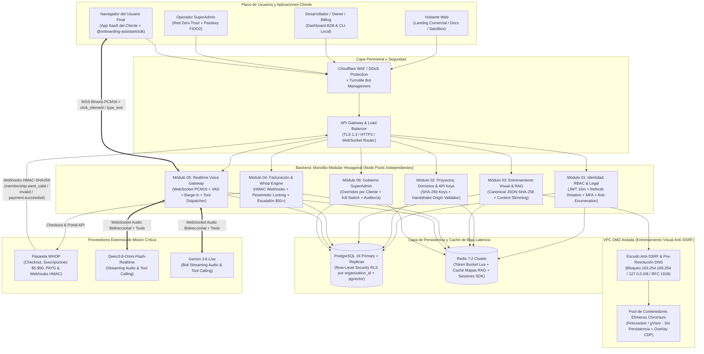
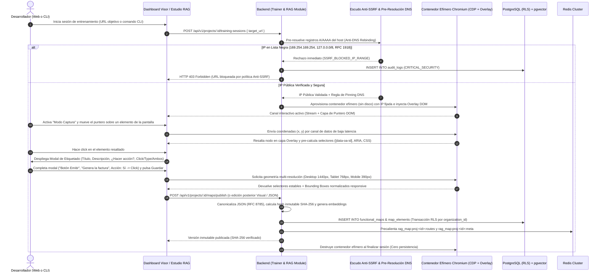

# MÓDULOS 4 Y 5: ARQUITECTURA DE DATOS (POSTGRESQL + RLS & REDIS) Y DIAGRAMAS DE ARQUITECTURA (MERMAID)

Este documento contiene el esquema físico completo de base de datos en **PostgreSQL 16+** (incluyendo extensiones, tipos `ENUM`, las 13 tablas troncales requeridas más las tablas de identidad, sesiones, acuerdos legales y matriz de precios, índices de alto rendimiento y políticas de **Row-Level Security (RLS)** para aislamiento estricto multi-tenant), la estrategia completa de **Redis 7.2+** y los **3 Diagramas Arquitectónicos en sintaxis Mermaid**.

---

# MÓDULO 4: ARQUITECTURA DE DATOS (POSTGRESQL & REDIS)

## 1. Código SQL Completo y Ejecutable (DDL PostgreSQL 16+)

```sql
-- =============================================================================
-- EXTENSIONES OBLIGATORIAS
-- =============================================================================
CREATE EXTENSION IF NOT EXISTS "pgcrypto";
CREATE EXTENSION IF NOT EXISTS "citext";
CREATE EXTENSION IF NOT EXISTS "vector";
CREATE EXTENSION IF NOT EXISTS "btree_gist";

-- =============================================================================
-- TIPOS ENUMERADOS (DOMINIOS ESTRICTOS)
-- =============================================================================
CREATE TYPE org_status_enum AS ENUM ('ACTIVE', 'SUSPENDED', 'PENDING_VERIFICATION', 'DELETED');
CREATE TYPE rbac_role_enum AS ENUM ('SUPERADMIN', 'OWNER', 'DEVELOPER', 'BILLING', 'VIEWER');
CREATE TYPE api_key_type_enum AS ENUM ('PUBLISHABLE', 'SECRET');
CREATE TYPE api_key_env_enum AS ENUM ('LIVE', 'TEST');
CREATE TYPE dom_action_type_enum AS ENUM ('NONE', 'CLICK', 'TYPE', 'BOTH');
CREATE TYPE ai_voice_model_enum AS ENUM ('QWEN_3_8_OMNI_FLASH_REALTIME', 'GEMINI_3_8_LIVE');
CREATE TYPE billing_plan_code_enum AS ENUM ('PAYG', 'PLAN_5', 'PLAN_10', 'PLAN_30', 'PLAN_50', 'CUSTOM_ENTERPRISE');
CREATE TYPE whop_sub_status_enum AS ENUM ('ACTIVE', 'TRIALING', 'PAST_DUE_OR_INVALID', 'CANCELED', 'SUSPENDED');
CREATE TYPE ledger_entry_type_enum AS ENUM (
    'PLAN_ACTIVATION_GRANT',
    'PAYMENT_SUCCEEDED_RENEWAL',
    'PAYMENT_SUCCEEDED_TOPUP',
    'VOICE_MINUTE_DEDUCTION',
    'CREDIT_SUPERADMIN_GRANT',
    'MANUAL_ADJUSTMENT',
    'REFUND_REVERSAL'
);
CREATE TYPE voice_session_status_enum AS ENUM (
    'HANDSHAKE_ISSUED',
    'ACTIVE_STREAMING',
    'COMPLETED_NORMAL',
    'TERMINATED_BARGE_IN_LIMIT',
    'TERMINATED_INSUFFICIENT_FUNDS',
    'TERMINATED_TENANT_SUSPENDED',
    'FAILED_PROVIDER_ERROR'
);
CREATE TYPE action_execution_status_enum AS ENUM (
    'DISPATCHED',
    'ACK_SUCCESS',
    'REJECTED_BY_GUARDRAIL',
    'BLOCKED_SENSITIVE_FIELD',
    'FAILED_SELECTOR_NOT_FOUND',
    'TIMEOUT'
);
CREATE TYPE legal_doc_type_enum AS ENUM (
    'TOS_B2B',
    'PRIVACY_POLICY',
    'DPA_ENTERPRISE',
    'AI_VOICE_AUP',
    'END_USER_VOICE_CONSENT'
);

-- =============================================================================
-- FUNCIONES DE CONTEXTO DE SEGURIDAD PARA ROW-LEVEL SECURITY (RLS)
-- =============================================================================
CREATE OR REPLACE FUNCTION app_current_org_id() RETURNS UUID AS $$
BEGIN
    RETURN NULLIF(current_setting('app.current_org_id', true), '')::UUID;
EXCEPTION WHEN OTHERS THEN
    RETURN NULL;
END;
$$ LANGUAGE plpgsql STABLE SECURITY DEFINER;

CREATE OR REPLACE FUNCTION app_current_user_id() RETURNS UUID AS $$
BEGIN
    RETURN NULLIF(current_setting('app.current_user_id', true), '')::UUID;
EXCEPTION WHEN OTHERS THEN
    RETURN NULL;
END;
$$ LANGUAGE plpgsql STABLE SECURITY DEFINER;

CREATE OR REPLACE FUNCTION app_is_superadmin() RETURNS BOOLEAN AS $$
BEGIN
    RETURN COALESCE(current_setting('app.is_superadmin', true), 'false') = 'true';
EXCEPTION WHEN OTHERS THEN
    RETURN FALSE;
END;
$$ LANGUAGE plpgsql STABLE SECURITY DEFINER;

-- Trigger universal para mantener updated_at
CREATE OR REPLACE FUNCTION trigger_set_updated_at() RETURNS TRIGGER AS $$
BEGIN
    NEW.updated_at = NOW();
    RETURN NEW;
END;
$$ LANGUAGE plpgsql;

-- =============================================================================
-- 1. TABLA: organizations (Tenants B2B)
-- =============================================================================
CREATE TABLE organizations (
    id UUID PRIMARY KEY DEFAULT gen_random_uuid(),
    name VARCHAR(160) NOT NULL,
    slug CITEXT NOT NULL UNIQUE,
    status org_status_enum NOT NULL DEFAULT 'ACTIVE',
    enforce_mfa BOOLEAN NOT NULL DEFAULT FALSE,
    enforce_sso BOOLEAN NOT NULL DEFAULT FALSE,
    sso_idp_metadata_xml TEXT,
    sso_email_domain CITEXT UNIQUE,
    opt_in_session_transcripts BOOLEAN NOT NULL DEFAULT FALSE,
    dpa_signed_at TIMESTAMPTZ,
    dpa_Clickwrap_ip INET,
    suspended_reason TEXT,
    suspended_at TIMESTAMPTZ,
    suspended_by_user_id UUID,
    created_at TIMESTAMPTZ NOT NULL DEFAULT NOW(),
    updated_at TIMESTAMPTZ NOT NULL DEFAULT NOW(),
    CONSTRAINT chk_org_slug_format CHECK (slug ~ '^[a-z0-9]+(?:-[a-z0-9]+)*$')
);

CREATE INDEX idx_organizations_status ON organizations(status);
CREATE TRIGGER trg_organizations_updated_at BEFORE UPDATE ON organizations
FOR EACH ROW EXECUTE FUNCTION trigger_set_updated_at();

-- =============================================================================
-- 2. TABLA: users (Identidades Globales B2B y SuperAdmin)
-- =============================================================================
CREATE TABLE users (
    id UUID PRIMARY KEY DEFAULT gen_random_uuid(),
    email CITEXT NOT NULL UNIQUE,
    full_name VARCHAR(160) NOT NULL,
    password_hash TEXT,
    token_version INTEGER NOT NULL DEFAULT 1,
    is_platform_superadmin BOOLEAN NOT NULL DEFAULT FALSE,
    email_verified_at TIMESTAMPTZ,
    mfa_totp_enabled BOOLEAN NOT NULL DEFAULT FALSE,
    mfa_totp_secret_enc BYTEA,
    mfa_webauthn_enabled BOOLEAN NOT NULL DEFAULT FALSE,
    mfa_webauthn_credentials_json JSONB NOT NULL DEFAULT '[]'::jsonb,
    mfa_recovery_codes_hashes JSONB NOT NULL DEFAULT '[]'::jsonb,
    oauth_google_sub VARCHAR(255) UNIQUE,
    oauth_github_id VARCHAR(255) UNIQUE,
    oauth_microsoft_oid VARCHAR(255) UNIQUE,
    failed_login_attempts INTEGER NOT NULL DEFAULT 0,
    locked_until TIMESTAMPTZ,
    last_login_at TIMESTAMPTZ,
    last_login_ip INET,
    created_at TIMESTAMPTZ NOT NULL DEFAULT NOW(),
    updated_at TIMESTAMPTZ NOT NULL DEFAULT NOW()
);

CREATE INDEX idx_users_email ON users(email);
CREATE INDEX idx_users_superadmin ON users(is_platform_superadmin) WHERE is_platform_superadmin = TRUE;
CREATE TRIGGER trg_users_updated_at BEFORE UPDATE ON users
FOR EACH ROW EXECUTE FUNCTION trigger_set_updated_at();

-- =============================================================================
-- TABLAS DE SOPORTE DE IDENTIDAD, SESIONES, RECUPERACIÓN Y LEGAL
-- =============================================================================
CREATE TABLE auth_sessions (
    id UUID PRIMARY KEY DEFAULT gen_random_uuid(),
    user_id UUID NOT NULL REFERENCES users(id) ON DELETE CASCADE,
    organization_id UUID REFERENCES organizations(id) ON DELETE CASCADE,
    token_family_id UUID NOT NULL,
    refresh_token_sha256 CHAR(64) NOT NULL UNIQUE,
    parent_token_sha256 CHAR(64),
    token_version_snapshot INTEGER NOT NULL,
    ip_address INET NOT NULL,
    user_agent TEXT NOT NULL,
    consumed_at TIMESTAMPTZ,
    revoked_at TIMESTAMPTZ,
    revocation_reason VARCHAR(120),
    expires_at TIMESTAMPTZ NOT NULL,
    created_at TIMESTAMPTZ NOT NULL DEFAULT NOW()
);

CREATE INDEX idx_auth_sessions_user_id ON auth_sessions(user_id);
CREATE INDEX idx_auth_sessions_family ON auth_sessions(token_family_id);

CREATE TABLE password_reset_tokens (
    id UUID PRIMARY KEY DEFAULT gen_random_uuid(),
    user_id UUID NOT NULL REFERENCES users(id) ON DELETE CASCADE,
    token_sha256 CHAR(64) NOT NULL UNIQUE,
    request_ip INET NOT NULL,
    user_agent TEXT,
    expires_at TIMESTAMPTZ NOT NULL,
    used_at TIMESTAMPTZ,
    created_at TIMESTAMPTZ NOT NULL DEFAULT NOW()
);

CREATE INDEX idx_pwd_reset_user_active ON password_reset_tokens(user_id) WHERE used_at IS NULL;

CREATE TABLE legal_documents (
    id UUID PRIMARY KEY DEFAULT gen_random_uuid(),
    doc_type legal_doc_type_enum NOT NULL,
    version_tag VARCHAR(32) NOT NULL,
    title VARCHAR(200) NOT NULL,
    content_markdown TEXT NOT NULL,
    content_sha256 CHAR(64) NOT NULL,
    is_mandatory BOOLEAN NOT NULL DEFAULT TRUE,
    is_active BOOLEAN NOT NULL DEFAULT TRUE,
    published_at TIMESTAMPTZ NOT NULL DEFAULT NOW(),
    UNIQUE (doc_type, version_tag)
);

CREATE TABLE user_legal_acceptances (
    id UUID PRIMARY KEY DEFAULT gen_random_uuid(),
    user_id UUID NOT NULL REFERENCES users(id) ON DELETE CASCADE,
    organization_id UUID REFERENCES organizations(id) ON DELETE CASCADE,
    legal_document_id UUID NOT NULL REFERENCES legal_documents(id) ON DELETE RESTRICT,
    document_sha256_snapshot CHAR(64) NOT NULL,
    ip_address INET NOT NULL,
    user_agent TEXT NOT NULL,
    accepted_at TIMESTAMPTZ NOT NULL DEFAULT NOW(),
    UNIQUE (user_id, legal_document_id, organization_id)
);

-- =============================================================================
-- 3. TABLA: memberships (Relación Multi-Tenant Usuarios <-> Organizaciones + RBAC)
-- =============================================================================
CREATE TABLE memberships (
    id UUID PRIMARY KEY DEFAULT gen_random_uuid(),
    organization_id UUID NOT NULL REFERENCES organizations(id) ON DELETE CASCADE,
    user_id UUID NOT NULL REFERENCES users(id) ON DELETE CASCADE,
    role rbac_role_enum NOT NULL DEFAULT 'DEVELOPER',
    invited_by_user_id UUID REFERENCES users(id) ON DELETE SET NULL,
    invitation_token_sha256 CHAR(64) UNIQUE,
    invitation_Accepted_at TIMESTAMPTZ,
    is_active BOOLEAN NOT NULL DEFAULT TRUE,
    created_at TIMESTAMPTZ NOT NULL DEFAULT NOW(),
    updated_at TIMESTAMPTZ NOT NULL DEFAULT NOW(),
    UNIQUE (organization_id, user_id),
    CONSTRAINT chk_no_tenant_superadmin CHECK (role <> 'SUPERADMIN')
);

CREATE INDEX idx_memberships_org_user ON memberships(organization_id, user_id);
CREATE INDEX idx_memberships_user_id ON memberships(user_id);
CREATE TRIGGER trg_memberships_updated_at BEFORE UPDATE ON memberships
FOR EACH ROW EXECUTE FUNCTION trigger_set_updated_at();

-- =============================================================================
-- 4. TABLA: projects (Proyectos dentro de una Organización + Estudio del Prompt)
-- =============================================================================
CREATE TABLE projects (
    id UUID PRIMARY KEY DEFAULT gen_random_uuid(),
    organization_id UUID NOT NULL REFERENCES organizations(id) ON DELETE CASCADE,
    name VARCHAR(140) NOT NULL,
    slug CITEXT NOT NULL,
    environment api_key_env_enum NOT NULL DEFAULT 'LIVE',
    primary_voice_model ai_voice_model_enum NOT NULL DEFAULT 'GEMINI_3_8_LIVE',
    fallback_voice_model ai_voice_model_enum NOT NULL DEFAULT 'QWEN_3_8_OMNI_FLASH_REALTIME',
    voice_persona_code VARCHAR(64) NOT NULL DEFAULT 'aura-es-neutral',
    speech_speed NUMERIC(3,2) NOT NULL DEFAULT 1.00 CHECK (speech_speed BETWEEN 0.50 AND 2.00),
    vad_barge_in_sensitivity VARCHAR(16) NOT NULL DEFAULT 'BALANCED',
    model_temperature NUMERIC(3,2) NOT NULL DEFAULT 0.20 CHECK (model_temperature BETWEEN 0.00 AND 1.00),
    system_prompt TEXT NOT NULL DEFAULT 'Eres el asistente técnico interactivo de la plataforma. Guía al usuario paso a paso.',
    onboarding_steps_json JSONB NOT NULL DEFAULT '[]'::jsonb,
    strict_step_enforcement BOOLEAN NOT NULL DEFAULT TRUE,
    ask_confirmation_before_submit BOOLEAN NOT NULL DEFAULT TRUE,
    active_functional_map_id UUID,
    is_active BOOLEAN NOT NULL DEFAULT TRUE,
    created_by_user_id UUID REFERENCES users(id) ON DELETE SET NULL,
    created_at TIMESTAMPTZ NOT NULL DEFAULT NOW(),
    updated_at TIMESTAMPTZ NOT NULL DEFAULT NOW(),
    UNIQUE (organization_id, slug)
);

CREATE INDEX idx_projects_org_id ON projects(organization_id);
CREATE TRIGGER trg_projects_updated_at BEFORE UPDATE ON projects
FOR EACH ROW EXECUTE FUNCTION trigger_set_updated_at();

-- =============================================================================
-- 5. TABLA: api_keys (Claves Públicas del SDK y Secretas de Backend)
-- =============================================================================
CREATE TABLE api_keys (
    id UUID PRIMARY KEY DEFAULT gen_random_uuid(),
    organization_id UUID NOT NULL REFERENCES organizations(id) ON DELETE CASCADE,
    project_id UUID NOT NULL REFERENCES projects(id) ON DELETE CASCADE,
    name VARCHAR(120) NOT NULL,
    key_type api_key_type_enum NOT NULL,
    environment api_key_env_enum NOT NULL DEFAULT 'LIVE',
    key_prefix VARCHAR(24) NOT NULL,
    last_four CHAR(4) NOT NULL,
    key_hash CHAR(64) NOT NULL UNIQUE,
    scopes TEXT[] NOT NULL DEFAULT ARRAY[]::TEXT[],
    rotated_from_key_id UUID REFERENCES api_keys(id) ON DELETE SET NULL,
    grace_period_ends_at TIMESTAMPTZ,
    last_used_at TIMESTAMPTZ,
    last_used_ip INET,
    expires_at TIMESTAMPTZ,
    revoked_at TIMESTAMPTZ,
    revoked_by_user_id UUID REFERENCES users(id) ON DELETE SET NULL,
    created_by_user_id UUID REFERENCES users(id) ON DELETE SET NULL,
    created_at TIMESTAMPTZ NOT NULL DEFAULT NOW()
);

CREATE INDEX idx_api_keys_org_project ON api_keys(organization_id, project_id);
CREATE INDEX idx_api_keys_active_hash ON api_keys(key_hash) WHERE revoked_at IS NULL;

-- =============================================================================
-- 6. TABLA: allowed_domains (Orígenes Autorizados para el Handshake del SDK)
-- =============================================================================
CREATE TABLE allowed_domains (
    id UUID PRIMARY KEY DEFAULT gen_random_uuid(),
    organization_id UUID NOT NULL REFERENCES organizations(id) ON DELETE CASCADE,
    project_id UUID NOT NULL REFERENCES projects(id) ON DELETE CASCADE,
    origin_pattern CITEXT NOT NULL,
    allow_localhost_dev BOOLEAN NOT NULL DEFAULT FALSE,
    dns_verified_at TIMESTAMPTZ,
    is_active BOOLEAN NOT NULL DEFAULT TRUE,
    created_by_user_id UUID REFERENCES users(id) ON DELETE SET NULL,
    created_at TIMESTAMPTZ NOT NULL DEFAULT NOW(),
    UNIQUE (project_id, origin_pattern)
);

CREATE INDEX idx_allowed_domains_project_active ON allowed_domains(project_id, origin_pattern) WHERE is_active = TRUE;

-- =============================================================================
-- 7. TABLA: functional_maps (Versiones Inmutables del Mapa Funcional RAG con SHA-256)
-- =============================================================================
CREATE TABLE functional_maps (
    id UUID PRIMARY KEY DEFAULT gen_random_uuid(),
    organization_id UUID NOT NULL REFERENCES organizations(id) ON DELETE CASCADE,
    project_id UUID NOT NULL REFERENCES projects(id) ON DELETE CASCADE,
    version_number INTEGER NOT NULL,
    version_label VARCHAR(120),
    source_mode VARCHAR(32) NOT NULL DEFAULT 'VISUAL_TRAINER', -- 'VISUAL_TRAINER' | 'JSON_CODE_EDITOR' | 'CLI_PUSH'
    canonical_map_json JSONB NOT NULL,
    content_sha256_hash CHAR(64) NOT NULL,
    total_elements_count INTEGER NOT NULL DEFAULT 0,
    is_active BOOLEAN NOT NULL DEFAULT FALSE,
    published_by_user_id UUID REFERENCES users(id) ON DELETE SET NULL,
    published_at TIMESTAMPTZ NOT NULL DEFAULT NOW(),
    created_at TIMESTAMPTZ NOT NULL DEFAULT NOW(),
    UNIQUE (project_id, version_number),
    UNIQUE (project_id, content_sha256_hash)
);

ALTER TABLE projects
    ADD CONSTRAINT fk_projects_active_functional_map
    FOREIGN KEY (active_functional_map_id) REFERENCES functional_maps(id) ON DELETE SET NULL;

CREATE INDEX idx_functional_maps_project_active ON functional_maps(project_id) WHERE is_active = TRUE;
CREATE INDEX idx_functional_maps_org_id ON functional_maps(organization_id);

-- =============================================================================
-- 8. TABLA: map_elements (Elementos DOM Indexados, Selectores y Coordenadas Responsive)
-- =============================================================================
CREATE TABLE map_elements (
    id UUID PRIMARY KEY DEFAULT gen_random_uuid(),
    organization_id UUID NOT NULL REFERENCES organizations(id) ON DELETE CASCADE,
    project_id UUID NOT NULL REFERENCES projects(id) ON DELETE CASCADE,
    functional_map_id UUID NOT NULL REFERENCES functional_maps(id) ON DELETE CASCADE,
    element_key VARCHAR(120) NOT NULL,
    url_route_pattern VARCHAR(512) NOT NULL DEFAULT '/',
    title VARCHAR(200) NOT NULL,
    functional_description TEXT NOT NULL,
    is_actionable BOOLEAN NOT NULL DEFAULT FALSE,
    action_type dom_action_type_enum NOT NULL DEFAULT 'NONE',
    step_order_hint INTEGER,
    primary_selector TEXT NOT NULL,
    accessibility_selector TEXT,
    structural_css_selector TEXT,
    xpath_fallback TEXT,
    selector_stability_score SMALLINT NOT NULL DEFAULT 100 CHECK (selector_stability_score BETWEEN 0 AND 100),
    desktop_bbox_json JSONB NOT NULL DEFAULT '{}'::jsonb,
    tablet_bbox_json JSONB NOT NULL DEFAULT '{}'::jsonb,
    mobile_bbox_json JSONB NOT NULL DEFAULT '{}'::jsonb,
    element_metadata_json JSONB NOT NULL DEFAULT '{}'::jsonb,
    semantic_embedding vector(1536),
    created_at TIMESTAMPTZ NOT NULL DEFAULT NOW(),
    updated_at TIMESTAMPTZ NOT NULL DEFAULT NOW(),
    UNIQUE (functional_map_id, element_key),
    CONSTRAINT chk_actionable_consistency CHECK (
        (is_actionable = FALSE AND action_type = 'NONE') OR
        (is_actionable = TRUE AND action_type IN ('CLICK', 'TYPE', 'BOTH'))
    )
);

CREATE INDEX idx_map_elements_map_route ON map_elements(functional_map_id, url_route_pattern);
CREATE INDEX idx_map_elements_org_project ON map_elements(organization_id, project_id);
CREATE INDEX idx_map_elements_embedding_hnsw ON map_elements USING hnsw (semantic_embedding vector_cosine_ops);
CREATE TRIGGER trg_map_elements_updated_at BEFORE UPDATE ON map_elements
FOR EACH ROW EXECUTE FUNCTION trigger_set_updated_at();

-- =============================================================================
-- TABLAS GLOBALES DE MATRIZ DE PRECIOS WHOP Y OVERRIDES DEL SUPERADMIN
-- =============================================================================
CREATE TABLE pricing_plans_config (
    plan_code billing_plan_code_enum PRIMARY KEY,
    whop_plan_id VARCHAR(120) NOT NULL UNIQUE,
    display_name VARCHAR(100) NOT NULL,
    monthly_fixed_price_usd NUMERIC(12,2) NOT NULL DEFAULT 0.00,
    included_minutes NUMERIC(14,4) NOT NULL DEFAULT 0.0000,
    base_overage_rate_per_minute_usd NUMERIC(12,6) NOT NULL DEFAULT 0.200000,
    volume_discount_eligible BOOLEAN NOT NULL DEFAULT FALSE,
    volume_discount_tiers_json JSONB NOT NULL DEFAULT '[]'::jsonb,
    is_active BOOLEAN NOT NULL DEFAULT TRUE,
    updated_by_superadmin_id UUID REFERENCES users(id) ON DELETE SET NULL,
    updated_at TIMESTAMPTZ NOT NULL DEFAULT NOW()
);

CREATE TABLE organization_pricing_overrides (
    id UUID PRIMARY KEY DEFAULT gen_random_uuid(),
    organization_id UUID NOT NULL UNIQUE REFERENCES organizations(id) ON DELETE CASCADE,
    custom_rate_per_minute_usd NUMERIC(12,6),
    manual_discount_percentage NUMERIC(5,2) NOT NULL DEFAULT 0.00 CHECK (manual_discount_percentage BETWEEN 0.00 AND 100.00),
    force_volume_discount_tiers BOOLEAN NOT NULL DEFAULT FALSE,
    custom_volume_tiers_json JSONB,
    override_notes TEXT NOT NULL,
    effective_from TIMESTAMPTZ NOT NULL DEFAULT NOW(),
    effective_until TIMESTAMPTZ,
    created_by_superadmin_id UUID NOT NULL REFERENCES users(id) ON DELETE RESTRICT,
    created_at TIMESTAMPTZ NOT NULL DEFAULT NOW(),
    updated_at TIMESTAMPTZ NOT NULL DEFAULT NOW()
);

-- =============================================================================
-- 9. TABLA: whop_subscriptions (Estado de Suscripción, Minutos y Saldo por Organización)
-- =============================================================================
CREATE TABLE whop_subscriptions (
    id UUID PRIMARY KEY DEFAULT gen_random_uuid(),
    organization_id UUID NOT NULL UNIQUE REFERENCES organizations(id) ON DELETE CASCADE,
    plan_code billing_plan_code_enum NOT NULL DEFAULT 'PAYG',
    status whop_sub_status_enum NOT NULL DEFAULT 'ACTIVE',
    whop_membership_id VARCHAR(140) UNIQUE,
    whop_user_id VARCHAR(140),
    whop_company_id VARCHAR(140),
    whop_plan_id VARCHAR(140),
    current_period_start TIMESTAMPTZ NOT NULL DEFAULT NOW(),
    current_period_end TIMESTAMPTZ NOT NULL DEFAULT (NOW() + INTERVAL '1 month'),
    period_included_minutes_ quota NUMERIC(18,6) NOT NULL DEFAULT 0.000000,
    period_included_minutes_remaining NUMERIC(18,6) NOT NULL DEFAULT 0.000000 CHECK (period_included_minutes_remaining >= 0),
    period_overage_minutes_used NUMERIC(18,6) NOT NULL DEFAULT 0.000000 CHECK (period_overage_minutes_used >= 0),
    current_period_overage_billed_usd NUMERIC(18,6) NOT NULL DEFAULT 0.000000 CHECK (current_period_overage_billed_usd >= 0),
    credit_balance_usd NUMERIC(18,6) NOT NULL DEFAULT 0.000000,
    hard_spend_cap_usd NUMERIC(18,2),
    auto_topup_enabled BOOLEAN NOT NULL DEFAULT FALSE,
    last_whop_webhook_event_id VARCHAR(160),
    last_whop_webhook_at TIMESTAMPTZ,
    created_at TIMESTAMPTZ NOT NULL DEFAULT NOW(),
    updated_at TIMESTAMPTZ NOT NULL DEFAULT NOW()
);

CREATE INDEX idx_whop_subscriptions_org_id ON whop_subscriptions(organization_id);
CREATE INDEX idx_whop_subscriptions_membership ON whop_subscriptions(whop_membership_id);
CREATE TRIGGER trg_whop_subscriptions_updated_at BEFORE UPDATE ON whop_subscriptions
FOR EACH ROW EXECUTE FUNCTION trigger_set_updated_at();

-- =============================================================================
-- 10. TABLA: voice_sessions (Sesiones de Voz en Tiempo Real con Qwen3.8 / Gemini 3.8)
-- =============================================================================
CREATE TABLE voice_sessions (
    id UUID PRIMARY KEY DEFAULT gen_random_uuid(),
    organization_id UUID NOT NULL REFERENCES organizations(id) ON DELETE CASCADE,
    project_id UUID NOT NULL REFERENCES projects(id) ON DELETE CASCADE,
    functional_map_id UUID NOT NULL REFERENCES functional_maps(id) ON DELETE RESTRICT,
    api_key_id UUID REFERENCES api_keys(id) ON DELETE SET NULL,
    external_end_user_id VARCHAR(255),
    origin_domain VARCHAR(255) NOT NULL,
    ai_model_used ai_voice_model_enum NOT NULL,
    status voice_session_status_enum NOT NULL DEFAULT 'HANDSHAKE_ISSUED',
    end_user_consent_verified BOOLEAN NOT NULL DEFAULT TRUE,
    current_step_index INTEGER NOT NULL DEFAULT 1,
    total_steps_completed INTEGER NOT NULL DEFAULT 0,
    barge_in_count INTEGER NOT NULL DEFAULT 0,
    total_tool_calls_count INTEGER NOT NULL DEFAULT 0,
    duration_seconds NUMERIC(14,3) NOT NULL DEFAULT 0.000,
    billed_minutes NUMERIC(18,6) NOT NULL DEFAULT 0.000000,
    total_billed_cost_usd NUMERIC(18,6) NOT NULL DEFAULT 0.000000,
    client_ip_hash CHAR(64) NOT NULL,
    user_agent TEXT,
    device_viewport_type VARCHAR(24) NOT NULL DEFAULT 'desktop',
    started_at TIMESTAMPTZ NOT NULL DEFAULT NOW(),
    ended_at TIMESTAMPTZ,
    termination_reason VARCHAR(160),
    created_at TIMESTAMPTZ NOT NULL DEFAULT NOW()
);

CREATE INDEX idx_voice_sessions_org_started ON voice_sessions(organization_id, started_at DESC);
CREATE INDEX idx_voice_sessions_project_status ON voice_sessions(project_id, status);

-- =============================================================================
-- 11. TABLA: usage_ledger (Libro Mayor Inmutable de Consumo y Transacciones Whop)
-- =============================================================================
CREATE TABLE usage_ledger (
    id UUID PRIMARY KEY DEFAULT gen_random_uuid(),
    organization_id UUID NOT NULL REFERENCES organizations(id) ON DELETE CASCADE,
    project_id UUID REFERENCES projects(id) ON DELETE SET NULL,
    voice_session_id UUID REFERENCES voice_sessions(id) ON DELETE SET NULL,
    whop_subscription_id UUID REFERENCES whop_subscriptions(id) ON DELETE SET NULL,
    external_whop_event_id VARCHAR(160) UNIQUE,
    whop_payment_id VARCHAR(160),
    entry_type ledger_entry_type_enum NOT NULL,
    minutes_delta NUMERIC(18,6) NOT NULL DEFAULT 0.000000,
    unit_rate_usd NUMERIC(12,6) NOT NULL DEFAULT 0.000000,
    discount_applied_pct NUMERIC(5,2) NOT NULL DEFAULT 0.00,
    amount_usd_delta NUMERIC(18,6) NOT NULL DEFAULT 0.000000,
    included_minutes_balance_after NUMERIC(18,6) NOT NULL,
    credit_balance_usd_after NUMERIC(18,6) NOT NULL,
    metadata_json JSONB NOT NULL DEFAULT '{}'::jsonb,
    created_at TIMESTAMPTZ NOT NULL DEFAULT NOW()
);

CREATE INDEX idx_usage_ledger_org_created ON usage_ledger(organization_id, created_at DESC);
CREATE INDEX idx_usage_ledger_session ON usage_ledger(voice_session_id);

-- =============================================================================
-- 12. TABLA: action_events (Telemetría de Ejecución Física de click_element y type_text)
-- =============================================================================
CREATE TABLE action_events (
    id UUID PRIMARY KEY DEFAULT gen_random_uuid(),
    organization_id UUID NOT NULL REFERENCES organizations(id) ON DELETE CASCADE,
    project_id UUID NOT NULL REFERENCES projects(id) ON DELETE CASCADE,
    voice_session_id UUID NOT NULL REFERENCES voice_sessions(id) ON DELETE CASCADE,
    map_element_id UUID REFERENCES map_elements(id) ON DELETE SET NULL,
    provider_tool_call_id VARCHAR(140) NOT NULL,
    tool_name VARCHAR(32) NOT NULL CHECK (tool_name IN ('click_element', 'type_text', 'advance_onboarding_step')),
    route_path_at_execution VARCHAR(512) NOT NULL,
    selector_used TEXT NOT NULL,
    action_payload_redacted_json JSONB NOT NULL DEFAULT '{}'::jsonb,
    execution_status action_execution_status_enum NOT NULL DEFAULT 'DISPATCHED',
    execution_latency_ms INTEGER,
    error_code VARCHAR(120),
    dispatched_at TIMESTAMPTZ NOT NULL DEFAULT NOW(),
    acknowledged_at TIMESTAMPTZ
);

CREATE INDEX idx_action_events_session ON action_events(voice_session_id, dispatched_at ASC);
CREATE INDEX idx_action_events_org_created ON action_events(organization_id, dispatched_at DESC);

-- =============================================================================
-- 13. TABLA: audit_logs (Bitácora de Auditoría de Seguridad e Infraestructura Append-Only)
-- =============================================================================
CREATE TABLE audit_logs (
    id UUID PRIMARY KEY DEFAULT gen_random_uuid(),
    organization_id UUID REFERENCES organizations(id) ON DELETE SET NULL,
    actor_user_id UUID REFERENCES users(id) ON DELETE SET NULL,
    actor_api_key_id UUID REFERENCES api_keys(id) ON DELETE SET NULL,
    actor_role rbac_role_enum,
    event_category VARCHAR(64) NOT NULL, -- 'AUTH', 'API_KEY', 'RAG_MAP', 'PROMPT', 'BILLING_WHOP', 'SSRF_DEFENSE', 'SUPERADMIN'
    event_action VARCHAR(120) NOT NULL,
    severity VARCHAR(24) NOT NULL DEFAULT 'INFO' CHECK (severity IN ('INFO', 'WARN', 'CRITICAL_SECURITY')),
    target_resource_type VARCHAR(64),
    target_resource_id VARCHAR(140),
    ip_address INET,
    user_agent TEXT,
    before_state_json JSONB,
    after_state_json JSONB,
    prev_record_sha256 CHAR(64),
    record_sha256 CHAR(64) NOT NULL,
    created_at TIMESTAMPTZ NOT NULL DEFAULT NOW()
);

CREATE INDEX idx_audit_logs_org_created ON audit_logs(organization_id, created_at DESC);
CREATE INDEX idx_audit_logs_severity_created ON audit_logs(severity, created_at DESC);
CREATE INDEX idx_audit_logs_actor ON audit_logs(actor_user_id, created_at DESC);
```

---

## 2. Políticas de Row-Level Security (RLS) en PostgreSQL para Aislamiento Multi-Tenant

Cada transacción abierta por el pool de base de datos del backend ejecuta al inicio:
`SET LOCAL app.current_org_id = '<org_uuid>'; SET LOCAL app.current_user_id = '<user_uuid>'; SET LOCAL app.is_superadmin = 'false';`

```sql
-- =============================================================================
-- ACTIVACIÓN ESTRICTA DE RLS (INCLUYENDO FORCE ROW LEVEL SECURITY)
-- =============================================================================
ALTER TABLE organizations ENABLE ROW LEVEL SECURITY;
ALTER TABLE organizations FORCE ROW LEVEL SECURITY;

ALTER TABLE memberships ENABLE ROW LEVEL SECURITY;
ALTER TABLE memberships FORCE ROW LEVEL SECURITY;

ALTER TABLE projects ENABLE ROW LEVEL SECURITY;
ALTER TABLE projects FORCE ROW LEVEL SECURITY;

ALTER TABLE api_keys ENABLE ROW LEVEL SECURITY;
ALTER TABLE api_keys FORCE ROW LEVEL SECURITY;

ALTER TABLE allowed_domains ENABLE ROW LEVEL SECURITY;
ALTER TABLE allowed_domains FORCE ROW LEVEL SECURITY;

ALTER TABLE functional_maps ENABLE ROW LEVEL SECURITY;
ALTER TABLE functional_maps FORCE ROW LEVEL SECURITY;

ALTER TABLE map_elements ENABLE ROW LEVEL SECURITY;
ALTER TABLE map_elements FORCE ROW LEVEL SECURITY;

ALTER TABLE whop_subscriptions ENABLE ROW LEVEL SECURITY;
ALTER TABLE whop_subscriptions FORCE ROW LEVEL SECURITY;

ALTER TABLE usage_ledger ENABLE ROW LEVEL SECURITY;
ALTER TABLE usage_ledger FORCE ROW LEVEL SECURITY;

ALTER TABLE voice_sessions ENABLE ROW LEVEL SECURITY;
ALTER TABLE voice_sessions FORCE ROW LEVEL SECURITY;

ALTER TABLE action_events ENABLE ROW LEVEL SECURITY;
ALTER TABLE action_events FORCE ROW LEVEL SECURITY;

ALTER TABLE audit_logs ENABLE ROW LEVEL SECURITY;
ALTER TABLE audit_logs FORCE ROW LEVEL SECURITY;

-- =============================================================================
-- POLÍTICAS DE AISLAMIENTO POR ORGANIZATION_ID + BYPASS DE SUPERADMIN AUDITADO
-- =============================================================================

-- 1. Política sobre organizations
CREATE POLICY rls_organizations_isolation ON organizations
    USING (id = app_current_org_id() OR app_is_superadmin())
    WITH CHECK (id = app_current_org_id() OR app_is_superadmin());

-- 2. Política sobre memberships
CREATE POLICY rls_memberships_isolation ON memberships
    USING (organization_id = app_current_org_id() OR user_id = app_current_user_id() OR app_is_superadmin())
    WITH CHECK (organization_id = app_current_org_id() OR app_is_superadmin());

-- 3. Política sobre projects
CREATE POLICY rls_projects_isolation ON projects
    USING (organization_id = app_current_org_id() OR app_is_superadmin())
    WITH CHECK (organization_id = app_current_org_id() OR app_is_superadmin());

-- 4. Política sobre api_keys
CREATE POLICY rls_api_keys_isolation ON api_keys
    USING (organization_id = app_current_org_id() OR app_is_superadmin())
    WITH CHECK (organization_id = app_current_org_id() OR app_is_superadmin());

-- 5. Política sobre allowed_domains
CREATE POLICY rls_allowed_domains_isolation ON allowed_domains
    USING (organization_id = app_current_org_id() OR app_is_superadmin())
    WITH CHECK (organization_id = app_current_org_id() OR app_is_superadmin());

-- 6. Política sobre functional_maps
CREATE POLICY rls_functional_maps_isolation ON functional_maps
    USING (organization_id = app_current_org_id() OR app_is_superadmin())
    WITH CHECK (organization_id = app_current_org_id() OR app_is_superadmin());

-- 7. Política sobre map_elements
CREATE POLICY rls_map_elements_isolation ON map_elements
    USING (organization_id = app_current_org_id() OR app_is_superadmin())
    WITH CHECK (organization_id = app_current_org_id() OR app_is_superadmin());

-- 8. Política sobre whop_subscriptions
CREATE POLICY rls_whop_subscriptions_isolation ON whop_subscriptions
    USING (organization_id = app_current_org_id() OR app_is_superadmin())
    WITH CHECK (organization_id = app_current_org_id() OR app_is_superadmin());

-- 9. Política sobre usage_ledger
CREATE POLICY rls_usage_ledger_isolation ON usage_ledger
    USING (organization_id = app_current_org_id() OR app_is_superadmin())
    WITH CHECK (organization_id = app_current_org_id() OR app_is_superadmin());

-- 10. Política sobre voice_sessions
CREATE POLICY rls_voice_sessions_isolation ON voice_sessions
    USING (organization_id = app_current_org_id() OR app_is_superadmin())
    WITH CHECK (organization_id = app_current_org_id() OR app_is_superadmin());

-- 11. Política sobre action_events
CREATE POLICY rls_action_events_isolation ON action_events
    USING (organization_id = app_current_org_id() OR app_is_superadmin())
    WITH CHECK (organization_id = app_current_org_id() OR app_is_superadmin());

-- 12. Política sobre audit_logs (Lectura aislada por tenant; inserción permitida al contexto actual)
CREATE POLICY rls_audit_logs_select ON audit_logs
    FOR SELECT
    USING (organization_id = app_current_org_id() OR app_is_superadmin());

CREATE POLICY rls_audit_logs_insert ON audit_logs
    FOR INSERT
    WITH CHECK (organization_id = app_current_org_id() OR organization_id IS NULL OR app_is_superadmin());
```

---

## 3. Estrategia Completa de Redis (Claves, Estructuras de Datos y TTLs)

| Patrón de Clave Redis (`Key Namespace`) | Tipo de Estructura Redis | Contenido Exacto del Valor / Campos | TTL (Tiempo de Vida) | Política de Invalidación / Actualización |
| :--- | :---: | :--- | :---: | :--- |
| `auth:user_tv:<user_id>` | `STRING` (Entero) | Valor actual de `users.token_version` (ej. `"4"`) | `86,400 seg` (24h, sliding) | Se actualiza vía `SET` en el mismo instante en que cambia la contraseña, MFA o se fuerza cierre de sesiones. |
| `apikey:sha256:<key_hash>` | `HASH` | `id`, `org_id`, `project_id`, `key_type`, `env`, `scopes_json`, `status`, `grace_ends_at` | `3,600 seg` (1h) | `DEL` inmediato al revocar o rotar una API Key desde el Dashboard. |
| `proj:<project_id>:allowed_domains` | `SET` | Miembros con cada patrón de dominio autorizado (ej. `"https://app.micrm.com"`) | `3,600 seg` (1h) | `DEL` + reconstrucción atómica (`MULTI/EXEC`) al añadir o eliminar un dominio en el Dashboard. |
| `rag_map:proj:<project_id>:meta` | `HASH` | `map_id`, `version_number`, `sha256_hash`, `system_prompt`, `steps_json`, `primary_model`, `fallback_model` | `86,400 seg` (24h) | Se actualiza inmediatamente al publicar una nueva versión del Mapa Funcional o del System Prompt. |
| `rag_map:proj:<project_id>:routes` | `HASH` | Campo = `url_route_pattern` (ej. `"/facturas/nueva"`), Valor = JSON comprimido (LZ4/UTF-8) con el array de elementos de esa ruta listos para **Context Slimming** | `86,400 seg` (24h) | Se precalienta (`Warm-up`) en el acto de publicación del Mapa Funcional (`PublishImmutableMapUseCase`). |
| `sdk_handshake:nonce:<jti>` | `STRING` | `"ISSUED"` con vinculación a `session_id` y `client_ip_hash` | `60 seg` (1 min) | Consumido con `GETDEL` atómico en cuanto el SDK abre el WebSocket de voz (impide reutilizar el token efímero de handshake). |
| `voice_session:state:<session_id>` | `HASH` | `org_id`, `project_id`, `current_route`, `current_step_index`, `ai_provider`, `gateway_node_id`, `started_at_ms`, `last_metering_tick_ms`, `accumulated_seconds` | `7,200 seg` (2h) | Actualizado en cada cambio de ruta, avance de paso o tick de facturación de 15 segundos; eliminado al finalizar la sesión. |
| `org:<org_id>:active_sessions` | `SET` | Conjunto de `session_id` actualmente conectados por WebSocket para esa organización | `7,200 seg` (2h) | Permite al SuperAdmin cortar en `<10ms` todas las sesiones en vivo de una organización si es suspendida o agota su saldo. |
| `whop:webhook:evt:<event_id>` | `STRING` | `"PROCESSED"` | `172,800 seg` (48h) | Adquirido con `SET ... NX EX 172800` antes de procesar cualquier webhook de Whop para garantizar idempotencia absoluta. |
| `rl:tb:<dimension>:<identifier>` | `HASH` | `tokens` (float), `last_refill_ms` (int64) | Dinámico (`2 * burst/rate + 60s`) | Gestionado de forma atómica por el script Lua de **Token Bucket**. |

---

# MÓDULO 5: DIAGRAMAS ARQUITECTÓNICOS EN SINTAXIS MERMAID

## 1. Diagrama de Arquitectura Global de Componentes



---

## 2. Diagrama de Secuencia del Entrenamiento Visual (CLI/Web ➔ Chromium ➔ Selector DOM ➔ Modal ➔ Mapa RAG)



---

## 3. Diagrama de Flujo del Bucle de Voz en Vivo, Cobro por Minuto y Ejecución de Acciones (Whop + Gemini/Qwen + SDK)

```mermaid
sequenceDiagram
    autonumber
    actor EndUser as Usuario Final
    participant SDK as @onboarding-assistant/sdk (DOM Cliente)
    participant GW as Gateway de Voz Realtime (Backend)
    participant Redis as Redis Cluster (Mapas & Sesiones)
    participant PG as PostgreSQL (Whop Billing FOR UPDATE)
    participant AI as Motor Dual IA (Gemini 3.8 Live / Qwen3.8-Omni)
    participant Whop as Pasarela Whop (Suscripciones & Pagos)

    Whop->>GW: Webhook HMAC-SHA256 (membership.went_valid / payment.succeeded)
    GW->>PG: SELECT ... FOR UPDATE en whop_subscriptions + Acredita minutos/saldo en usage_ledger

    EndUser->>SDK: Inicia Asistente de Voz y acepta consentimiento de sesión
    SDK->>GW: POST /api/v1/sdk/handshake (Origin + pk_live_... + ruta actual)
    GW->>Redis: Valida API Key SHA-256, Origin en allowed_domains y Token Bucket Rate Limit
    GW->>PG: Verifica suscripción activa o saldo disponible en whop_subscriptions
    GW-->>SDK: Devuelve ephemeral_ws_token (TTL 60s)

    SDK->>GW: Abre WebSocket WSS + envía evento route.changed (/clientes/nuevo)
    GW->>Redis: Ejecuta Context Slimming (extrae solo elementos DOM de /clientes/nuevo)
    GW->>AI: Inicializa sesión Realtime con System Prompt Paso a Paso + Elementos de la ruta actual

    loop Bucle Continuo de Voz Bidireccional, Barge-in, Herramientas y Tarificación
        EndUser->>SDK: Habla al micrófono ("Quiero registrar a la empresa Acme")
        SDK->>GW: Stream binario de frames PCM16 (16kHz, 20ms)
        GW->>AI: Reenvía audio PCM16 en tiempo real
        
        AI-->>GW: Emite audio de respuesta + Tool Call: type_text(el_input_empresa, "Acme")
        GW->>GW: Verifica en Mapa RAG que el_input_empresa tiene is_actionable=true y permite TYPE
        GW-->>SDK: Envía audio de voz + comando JSON tool.execute(type_text)
        
        SDK->>SDK: Verifica que no sea campo sensible, mueve puntero, escribe "Acme" en el DOM
        SDK-->>GW: Envía tool.execution.ack (SUCCESS, 16ms)
        GW->>PG: INSERT INTO action_events (ACK_SUCCESS)
        GW->>AI: Envía confirmación de herramienta ejecutada para avanzar al siguiente paso del Prompt

        opt Interrupción del Usuario en Mitad de Locución (Barge-in < 50ms)
            EndUser->>SDK: Habla encima del asistente ("¡Espera, escribe Acme Global!")
            SDK->>SDK: VAD local detecta voz -> Corta buffer de reproducción de audio en <5ms
            SDK->>GW: Trama prioritaria voice.barge_in
            GW->>AI: Envía señal de cancelación inmediata (response.cancel / interrupted)
        end

        par Pulso de Deducción de Minutos cada 15 segundos (Anti-Race Condition)
            GW->>PG: BEGIN; SELECT * FROM whop_subscriptions WHERE org_id = $1 FOR UPDATE;
            PG->>PG: Descuenta minutos del plan ($5/$10/$30/$50) o calcula Overage con Descuento por Volumen ($50+) / Override SuperAdmin
            PG->>PG: UPDATE whop_subscriptions + INSERT INTO usage_ledger; COMMIT;
            alt Saldo Agotado o Tope de Gasto Superado
                PG-->>GW: INSUFFICIENT_FUNDS
                GW-->>SDK: Despedida controlada y cierre de WebSocket (Código 4002)
            end
        end
    end
```
